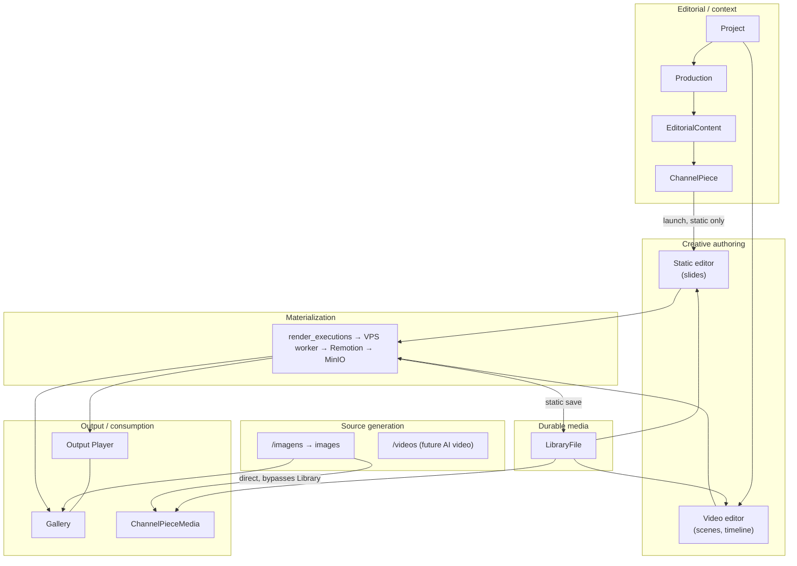
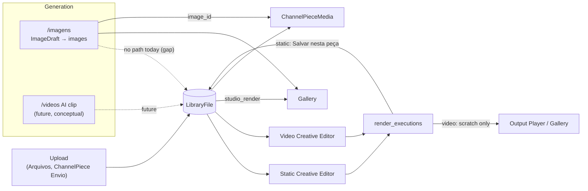
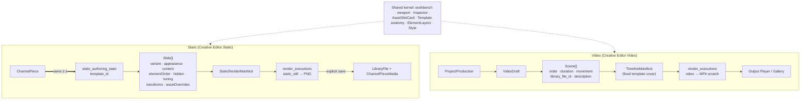
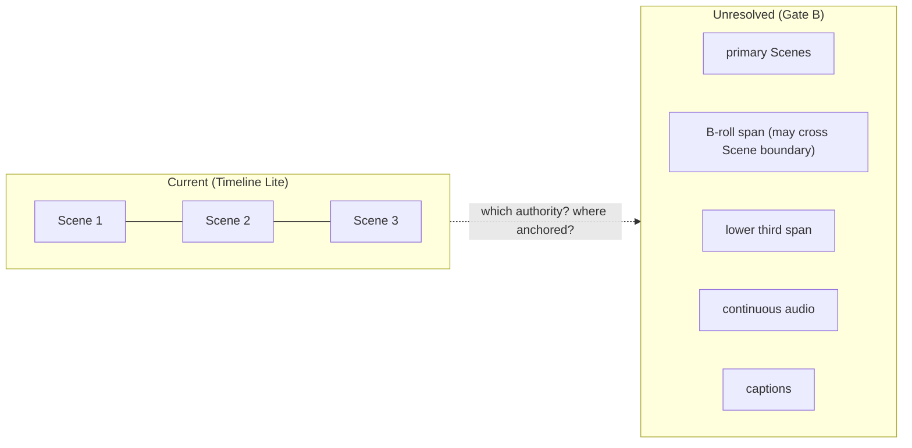
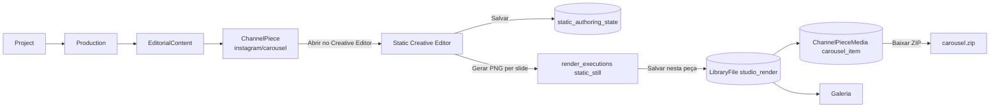
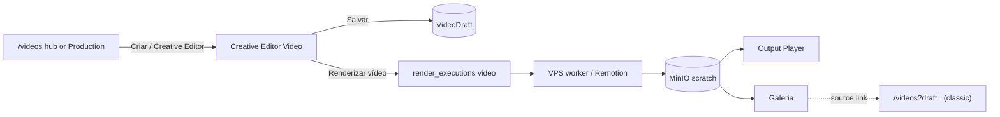
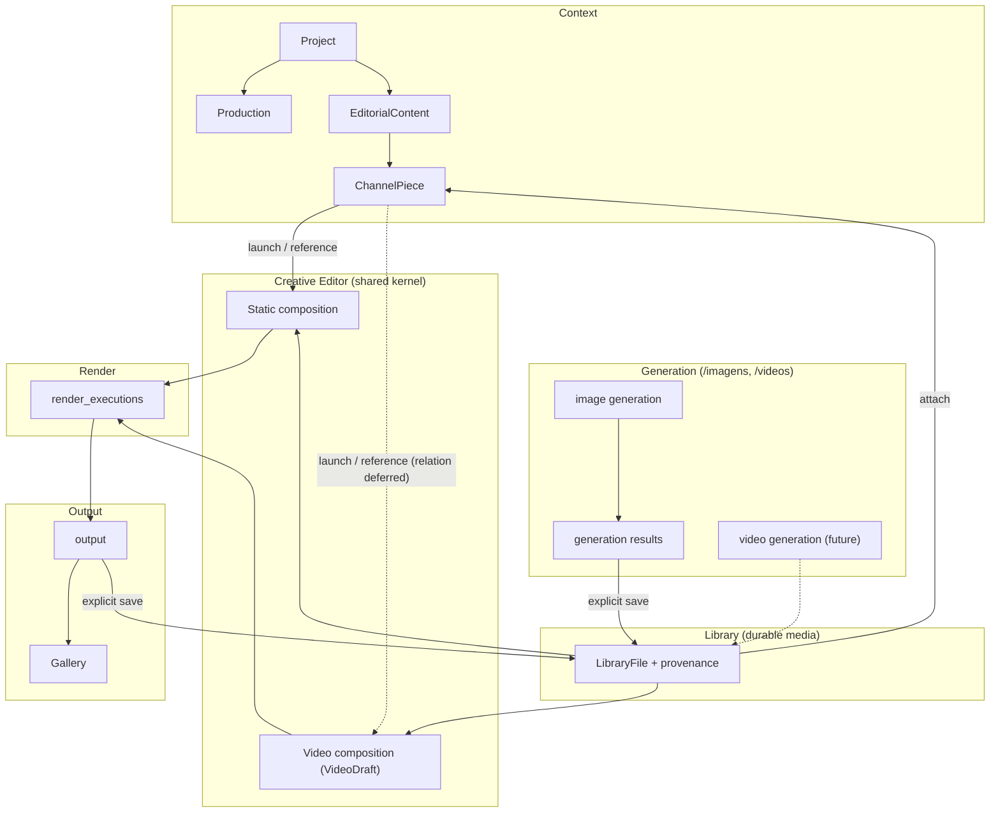

# Content Agent Studio — Product / Domain Architecture Review V1

Status: architecture and product AUDIT. No product code, schema, route or data was changed by this review.
Location: `docs/architecture/`, next to `MEDIA_PRODUCTION_ARCHITECTURE_V1.md` (the established convention for canonical architecture documents).

---

## 1. Executive summary

Content Agent Studio today is **one Project-scoped product with five real layers**:

1. **Editorial context:** Project → Production → EditorialContent → ChannelPiece.
2. **Source-media generation:** `/imagens` for images only.
3. **Media Library:** LibraryFile, surfaced as "Arquivos".
4. **Creative authoring:** two Creative Editors — Static (Slides) and Video (Scenes / Timeline Lite).
5. **Materialization / output:** `render_executions`, the VPS worker, the Output Player and Gallery, and ChannelPieceMedia as the binding of media to a publication target.

**The two Creative Editors are asymmetric in ownership, not only in medium.**
- **Static:** the authored state is a row **owned in the database by a ChannelPiece** (`channel_piece_static_authoring_states`: `channel_piece_id NOT NULL UNIQUE`, `ON DELETE CASCADE`), and it **only exists for `carousel`**. For other static formats the editor works on ephemeral state.
- **Video:** the authored state is an **independent, Project/Production-scoped document** (`video_drafts` + `VideoScene[]`) with **no relation to ChannelPiece**. Video ChannelPieces have **no Creative Editor entry at all**.

**Several responsibilities blur today.**
- **Generated images:** they live in a parallel asset store (`images`) that never reaches LibraryFile, so they cannot be used in either Creative Editor.
- **Outputs:** Static PNG outputs become LibraryFiles and ChannelPieceMedia bindings, while Video MP4 outputs stay only in render scratch.
- **Two editors for one document:** the classic `/videos?draft=` workspace still edits the same VideoDraft as `/creative-editor/video/[draftId]`, with an 800 ms autosave.
- **"Approved"** means two unrelated things: an image evaluation result, and ChannelPiece editorial status.

**Conclusion on the fundamental authoring unit.** The evidence supports **medium-specific composition documents sharing one Creative Editor kernel**. It does not support one generic CreativeDocument. ChannelPiece is best understood as the editorial/publication *context* that launches authoring and receives output. It should not be the universal owner of compositions.

**Gate B.** Exactly **one P0** item exists: the classic `/videos` workspace must stop writing `VideoDraft.scenes` before Gate B adds temporal state that it would silently corrupt. Everything else is P1–P3 or an explicitly deferred decision.

## 2. Starting checkpoint

| Check | Value |
|---|---|
| Starting SHA | `82cd7bda588c7357a5bf56e1c83bbbafb8f1d8b2` (`82cd7bd`) |
| HEAD / origin/main / remote main | all `82cd7bd` |
| Branch | `feat/creative-editor-video-foundation-v1` (tracks `origin/main`) |
| Working tree | clean; ignored local files only: `.env.local`, `.next/`, `tsconfig.typecheck.tsbuildinfo` (untouched, not committed) |

## 3. Method / evidence

Authority order used: executable code + database schema, then product behavior, then latest V1 docs, then older docs, then inference. Inferences are marked **(inference)**.

**Evidence sources:**
- Router inventory: `git ls-files app`, 17 pages and 47 API routes.
- Sidebar navigation: `lib/sidebar-navigation.ts`.
- **Production schema (read-only SQL on Supabase `nuhdhnasuohizxtmyiju`):**
  - `information_schema.columns`;
  - `pg_constraint` (CHECK/UNIQUE);
  - row counts / last activity per table;
  - distributions (LibraryFile origin/kind, ChannelPieceMedia source/role, render_executions kind/status, ChannelPiece channel/format).
- Migrations `scripts/001…035_*.sql`; their definitions matched the production schema.
- API mutation code:
  - `/api/video-drafts`, `/api/video-drafts/[id]/render`;
  - `/api/creative/static-authoring-*`;
  - `/api/channel-piece-media/*`, `/api/library-files`, `/api/storage/upload-image`;
  - Gallery / render-execution routes.
- UI surfaces:
  - `/imagens`, `/videos`, `/galeria`, `/arquivos`, `/conteudos`, `/posts`, `/dashboard`, the Project / Production / EditorialContent pages;
  - both Creative Editors;
  - `components/publication/*`, `components/library/*`.
- Docs:
  - `MEDIA_PRODUCTION_ARCHITECTURE_V1` (docs/architecture);
  - `CREATIVE_EDITOR_VIDEO_FOUNDATION_V1`, `CREATIVE_EDITOR_VIDEO_STATIC_PARITY_AND_DOCK_POLISH_V1`, `STATIC_CAROUSEL_FINAL_USABILITY_AND_EXPORT_V1` (docs/productization/creative-rendering);
  - `CREATIVE_EDITOR_AUTHORING_MODEL_V1` and `TIMELINE_MANIFEST_V1` (Google-Drive copies under `docs/discovery/creative-rendering/google-drive/` in the primary checkout, not versioned in this worktree).
- A single unauthenticated production HTTP probe (`/dev/creative-preview`). No production mutation.

**Doc vs code drift found in `MEDIA_PRODUCTION_ARCHITECTURE_V1`** (code wins):

| Doc says | Code now |
|---|---|
| Static rendering is synchronous/process-local | Static PNG is an async `render_executions` job (`kind='static_still'`) on the VPS worker (migration 034) |
| "No static RenderExecution merely for symmetry" | Superseded by 034 (semantic reason: Vercel cannot run Chromium) |
| Carousel is a label, not a persisted ordered slide model | `channel_piece_static_authoring_states.slides` persists ordered slides, template root, per-slide state |
| `/videos` is the video workspace | Video authoring moved to `/creative-editor/video/[draftId]`; `/videos` keeps hub + classic workspace |
| `tiktok:reel` misclassified as static | Fixed: `VIDEO_FORMATS = {reel, short, video_description}` independent of channel |

The doc's principles (separate lifecycles, no unified Output, no Clip, ChannelPiece ≠ authoring owner) remain consistent with code and are **not** contradicted.

---

## 4. Current product surface map (factual)

Status legend: CURRENT · TRANSITIONAL · LEGACY · DEV.

| Surface | Route | Real responsibility today | Primary entities | Creates | Reads | Comes from → goes to | Status | Overlap |
|---|---|---|---|---|---|---|---|---|
| Dashboard | `/dashboard` | Counts and recent activity | projects, productions, editorial_contents, image_drafts, video_drafts | — | those tables | login → anywhere | CURRENT | — |
| Projects | `/projetos`, `/projetos/[id]` | Project CRUD, Identity edit, Productions list | projects (+`identity` JSONB), productions | Project, Production | — | nav → Production | CURRENT | — |
| Production | `/projetos/[id]/producoes/[productionId]` | Organizational hub: lists EditorialContents, ChannelPieces, image drafts, video drafts; launches `/imagens`, `/videos`, contents | productions | EditorialContent | editorial_contents, channel_pieces, image_drafts, video_drafts | Project → contents / `/imagens?…` / **`/videos?draft=` (classic)** | CURRENT | Draft lists duplicate the `/imagens` and `/videos` hubs |
| Conteúdos | `/conteudos` | Cross-project EditorialContent list + create | editorial_contents | EditorialContent | projects, productions | nav → EditorialContent page | CURRENT | Same objects as the Production page |
| EditorialContent | `/projetos/[id]/conteudos/[ecId]` | Edit editorial body; create/edit ChannelPieces (AI body suggestion); ChannelPiece media section; **"Abrir no Creative Editor" only for static formats** | editorial_contents, channel_pieces, channel_piece_media | ChannelPiece, ChannelPieceMedia | images (Galeria tab), library_files | Production/Conteúdos → Static editor | CURRENT | — |
| Static Creative Editor | `/projetos/[id]/conteudos/[ecId]/channel-pieces/[cpId]/editar-visual` | Template-constrained static authoring; carousel = persisted slides; other static formats = ephemeral single slide; "Gerar PNG" (VPS); "Salvar nesta peça" (→ LibraryFile + ChannelPieceMedia); ZIP export | channel_piece_static_authoring_states, render_executions(static_still), library_files, channel_piece_media | static authoring row (carousel only), render_execution, LibraryFile(studio_render), ChannelPieceMedia | project/identity, primitives catalog, library_files | EditorialContent → itself | CURRENT | — |
| Video Creative Editor | `/creative-editor/video/[draftId]` | VideoDraft authoring: Live Player, CENAS, Timeline Lite, Inspector, render, Output Player | video_drafts, render_executions(video) | VideoDraft updates, render_execution | library_files, project identity | `/videos` hub (shortcut) → Galeria | CURRENT | Same VideoDraft editable in the classic `/videos` |
| Imagens | `/imagens`, `/imagens/rascunhos` | AI image generation workspace (prompt, provider, evaluation, attempts) + draft hub | image_drafts, images, generation_tasks, prompts, user_settings | ImageDraft, Image (generation result) | projects, productions | nav / Production → Galeria | CURRENT | — |
| Vídeos hub | `/videos` (no `draft` param), `/videos/rascunhos` | VideoDraft launcher (Creative Editor shortcut) + "Criar no Creative Editor" | video_drafts | VideoDraft | — | nav → Creative Editor | TRANSITIONAL | Duplicates the Production draft list |
| Vídeos classic workspace | `/videos?draft=…&production=…` | Pre-Creative-Editor VideoDraft editor (SceneCards, Storyboard, 800 ms autosave), render, completed-MP4 player, "Preparar publicação" (QuickFlow) | video_drafts, render_executions | VideoDraft (writes `scenes`), render_execution | library_files | Production page, `/videos/rascunhos`, Gallery "source" link | LEGACY (still primary target of several links) | **Second editor for the same VideoDraft** |
| Galeria | `/galeria` | Read projection of outputs: generated images (`images`), completed **video** render_executions, `studio_render` LibraryFiles | — (projection) | — | images, image_drafts, render_executions, video_drafts, library_files | nav → `/imagens?draft=` / `/videos?draft=` source links; static renders have no source link | CURRENT | Library also lists `studio_render` files |
| Arquivos (Library) | `/arquivos` | Project-scoped folders, upload, trash, download | library_files, library_folders | LibraryFile(upload), folders | projects | nav | CURRENT | Contains render outputs as well as sources |
| Posts | `/posts` | Pre-EditorialContent post authoring, with migration links to EditorialContent | posts | Post | — | not in sidebar (URL only) | LEGACY | Superseded by EditorialContent/ChannelPiece (`legacy_post_id`) |
| Configurações | `/configuracoes` | User settings (providers/API keys, evaluator, theme) | user_settings | — | — | nav | CURRENT | — |
| Dev harness | `/dev/creative-preview` | Renderer regression harness | fixtures | — | — | URL only; **HTTP 200 unauthenticated in production** (render route blocked in prod) | DEV | — |

**Not present as product surfaces** (factual absences): no Template library UI, no preset UI, no publication/distribution surface, no AI video generation, no Static-direct (non-ChannelPiece) editor entry, no Video ChannelPiece entry.

## 5. Current domain entity map (factual)

Row counts are production values at audit time, shown as signals of activity only.

| Entity (table) | Purpose in code | Persisted / derived | Truth or projection | Key FKs / enforced cardinality | Mutated by | Exposed in | Duplication |
|---|---|---|---|---|---|---|---|
| Project (`projects`, 9) | Scope + owner; `identity` JSONB | persisted | truth | user → N | projects UI | everywhere | — |
| Project Identity (`projects.identity`) | Editorial/brand identity (purpose, audience, voice, expression) | persisted JSON | truth for identity text; **not** a visual-token source | 1:1 with Project | Project page | Estilo panels (defaults), evaluator | Visual tokens are Studio defaults (see §15) |
| Production (`productions`, 16) | Organizational context (title, intention, type) | persisted | truth | `project_id NOT NULL`; nullable FK from editorial_contents / image_drafts / video_drafts / posts | Project/Production UI | hubs | `type` behaviorally inert |
| EditorialContent (`editorial_contents`, 13) | Channel-independent editorial content | persisted | truth | `project_id NOT NULL`, `production_id` nullable (11/13 set); `legacy_post_id` | EC page, Conteúdos | EC page | — |
| ChannelPiece (`channel_pieces`, 13) | Channel/format-adapted text + editorial status | persisted | truth | `editorial_content_id NOT NULL` CASCADE; channel ∈ 6, format ∈ 9, status ∈ draft/ready/approved/archived | EC page | EC page, Static editor | — |
| Static authored state (`channel_piece_static_authoring_states`, 1) | Carousel slides + root `template_id` | persisted | **truth for Static composition** | `channel_piece_id NOT NULL UNIQUE ON DELETE CASCADE` (1:1, owned) | `PUT /api/creative/static-authoring-state` | Static editor | Only carousel writes it |
| VideoDraft (`video_drafts`, 11) | Video authoring document | persisted | **truth for Video composition** | `project_id`, `production_id` nullable in schema (POST requires production; 9/11 set); **no ChannelPiece FK** | `/api/video-drafts` (POST/PATCH) from both editors | Creative Editor Video, classic `/videos`, Production, Dashboard | Two writers |
| VideoScene (`video_drafts.scenes[]`) | Ordered Scenes: order, duration, movement, `library_file_id`, description, prompt, `image_url` (legacy base64) | persisted JSON | truth | array order = sequence | same | same | `image_url` legacy |
| ImageDraft (`image_drafts`, 28) | Image-generation workspace (prompt details, attempts, evaluation, `current_image_id`) | persisted | truth for generation workflow | `current_image_id → images` | `/api/image-drafts` | `/imagens` | Different layer from VideoDraft despite the shared word "Draft" |
| Image (`images`, 26) | Generated image result (+storage metadata, status draft/generating/approved/rejected) | persisted | truth for generation result | `project_id` | `/imagens` (supabase client) | `/imagens`, Galeria, ChannelPiece media "Galeria" tab | **Parallel asset store** to LibraryFile |
| GenerationTask (`generation_tasks`, 12) | Async provider task (NanoBanana) | persisted | operational | `task_id` unique | nanobanana routes | — | — |
| Prompt (`prompts`, 40) | Prompt history (image/video type) | persisted | history | user | `/imagens` | `/imagens` | — |
| LibraryFile (`library_files`, 28) | Durable media record: kind ∈ image/video/audio/document/other; origin ∈ upload/studio_render; `source_render_execution_id` | persisted | truth for durable media | `project_id` nullable in schema (28/28 set) | `/api/library-files` (upload), `/api/channel-piece-media/upload` (upload + static render save) | Arquivos, both editors' pickers, Galeria (studio_render), ChannelPiece media | Holds sources AND saved outputs |
| LibraryFolder (`library_folders`) | Per-project folder tree | persisted | truth | `project_id NOT NULL` | `/api/library-folders` | Arquivos | — |
| ChannelPieceMedia (`channel_piece_media`, 13) | Binding of media to a ChannelPiece (role, position) | persisted | truth for attachment | `channel_piece_id` CASCADE; **exactly one of** `image_id` / `library_file_id`; unique position; one primary | `/api/channel-piece-media/*` | EC page, Static ZIP export | Two source kinds |
| RenderExecution (`render_executions`, 31) | Async render job + frozen `input_snapshot` + output location | persisted | truth for execution + scratch output | kind='video' ⇒ `video_draft_id`; kind='static_still' ⇒ `channel_piece_id` (CHECK); `project_id NOT NULL` | render routes, worker claim/complete/fail | both editors, Galeria (video) | Video output lives only here |
| TimelineManifest | Renderer-neutral temporal contract | **derived** (frozen inside `input_snapshot`) | projection | from VideoDraft | adapter | worker, Live Player | — |
| StaticRenderManifest | Static render contract | **derived** (frozen inside `input_snapshot`) | projection | from browser-submitted authored request | static render route | worker | — |
| ResolvedTimelineInput / TimelineComposition | Runtime render input / Remotion tree | derived, in memory | projection | — | — | worker, Live Player | — |
| Template (code registries) | TemplateDescriptor (renderer: `editorial.documentary-card`, `editorial.quote-card`) and TemplateDefinition (authoring: `editorial-documentary-collage-v1`, layouts, elements, slots) | code, not DB | truth in code | Static stores `template_id` string | — | both editors | Two template layers (see §15) |
| Primitive catalog (`lib/creative/primitives/discovery.ts`) | Project-specific paper/tape primitives | code (hardcoded Portal project + LibraryFile ids) | truth in code | — | — | Static | — |
| Legacy `videos` (0 rows), `posts` (4) | Pre-current models | persisted | legacy | — | `/posts` | `/posts` | Superseded |

**Absent by design, not missing by accident:** Clip, Timeline table, ContentVersion, unified Output, Publication entity, Template/Preset tables.

## 6. Authoritative-state map ("who owns the truth?")

| Concept | Current authority | Notes |
|---|---|---|
| Editorial intent | `editorial_contents` (title/body/ai_context/status) | channel-independent |
| Channel-specific intent | `channel_pieces` (channel, format, title, body, cta, hashtags) | also seeds Static slide text at creation (`contextualContentForChannelPiece`) — copy, not link |
| Static composition | `channel_piece_static_authoring_states` (carousel only) | non-carousel static: **no persisted authority**; state lives in the browser |
| Static slides | `…static_authoring_states.slides[]` | per slide: variant (layout), appearance, content, primitiveSelection/Transforms, tuning, elementOrder, hiddenElements, assetOverrides |
| Video composition | `video_drafts` | Project/Production scoped |
| Video Scenes | `video_drafts.scenes[]` | array order = sequence |
| Template selection | Static: `template_id` (root) + per-slide `variant`; Video: **hardcoded** in adapter (`editorial.documentary-card`/`cover`) | Video has no authored template state |
| Project identity / brand | `projects.identity` (text); visual tokens = **Studio defaults** in `adaptProjectIdentityToVisualTokens` | identity presence is still *required* to render video (409 if missing) |
| Asset metadata | `library_files` | generated images: `images` (separate) |
| Generated image result | `images` (+ `image_drafts.current_image_id`) | never becomes LibraryFile |
| Generated video result | — (does not exist) | future |
| Scene duration / motion | `VideoScene.duration` / `.movement` | Timeline/Inspector are views |
| Element structure | code (TemplateDefinition layouts); Static per-slide order/visibility overrides; Video: default only | |
| Render execution | `render_executions` | server-authoritative insert (service role) |
| Final rendered file | Video: `render_executions.output_*` (MinIO scratch); Static: scratch then, on explicit save, LibraryFile(origin `studio_render`) | asymmetric durability |
| Gallery visibility | derived (projection over images, video executions, studio_render LibraryFiles) | no Gallery table |
| Approval | two unrelated fields: `images.status='approved'` (evaluation) and `channel_pieces.status='approved'` (editorial) | no approval of a render/output |
| Publication | not modeled (ChannelPiece status is the closest) | QuickFlow "Preparar publicação" creates EditorialContent/ChannelPiece |

Preserved distinctions verified in code:
- VideoDraft/VideoScene ≠ TimelineManifest: the manifest is derived; the render snapshot is frozen.
- Timeline geometry ≠ Timeline state: geometry is derived, never persisted.
- Render ≠ Save: Video saves the draft *before* rendering ("Salvar e renderizar"); Static renders the current authored request without saving.
- Render completion ≠ approval: no approval is written by the worker.
- Gallery visibility ≠ publication: Gallery is a projection.
- Generated source media ≠ composition: `images` are never compositions.

```mermaid
flowchart LR
  subgraph Editorial
    P[Project<br/>identity JSON] --> PR[Production]
    P --> EC[EditorialContent]
    PR -. nullable .-> EC
    EC --> CP[ChannelPiece]
  end
  subgraph Authoring truth
    CP ==>|"1:1 owned, CASCADE<br/>(carousel only)"| SAS[(static_authoring_state<br/>slides[] + template_id)]
    P --> VD[(VideoDraft<br/>scenes[])]
    PR -. nullable .-> VD
  end
  subgraph Generation
    ID[(ImageDraft)] --> IMG[(images)]
  end
  subgraph Library
    LF[(LibraryFile<br/>origin upload / studio_render)]
  end
  subgraph Execution
    RE[(render_executions<br/>kind video / static_still)]
  end
  VD --> RE
  CP --> RE
  RE -->|"static: explicit save"| LF
  LF --> CPM[(ChannelPieceMedia)]
  IMG --> CPM
  CP --> CPM
```

## 7. Product layers (hypothesis tested)

The proposed seven-layer model **mostly fits**, with three corrections from evidence:

| Hypothesis layer | Fit | Evidence-based correction |
|---|---|---|
| Editorial / context | fits | Project is mandatory everywhere. Production is required by draft APIs but nullable in schema. |
| Source-media generation | partial | Only images exist. Generated images **do not flow into Library**; they form their own store consumed by Gallery and ChannelPieceMedia. |
| Media / asset Library | partial | Library contains **both** sources and saved Static outputs (`origin=studio_render`). It is "durable media", not "source media only". |
| Creative authoring | fits, asymmetric | Static authored state is owned by ChannelPiece; Video is independent (§9). |
| Creative building blocks | fits (code-level) | Templates, elements, slots and motion presets are code registries, not data. Identity does not yet feed visuals. |
| Temporal authoring | fits (Video only) | Scene sequence only. No independent segments. |
| Rendering / materialization | fits | One shared execution plane (`render_executions` + VPS worker) for both media, with kind-specific subjects. |
| Output / consumption | fits, asymmetric | Static output → LibraryFile + ChannelPieceMedia. Video output → scratch + Output Player + Gallery only. |
| Distribution / publication | thin | ChannelPiece status + ChannelPieceMedia are the only publication-side state. No platform delivery. |

**Better map from evidence:** "Library" is best described as the **durable media layer** (sources + saved outputs), and "Gallery" as a **read projection across generation results, executions and saved outputs**. See §8.



## 8. Generation / Library / Authoring / Output boundaries

| Hypothesis | Current match | Violations / blur |
|---|---|---|
| `/imagens` = image generation + its history | **Good.** Generation, evaluation, attempts, drafts. | Its results never enter Library, so they cannot be composed in either editor. Gallery treats them as outputs ("generated") and ChannelPieceMedia can bind them directly, skipping Library and authoring. |
| `/videos` = AI video generation + its history | **Not yet.** No generation exists. | `/videos` is today a VideoDraft hub plus the **classic authoring/render workspace**. Label "Vídeos" plus draft editing implies authoring ownership that belongs to the Creative Editor. |
| Library = reusable source media | **Mostly.** Uploads plus the pickers used by both editors. | Also stores saved Static **outputs** (`studio_render`, 18 of 28 files); these are reusable as sources (legitimately), but the concept is "durable media". Video outputs are not saved. |
| Creative Editor = authoring | **Good** for both media. | Static authoring is gated by ChannelPiece; Video has a second, legacy editor. |
| Gallery = materialized outputs | **Mixed.** | Shows generation results (source-media, not authored) next to authored outputs. Static renders appear only after an explicit save (as LibraryFile). Video renders appear immediately (scratch execution). Source links go to the **classic** `/videos?draft=`; static items have **no** source link. |

**Naming confusion:**
- "Galeria" mixes generation results and authored outputs.
- "Arquivos" is the Library but is never called "Library/Biblioteca" in the sidebar, while pickers say "Biblioteca".
- "Rascunhos" means generation drafts in `/imagens` and authoring documents in `/videos`.

These are temporary/transitional, not wrong models. The largest real boundary gap is **generated image → Library** (P1).



## 9. Static vs Video authoring comparison

| Question | Static | Video |
|---|---|---|
| 1. Persisted authority | `channel_piece_static_authoring_states` row: `slides[]` + `template_id` + `schema_version`; **carousel only** | `video_drafts` row: `scenes[]` + `name` |
| 2. Relationship to ChannelPiece | **Structurally owned in the DB**: `channel_piece_id NOT NULL UNIQUE`, `ON DELETE CASCADE` | None |
| 3. Can it exist without a ChannelPiece today? | **No** without a schema change: the row's identity is its ChannelPiece. | Yes |
| 4. Coupling breakdown | see below | Project/Production only |
| 5. Why VideoDraft exists and Static has no equivalent | VideoDraft predates the editorial model (migration 002). Static authoring was added later *inside* the ChannelPiece workflow (033) as the fastest seam. | — |
| 6. Nature of the asymmetry | **Historical plus implementation convenience**, not semantic (see §22). | — |

**Static coupling breakdown (4):**

| Coupling kind | Present? | Evidence |
|---|---|---|
| Routing | yes | `/projetos/[id]/conteudos/[ecId]/channel-pieces/[cpId]/editar-visual` |
| UI context | yes | header context, back-to-content |
| API assumptions | yes | `static-authoring-context` requires projectId + editorialContentId + channelPieceId; `static-authoring-state` keyed by channelPieceId |
| Database ownership | **yes** | FK NOT NULL + UNIQUE + CASCADE |
| Render subject | yes | `render_executions.kind='static_still'` ⇒ `channel_piece_id NOT NULL` (CHECK) |
| Output binding | yes | "Salvar nesta peça" ⇒ LibraryFile(studio_render) + ChannelPieceMedia; ZIP export reads ChannelPieceMedia |
| Content seeding | yes (copy) | default slide text is copied from ChannelPiece/EditorialContent |

**7. Is a StaticDraft / StaticComposition / CreativeDocument needed?**
- **Not now.** Static authoring works for its only persisted case (carousel).
- A separate Static composition entity becomes justified **only** if one of these is chosen as a product need:
  - (a) authoring a static composition without a ChannelPiece;
  - (b) reusing one composition across ChannelPieces;
  - (c) keeping alternatives/revisions per ChannelPiece.
- None is evidenced today (1 persisted Static state in production).
- If needed later, the smallest step is to **re-key** the existing row, i.e. make it addressable by its own `id` with a nullable, non-unique `channel_piece_id`. No new generic entity is required.

**8. Different entities under a shared contract?** Yes. This is already the de-facto model:
- both editors share the kernel (§19);
- both freeze a renderer-neutral manifest into the same `render_executions` table;
- both use LibraryFile identities.

The persisted shapes differ legitimately:
- **Slide:** layout / appearance / element overrides.
- **Scene:** duration / movement / sequence.

**9. Shared concepts that already exist:**
- Template registries;
- AssetRef / LibraryFile binding;
- the slot resolver;
- Element stack resolution;
- identity snapshot;
- `render_executions` + worker + snapshot freezing;
- the explicit-save authoring semantic ("Voltar ao salvo", optional Auto-save);
- the editor shell.

**10. Duplicated only conceptually:**
- "Save" semantics differ: Static renders unsaved state; Video saves first.
- Template selection: stored per carousel vs hardcoded for video.
- Per-unit override model: rich for Slide, minimal for Scene.
- Output save: Static → Library/ChannelPiece; Video → none.



## 10. Fundamental authoring unit analysis

| Model | Evidence for | Evidence against | Implication |
|---|---|---|---|
| **1. ChannelPiece** | Static state is owned by ChannelPiece; outputs bind to ChannelPiece | Video authoring has no ChannelPiece; ChannelPiece also owns text, status, media and publication intent (overloaded); Video ChannelPieces cannot author at all | Would force a VideoDraft → ChannelPiece FK and forbid direct authoring |
| **2. Medium-specific composition** (Static state, VideoDraft) | Both exist as rows with their own schema; both freeze their own manifest; semantics differ materially | Static's composition has no identity independent of ChannelPiece | Keeps both models; asks only that Static composition *can* be addressed independently later |
| **3. Generic CreativeDocument** | Shared editor kernel; shared render table | No shared persisted shape; slide and scene semantics differ; no product need for cross-medium documents | Large migration of both models for no current behavior |
| **4. Hybrid contextual model** (composition + optional context links) | Video already works this way: Project/Production context + independent document; Static's context is ChannelPiece | Needs an explicit Composition↔ChannelPiece relation decision | Smallest evolution from what exists |

**Conclusion:**
- The Creative Editor edits **a medium-specific composition** (model 2).
- It is entered **with an optional editorial context** (model 4).
- Today the Static composition is *identified by* its ChannelPiece; the Video composition is *identified by itself*.
- A generic CreativeDocument (model 3) is **not justified by current evidence**.
- ChannelPiece as universal owner (model 1) contradicts the working Video model and overloads ChannelPiece further.

## 11. Slide vs Scene analysis

| Aspect | Static Slide | Video Scene |
|---|---|---|
| Role | one visual unit of a carousel (one PNG) | one narrative/temporal unit (one primary segment) |
| Persistence | `slides[]` JSON in static authoring row | `scenes[]` JSON in VideoDraft |
| Order | `order` (unique) | array position (`order` renumbered) |
| Template binding | root `template_id` + per-slide `variant` (8 layouts) + `appearance` | none; adapter forces `documentary-card`/`cover`, appearance defaults to dark |
| Content | per-layout structured content | `description` (brief, **not rendered**); title placeholder `Cena N` |
| Elements | per-slide `elementOrder`, `hiddenElements`, `tuning`, `primitiveTransforms` | none (default stack, read-only in UI) |
| Assets | `assetOverrides` per slot + legacy `heroRef` + primitive selection | `library_file_id` = hero override only |
| Time | none | `duration`, `movement` → semantic motion preset |
| Render | one static_still execution per slide | one template segment per scene inside one video execution |

**Conclusion:**
- Slide ≈ Scene **as authoring units**: one template-driven visual composition each.
- Video's Scene is **missing its composition model**: template, layout, appearance, text content, element overrides and material slots.
- This is **neither a Gate B issue nor a temporal issue**. It is a **separate "Scene composition parity" authoring mission** that can reuse the Slide's per-unit schema almost directly: the same template registry, element stack and slot resolver.
- The current state is an **appropriate Foundation limitation** (documented in Foundation V1 and Parity V1). It is not a defect.

## 12. Creative Editor entry model

| Path | Exists today? | Useful? | Ownership implication |
|---|---|---|---|
| **Contextual:** Project → (Production) → EditorialContent → ChannelPiece → Editor | Static only (static formats) | Yes: the editorial workflow | For Video it requires a ChannelPiece↔VideoDraft relation (deferred) |
| **Direct:** Project/Production → create/open composition | Video only (`/videos` hub "Criar no Creative Editor", Production draft list → classic editor) | Yes, for video (no editorial content needed to make a video) | Static would need an addressable composition (see §9) |
| **Asset-initiated:** Library → composition | No | Plausible later | Needs a direct-authoring path first; not needed now |
| Authoring **outside Project** | No (Project required everywhere: LibraryFile, identity, render `project_id NOT NULL`) | **Not desirable**: Project carries identity, Library scope and ownership checks | Keep Project mandatory |

**Conclusions:**
- Authoring **outside ChannelPiece** is already real (Video) and desirable for media not tied to a single publication.
- Authoring **outside Project** is unnecessary.
- **Video ChannelPieces (reel/short) have no entry into the Creative Editor.** That is the biggest entry gap (P1). It can be closed by a *launch/reference* link without making ChannelPiece the owner.

## 13. ChannelPiece responsibility audit

| Responsibility | Current | Preferred (conceptual, not implemented) |
|---|---|---|
| Channel-specific editorial intent (text, CTA, hashtags) | owns | owns |
| Editorial status (draft/ready/approved/archived) | owns | owns (it is the only publication-side approval) |
| Publication target / derived canvas | derives (not stored) | keep derived |
| Media attachment | owns via ChannelPieceMedia | owns (**receives output**) |
| Static composition | **owns** (1:1 row) | **references/launches** (can keep 1:1 by default) |
| Video composition | none | **references/launches** (relation deferred) |
| Render subject (static_still) | yes (`channel_piece_id` on render) | acceptable while Static composition has no own id |
| Delivery to platforms | none | future |

**Conclusion:**
- ChannelPiece accumulated "composition owner" for Static by convenience. Its preferred role is **editorial/publication context that launches authoring and receives approved/bound output**.
- There is no evidence that forces a change now (1 persisted Static state).
- The preferred role only needs to be *preserved* by not extending ownership further. In particular, Gate B must not add a ChannelPiece FK to VideoDraft.

## 14. Project / Production / EditorialContent hierarchy

| Entity | Represents | Mandatory? | Cardinality (enforced) | Authoring / asset implications |
|---|---|---|---|---|
| Project | scope, owner, identity | **yes** for everything that matters (Library, identity, renders) | user → N | Library scope and identity come from here |
| Production | organizational context (title, intention, type) | nullable in DB; **required** by image/video draft POST and video render (409) | Project → N; nullable links from EC/drafts | `type` is inert; no asset or template effect |
| EditorialContent | channel-independent editorial content | needs Project | Project → N | seeds ChannelPiece text |
| ChannelPiece | channel-adapted content + status | needs EC | EC → N (CASCADE) | owns Static state, receives media |

**Conclusions:**
- Creative authoring happens "inside" this hierarchy for Static because the **first working seam** was the ChannelPiece workflow (MEDIA_PRODUCTION_ARCHITECTURE_V1 §4 "contextual entry seam").
- The hierarchy itself does not require it: Video authors directly at Project/Production.
- Production being API-required but schema-nullable is a **consistency gap** (P2). The legacy null rows (2 video drafts, 2 ECs) cannot render video.

## 15. Template / Preset / Project Identity map

| Concept | Where it lives | Structural / branding / default / per-unit / constraint | Overrides / inheritance |
|---|---|---|---|
| TemplateDescriptor (`lib/creative/templates/registry.ts`: `editorial.documentary-card`, `editorial.quote-card`) | code | **renderer-facing structure**: modes, canvas support, motion presets, content/asset schema | none |
| TemplateDefinition (`template-definitions.ts`: `editorial-documentary-collage-v1`) | code | **authoring structure**: layouts (8), elements, asset slots, default stacks, anatomy | Static: `template_id` per carousel; Video: none |
| Template family / anatomy | code | structural, read-only in UI | — |
| Layout (`variant`) | per Slide | per-unit structural choice | Static only |
| Appearance (light/dark) | per Slide | per-unit style | Static only; Video = cover default (dark) |
| Motion presets | TemplateDescriptor capabilities | structural capability | Video Scene `movement` → preset (partial mapping) |
| Presets (general) | **absent** | — | — |
| Project primitives (paper/tape) | code catalog, hardcoded to the Portal project | project-specific defaults | Slide `primitiveSelection` |
| Project Identity | `projects.identity` JSON | branding (text) | **not applied to visual tokens**: `adaptProjectIdentityToVisualTokens` returns Studio defaults |
| Visual tokens | Studio defaults (`CREATIVE_IDENTITY_DEFAULTS`) | style | none |
| Channel constraints / canvas | `staticAuthoringTarget` (1080×1350; story 1080×1920); video adapter 1080×1920@30 | platform constraint (derived) | not stored |

**Ambiguities:**
- Two "Template" layers share the word (descriptor vs definition). The mapping is `TemplateDefinition.renderer.componentKey` → descriptor.
- The video adapter bypasses TemplateDefinition.
- Identity is required to render video but does not change the render.
- The Portal primitive catalog is code, not data.

None blocks Gate B.

## 16. Asset lifecycle

| Question | Finding |
|---|---|
| Does all reusable media converge into LibraryFile? | **No.** Generated images live in `images` and never become LibraryFile. |
| Generated → durable | Generated images are stored durably (S3 + `images` row) but outside Library. There is no "save to Library" action. |
| Upload → Library | `/arquivos` upload and the ChannelPiece "Envio" tab both create LibraryFile(`origin=upload`). |
| Render → Library | Static: explicit "Salvar nesta peça" → LibraryFile(`origin=studio_render`, `source_render_execution_id`). Video: **none**. |
| Project vs global | All LibraryFiles are Project-scoped (28/28). There is no global library. |
| Template default vs user asset | Template defaults are code fixtures (`/creative-fixtures/…`), shown as origin "Template" by the shared slot resolver. User assets are LibraryFile overrides (Slide `assetOverrides`; Scene `library_file_id`). |
| Provenance | LibraryFile `origin` + `source_render_execution_id`; images carry prompt/model; no provenance link image → Library. |
| References vs URLs | Both editors persist **stable LibraryFile ids**. Signed URLs are runtime-only: display URLs from `/api/library-files`, presigned at claim time by the worker, and asserted absent from snapshots. |

## 17. Render / output lifecycle

| Stage | Static | Video |
|---|---|---|
| Source asset | LibraryFile / fixtures | LibraryFile / fixtures |
| Authoring document | static authoring row (carousel) or browser state | VideoDraft |
| Render execution | `render_executions(kind=static_still, channel_piece_id)` | `render_executions(kind=video, video_draft_id)` |
| Rendered output | MinIO scratch (execution) | MinIO scratch (execution) |
| Durable output | LibraryFile(studio_render), **explicit** | **none** |
| Gallery entry | after explicit save (LibraryFile projection) | immediately (execution projection) |
| Approval | none (ChannelPiece status only) | none |
| Channel binding | ChannelPieceMedia (auto on save) | none |
| Publication | not modeled | not modeled |

**Coherence:**
- The separate entities are coherent. One execution plane is shared correctly.
- **No unified Output entity is needed.**
- The incoherence is **durability asymmetry**: Video outputs depend on scratch retention and never become Library media or ChannelPieceMedia (P1, already a known gap in MEDIA_PRODUCTION_ARCHITECTURE_V1 §13.5).
- No single entity acts as several stages dangerously. The closest overload is ChannelPiece (composition owner + render subject + media target + status) for Static.

## 18. Route responsibility map

| Route | Addresses | Context in URL | Implied ownership true? | Status |
|---|---|---|---|---|
| `/creative-editor/video/[draftId]` | VideoDraft | none (context read from draft) | yes | **canonical** |
| `/projetos/[id]/conteudos/[ecId]/channel-pieces/[cpId]/editar-visual` | Static authoring row via ChannelPiece | Project/EC/CP | **yes today**: the DB really makes CP the owner | canonical for current model |
| `/videos` (no params) | VideoDraft hub | — | implies `/videos` owns drafts (transitional) | transitional |
| `/videos?draft=…` | VideoDraft (classic editor) | query | implies authoring ownership that belongs to the Creative Editor | **legacy** (still linked from Production, `/videos/rascunhos`, Gallery) |
| `/videos/[draftId]/editor` | — | — | never shipped | not present (do not canonize) |
| `/imagens`, `/imagens?draft=` | ImageDraft | query | yes (generation workspace) | canonical |
| `/galeria` | projection | — | n/a | canonical |
| `/arquivos` | LibraryFiles | — | yes | canonical (name ≠ "Biblioteca") |
| `/projetos/...` hierarchy | Project/Production/EC | path | yes | canonical |
| `/posts` | Post | — | legacy | legacy |
| `/api/render-executions/[id]/output-url` | execution output | — | yes | canonical |
| `/dev/creative-preview` | harness | — | n/a | dev (publicly reachable) |

**Future neutral Static route:** `/creative-editor/static/[compositionId]` would need an addressable Static composition id.
- The existing row has an `id`, but it is unique per ChannelPiece and exists only for carousels.
- A neutral route therefore requires:
  - (a) persisting non-carousel static state;
  - (b) addressing by row id;
  - (c) keeping the ChannelPiece route as a contextual alias.
- No broad migration is needed until direct Static authoring is a product need.

## 19. Shared Creative Editor kernel

| Layer | Pieces (file) | Static | Video |
|---|---|---|---|
| **Shared kernel** | `CreativeWorkbench` + floating Inspector (Dockview infra), `usePreviewViewport`, `ViewportZoomControls`, `lib/creative/authoring/viewport.ts`, `AssetSlotCard` + `resolveSlotResource`, `TemplateFamilyAnatomy` / `TemplateAnatomy`, `ElementLayers` (editable/read-only), `StyleSourcePanel`, `ProjectLibraryAssetPicker`, template registries, element-stack resolver, identity adapter, `render_executions` + worker, Explicit Save / Voltar ao salvo / Auto-save pattern | ✓ | ✓ |
| **Static-specific** | Slides, slide pager, add/remove slide dialog, layout/appearance selectors, per-slide transforms/tuning, primitive catalog, PNG render jobs per slide, "Salvar nesta peça", ZIP export, Restaurar padrão / Ordem padrão | ✓ | — |
| **Video-specific** | Live Player adapter (`remotion/player`), frame cursor (`currentFrame`), transport, Scenes (CENAS), Timeline Lite, bottom authoring dock, Motion tab, Scene context header, Output Player, "Salvar e renderizar" | — | ✓ |

**Duplicated rather than shared (candidates only, not requests):**
- The render polling / output-url fetch logic exists separately in each page.
- Save-status labels.
- Header context dropdown markup.

## 20. Temporal / Gate B boundary analysis

**Today:**



Scenes are contiguous, indivisible primary blocks. The TimelineManifest has one track (`video-main`) with one template segment per Scene.

**Four distinct concepts that Gate B must not conflate:**

| Concept | Meaning | Current support |
|---|---|---|
| Root timeline | global frame axis of the video | derived from Scene order/duration |
| Scene-internal composition | template, layout, elements, assets *inside* one Scene | missing (fixed cover) → separate mission (§11) |
| Element motion | how an element animates within its Scene | semantic preset per Scene only |
| Independent temporal segments | objects with own start/duration on the root timeline, possibly crossing Scenes | none |

**Constraints Gate B must resolve** (not decided here):
1. **Authority:** where independent segments persist. Options: inside VideoDraft (same document, same PATCH) or a separate row. It must be one authority with `scenes[]`.
2. **Anchoring:** absolute frames on the root timeline, or Scene-relative, or both. This decides what reordering or retiming a Scene does to overlapping segments.
3. **Ownership of content:** is a B-roll/lower third a Template element instance, an Asset placement, or a new segment kind? (Element ≠ Track stays open in both directions.)
4. **Scene-internal vs root:** whether "double-click a Scene to edit its internal element timing" is a nested timeline or a view over root segments clipped to the Scene.
5. **Audio:** separate track kind with its own asset lifecycle (LibraryFile `kind='audio'` exists but is unused).
6. **Transitions:** effects between Scenes vs objects on the timeline.
7. **Source ranges** only when real clips require them.

**Prerequisite from this review:** a single writer for VideoDraft (P0-1).

## 21. Vocabulary / glossary (proposal only; no code renames)

| Term | Code meaning | UI meaning | Render/runtime meaning | Ambiguity |
|---|---|---|---|---|
| Draft | `ImageDraft` = generation workspace; `VideoDraft` = authoring document | "Rascunhos" in both hubs | — | **Same word, two layers** |
| Composition | — | — | Remotion `TimelineComposition` / Remotion "composition" | Collides with the product concept "authored composition" |
| Scene | `VideoScene` | "Cena" | one template segment | — |
| Slide | persisted slide | "Slide" | one static_still render | — |
| Segment | TimelineManifest segment (`scene:<id>`) | not shown | Remotion sequence placement | Today Segment ≡ Scene; will diverge in Gate B |
| Track | manifest track (`video-main`) | not shown | — | UI has none yet |
| Clip | none | none | none | reserved |
| Element | TemplateDefinition element | "Elementos" / "Camadas" | a DocumentaryCard layer | "Layer" used as UI synonym |
| Layer | `ElementLayers` (UI) | "Camadas" | — | Should stay a UI word for Element stack |
| Asset / slot | AssetRef, slot (hero, paper…) | "Assets" | ResolvedAsset | — |
| Motion | `VideoScene.movement` → MotionSpec preset | "Motion" | frame-based animation | Two vocabularies (movement vs preset) |
| Transition | none | none | none | reserved |
| Timeline | derived Scene ranges + TimelineManifest | "Timeline" | TimelineComposition | Geometry vs state separation holds |
| Template | TemplateDescriptor vs TemplateDefinition | "Template" | component binding | **Two layers** |
| Output | render output, LibraryFile(studio_render), Gallery item | "Resultado", "Vídeo renderizado", "Galeria" | MinIO object | Several stages share the word |
| Approved | `images.status` (evaluation) / `channel_pieces.status` (editorial) | "Aprovada" | — | **Two meanings** |

**Proposed glossary:**
- **Composition** = the authored medium-specific document (Static state / VideoDraft).
- **Unit** = Slide / Scene.
- **Element** = template-defined visual part.
- **Segment** = placement on the timeline (a Scene is the primary segment).
- **Track** = temporal lane.
- **Render** = execution.
- **Output** = materialized file.
- **Saved output** = LibraryFile(studio_render).
- **Attachment** = ChannelPieceMedia.
- **Approval** = editorial status on ChannelPiece.
- Image "approved" = **evaluation result**.

## 22. Valid vs accidental asymmetries

| Asymmetry | Classification | Reason |
|---|---|---|
| Scenes vs Slides | **Valid** | time vs pagination |
| Motion only in Video | **Valid** | time |
| Timeline only in Video | **Valid** | time |
| Output format PNG vs MP4, per-slide vs whole-video jobs | **Valid** | medium |
| Live Player vs Canvas | **Valid** | medium |
| `/imagens` generates; `/videos` does not | **Valid (maturity)** | AI video out of scope |
| VideoDraft exists, no Static equivalent | **Historical / convenience** | Static added inside the ChannelPiece seam |
| Video route neutral, Static route ChannelPiece-deep | **Historical**, but truthful to the current DB | follows ownership |
| Static state only for carousel | **Accidental** (incomplete) | non-carousel static authoring is lost on reload |
| Static outputs → Library + ChannelPiece; Video outputs → scratch only | **Accidental** (known gap) | durability lifecycle unfinished |
| Template per carousel; Video fixed template | **Foundation limitation** | separate mission |
| Static renders unsaved state; Video renders saved state | **Historical** (Video render route reads DB) | acceptable; should be documented as intended or converged |
| Static entry exists from ChannelPiece; Video entry does not | **Accidental / gap** | missing launch path |
| Identity required for video render, unused visually | **Accidental** | gating without effect |

## 23. Responsibility collisions

| Collision | Classification |
|---|---|
| Classic `/videos?draft=` and Creative Editor both write `VideoDraft.scenes` (classic autosave 800 ms, last write wins; classic can also write base64 `image_url`) | **Dangerous second writer** (P0 before Gate B) |
| Generated images: `images` store vs LibraryFile (ChannelPieceMedia accepts both) | **Architectural ambiguity** (parallel asset store) |
| Gallery vs Library both list saved Static outputs | Harmless (projection vs durable) |
| Gallery shows generation results and authored outputs together | Transitional naming |
| Production page, `/videos` hub and `/videos/rascunhos` all list VideoDrafts; Production and `/videos/rascunhos` link only to the classic editor, while the hub offers both (Dashboard shows counts only) | Transitional duplication (link targets are debt) |
| Gallery "source" for video → classic editor; static renders have no source link | Technical debt |
| Two "approved" meanings | Architectural ambiguity (vocabulary) |
| TemplateDescriptor vs TemplateDefinition | Acceptable layering (needs glossary) |
| ChannelPiece as Static composition owner + render subject + media target + editorial status | Architectural ambiguity (accumulated) |
| Production nullable in DB, required in APIs | Technical debt |
| `/posts` legacy authoring still reachable | Transitional duplication |

## 24. Current user journey maps

**A. Instagram Carousel (editorial workflow) — current**



**B. Video (direct VideoDraft) — current**



**C. Generated image — current**: `/imagens` → ImageDraft → `images` → Galeria → (optional) ChannelPieceMedia via the "Galeria" tab. **Does not reach Library or either Creative Editor.**

**D. Existing Library asset — current**: `/arquivos` upload (or ChannelPiece "Envio") → LibraryFile → Static slot "Trocar" / Video Scene "Trocar" → composition → render → output. Static outputs are saved back as LibraryFile and bound to the ChannelPiece; Video outputs are not saved.

**E. Generated video (FUTURE, conceptual — does not exist)**: `/videos` AI clip → LibraryFile(kind video, provenance) → Creative Editor Video (Scene asset or future segment) → render → output.

## 25. Proposed conservative target architecture

**What each concept is:**
- **Project:** mandatory scope. Owns identity, the Library scope and ownership.
- **Production:** optional organizational grouping. It is not a workspace, template selector or output container.
- **EditorialContent:** channel-independent editorial intent.
- **ChannelPiece:** channel-adapted editorial/publication context and editorial status. It **launches** authoring and **receives** outputs (ChannelPieceMedia). It *may* own a default composition for convenience, but it is not the universal owner.
- **`/imagens`, `/videos`:** source-media generation plus their generation history. `/videos` sheds VideoDraft authoring (classic workspace) and keeps at most a launcher until AI video exists.
- **Library (Arquivos):** durable media: uploads, generated media saved explicitly, and saved outputs, with provenance (`origin`).
- **Creative Editor:** authoring of medium-specific compositions on a shared kernel.
- **Static composition:** today the ChannelPiece-owned state row. It becomes addressable on its own only when direct/reuse needs appear.
- **Video composition:** VideoDraft.
- **Slide / Scene:** per-unit template composition. Scene additionally has time and motion.
- **Element:** template-defined part of a unit. Temporal independence is undecided.
- **Motion:** semantic, template-constrained animation.
- **Timeline:** derived temporal view. Future independent segments get one explicit authority.
- **Render:** a `render_executions` job with a frozen manifest.
- **Output:** a materialized file (scratch). It becomes durable only through explicit save to Library.
- **Gallery:** read projection.
- **Publication:** ChannelPiece status + attachments (platform delivery deferred).



## 26. Correction plan

### P0 — must correct before Gate B

**P0-1: Single writer for VideoDraft authoring (retire classic `/videos?draft=` editing).**

- **Problem:** two editors write the same `VideoDraft.scenes`.
  - The classic workspace autosaves the whole `scenes` array every 800 ms from its own state.
  - It can write legacy base64 `image_url`.
  - It knows nothing about new authored state.
- **Evidence:**
  - `app/(dashboard)/videos/page.tsx` autosave effect (PATCH with `scenes`);
  - `/api/video-drafts` PATCH replaces `scenes` wholesale;
  - links to the classic editor from the Production page (`producoes/[productionId]/page.tsx:775`), `/videos/rascunhos`, `draftRoute('video')` (hub "Abrir (clássico)") and Gallery `sourceHref`.
- **Risk if unchanged:** Gate B will add temporal state anchored to Scenes (new per-scene fields or segments referencing scene ids/frames).
  - A reorder/delete/duration change in the classic editor would silently invalidate that state.
  - Having two editors open means last write wins.
  - The temporal architecture would be built on an authority with an uncontrolled second writer.
- **Smallest correction:**
  - Make the classic `/videos?draft=` view non-authoring: redirect to `/creative-editor/video/[draftId]`, or read-only plus an "Abrir no Creative Editor" action.
  - Point `draftRoute('video')`, the Production page, `/videos/rascunhos` and Gallery `sourceHref` to the canonical route.
  - Keep the hub and output/publication actions.
- **Migration risk:** low.
- **Affected:** `/videos` page, draft-hub, Production page, Gallery helper.
- **Schema / route / data migration:** none / link targets only / none.
- **Backward compatible:** yes (old URLs keep working through redirect).

No other item meets the P0 bar. Static ownership, the ChannelPiece↔VideoDraft relation and asset convergence do not change where Gate B's temporal truth lives.

### P1 — should correct soon (Gate B can proceed)

| ID | Problem | Evidence | Risk | Smallest correction | Schema | Route | Data | BC |
|---|---|---|---|---|---|---|---|---|
| P1-1 | Video ChannelPieces cannot enter the Creative Editor | `isStaticChannelPiece` excludes reel/short/video_description; no video launch on the EC page | Video editorial workflow broken; pressure to add a forced FK | Launch path from a video ChannelPiece to create/open a VideoDraft **with the relation model decided explicitly** (see deferred D-9); no ownership FK by default | maybe (link) | no | no | yes |
| P1-2 | Non-carousel static authoring is not persisted | editor: `format !== 'carousel'` ⇒ single default slide, no save UI; the `PUT` route and table do not restrict format (UI-only restriction) | authored work lost on reload; not reproducible | Enable save/load of the existing state row for any static format (1 slide) | no | no | no | yes |
| P1-3 | Generated images never reach Library / Creative Editor | no path `images` → `library_files`; editors pick only LibraryFile | generation and authoring disconnected | Explicit "Salvar na Biblioteca" (LibraryFile with provenance, e.g. a new `origin='generated'`) | yes (origin enum) | no | no | yes |
| P1-4 | Video output has no durable save / attachment | 0 LibraryFile from video executions; scratch only | outputs depend on scratch retention; cannot attach MP4 to a ChannelPiece | Explicit "Salvar vídeo" → LibraryFile(kind video, studio_render) (+ optional ChannelPieceMedia), mirroring Static | no (origin exists) | no | no | yes |
| P1-5 | Scene composition model missing (template/layout/text/elements per Scene) | adapter hardcodes cover; Scene fields | Video cannot be authored beyond one card look | Separate "Scene composition parity" mission reusing the Slide per-unit schema | JSON only | no | no | yes |

### P2 — conceptual / naming cleanup

| ID | Item |
|---|---|
| P2-1 | Two meanings of "approved" (image evaluation vs ChannelPiece status): rename in UI/docs (e.g. "Aprovada na avaliação") |
| P2-2 | "Rascunhos" for generation workspaces vs authoring documents; "Arquivos" vs "Biblioteca" |
| P2-3 | Identity required for video render but unused for visuals: document or relax |
| P2-4 | Production nullable in DB, required by APIs: document or align |
| P2-5 | `/dev/creative-preview` publicly reachable in production (fixtures only): gate by env/auth |
| P2-6 | `MEDIA_PRODUCTION_ARCHITECTURE_V1` drift (§3): annotate as superseded where code moved on |
| P2-7 | Render-before-save semantics differ (Static renders unsaved state, Video saves first): document the intended rule |
| P2-8 | Template layer naming (Descriptor vs Definition) in glossary; video adapter should eventually go through TemplateDefinition |
| P2-9 | Legacy `/posts` and empty `videos` table: retirement plan |

### P3 — future evolution

- Neutral Static route / addressable Static composition.
- Project-generic primitive catalog (data, not code).
- Identity → visual tokens.
- Stored presets.
- Shared render-job client hook.
- Library "global" scope.
- Asset-initiated authoring.

## 27. Deferred-decision register

| Decision | Why deferred | Evidence still needed | Future mission |
|---|---|---|---|
| D-1 Generic CreativeDocument | No shared persisted shape or cross-medium need | a real cross-medium document requirement | none planned |
| D-2 StaticComposition entity | 1 persisted static state; no direct/reuse need yet | direct Static authoring or reuse/alternatives requirement | Static authoring evolution |
| D-3 Nested Scene timeline | depends on Scene-internal composition model | Scene composition parity results + Gate B cases | Gate B |
| D-4 Element → Track | open in both directions | first element that truly needs independent timing | Gate B |
| D-5 Generic Segment model | only primary Scene segments exist | B-roll / overlay / audio real cases | Gate B |
| D-6 Audio architecture | no audio authored today | voice/music use case | Gate B / audio mission |
| D-7 B-roll, lower third, captions, transitions as objects | not modeled | Gate B vertical slice | Gate B |
| D-8 Source in/out | no real clips yet | AI/uploaded clips needing trims | post-Gate B / clip mission |
| D-9 ChannelPiece ↔ VideoDraft cardinality (1:1, 1:N alternatives, N:M cross-post) | no observed usage | first real video ChannelPiece workflow | P1-1 mission |
| D-10 Shared generic Output entity | lifecycles differ; not needed | none expected | none |
| D-11 Cross-ChannelPiece composition reuse | no demand yet | cross-posting requirement | with D-2/D-9 |
| D-12 Authoring outside Project | not desirable | — | none |
| D-13 AI video generation model | out of scope | provider choice, clip lifecycle | `/videos` generation mission |

## 28. Recommended next mission

**VIDEO_DRAFT_SINGLE_WRITER_AND_CANONICAL_ENTRY_V1 (P0-1).**
- Retire classic `/videos?draft=` authoring by redirecting or making it read-only.
- Point every VideoDraft link (Production page, `/videos/rascunhos`, hub "Abrir (clássico)", Gallery source) to `/creative-editor/video/[draftId]`.
- Keep the `/videos` hub and output/publication actions.

This is small, backward compatible and makes the VideoDraft authority safe for Gate B.

**Then**, in either order:
- **Gate B** (independent temporal segments), with the constraints of §20.
- **Scene composition parity** (P1-5).

P1-1 (video ChannelPiece entry, with the explicit D-9 relation decision) should precede any editorial video production at scale.

## 29. Final checkpoint / git state

- Starting SHA: `82cd7bd`.
- This review is a **documentation-only** commit: exactly this file.
  - No application source, schema, migration, route, API, component, test, dependency, Vercel config, worker or render code was modified.
  - No production data was mutated (read-only SQL and one unauthenticated GET only).
- Final SHA: the commit that introduces this file on `main`, verified equal on local HEAD, `origin/main` and remote `main` at delivery.
- Local ignored files left untouched and uncommitted: `.env.local`, `.next/`, `tsconfig.typecheck.tsbuildinfo`.

## Follow-up (after this review)

- **P0-1 resolved** by VIDEO_DRAFT_SINGLE_WRITER_AND_CANONICAL_ENTRY_V1 (see `docs/productization/creative-rendering/VIDEO_DRAFT_SINGLE_WRITER_AND_CANONICAL_ENTRY_V1.md`): `/videos?draft=` redirects to `/creative-editor/video/[draftId]`, the classic workspace was removed (`/videos` is hub-only, QuickFlow kept per draft), and every VideoDraft authoring link (Production, `/videos/rascunhos`, Dashboard, Gallery source) now opens the canonical editor. The rows above describing the classic workspace reflect the state at `82cd7bd`.
- **Scene composition (P1-5) delivered** by VIDEO_SCENE_COMPOSITION_PARITY_V1 (see `docs/productization/creative-rendering/VIDEO_SCENE_COMPOSITION_PARITY_V1.md`): each VideoScene owns an optional `composition` (layout, appearance, content, element order/visibility) in the existing `video_drafts.scenes` JSONB — no migration, no new table. One resolver feeds both the Live Player and the TimelineManifest; the TemplateSegment payload gained optional `layering`, and the VPS worker bundle was updated for it (renderer file only). Template family stays implicit per VideoDraft; material slots, element transforms and style overrides per Scene remain gaps; Element → Track is still unresolved; Gate B questions are listed there, unanswered.
- **Gate B (independent temporal composition) proven** by VIDEO_TIMELINE_GATE_B_INDEPENDENT_TEMPORAL_COMPOSITION_V1 (see `docs/productization/creative-rendering/VIDEO_TIMELINE_GATE_B_INDEPENDENT_TEMPORAL_COMPOSITION_V1.md`): one additive column `video_drafts.timeline` (migration 036) holds typed independent items (B-roll, lower third, audio) with absolute frames next to the primary `scenes`; Track and Segment remain derived (lane = kind; manifest tracks/segments built on demand), `timeline.v0` needed no change, and a real VPS render showed B-roll and a lower third crossing Scene boundaries with continuous audio. Verdict B (one bounded evolution, now applied); next: VIDEO_AUDIO_AUTHORING_V1.
