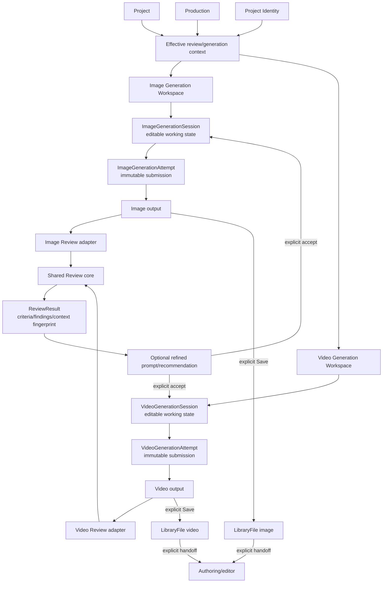

# GENERATION_SESSION_AND_REVIEW_ARCHITECTURE_CONVERGENCE_V1

Status: complete — architectural discovery and migration planning only.

This document records the current architecture at `origin/main` `8424e6921db9798e2b7fc78635cc8276a7a21234` and a bounded migration direction. It does not implement a Generation Session, alter a database schema, run a migration, change a route, change autosave, refactor Review, implement Video Review, or invoke a paid provider.

## 1. Scope and evidence boundary

The worktree used for this discovery is:

```text
D:/Traycer/worktrees/fmultiman__content-studio-ai/discovery-generation-session-review-convergence-v1
branch: discovery/generation-session-review-convergence-v1
```

The protected historical checkout was not modified. TERRA performed bounded, read-only reconnaissance of Image Review, Project Identity, and the future Video Review boundary. SOL remained the only writer.

The repository has no `docs/discovery/generation/` directory. Related generation discoveries, including `GENERATION_DRAFT_AUTOSAVE_AND_RESUME_REGRESSION_AUDIT_V1.md`, are under `docs/discovery/creative-rendering/`. This document is therefore stored beside that established generation discovery so that the autosave evidence and this convergence decision remain discoverable together.

The Supabase project was inspected read-only. No rows were inserted, updated, deleted, migrated, or promoted, and no generation provider was called.

## 2. Executive decision

Image should adopt explicit Generation Session semantics. `ImageDraft` should not remain the authority for editable generation working state. The first target should be a media-agnostic domain contract with media-specific physical persistence: `ImageGenerationSession` and `VideoGenerationSession` may have separate tables and payloads while implementing the same lifecycle contract. A polymorphic physical table is not justified by the current codebase.

The canonical lineage is:

```text
Project + Production + effective Project Identity
              ↓
Generation Workspace
              ↓
Generation Session — mutable working state
              ↓ Generate
Generation Attempt — immutable submitted request
              ↓
Media Output — application-owned source media
              ↓ optional, advisory
Review / Evaluation — immutable analysis of Attempt/output
              ↓ explicit user action
refined prompt or motion suggestion → Session working state
              ↓ explicit user action
next Attempt
              ↓ explicit
LibraryFile promotion
              ↓ explicit
Creative Editor / authoring handoff
```

This preserves the established boundaries: generated media is not authored composition; `VideoGeneration` is not `VideoDraft`; Review is not Approval; and Library promotion or authoring handoff is explicit.

## 3. Current Image generation architecture

### 3.1 Product surfaces and routes

| Surface | Current authority and behavior |
|---|---|
| `/imagens` | Client generation and review workspace in `app/(dashboard)/imagens/page.tsx`. It owns local editable prompt, provider selection, current output, status, evaluation, and the draft autosave loop. |
| `/imagens/rascunhos` | Persisted `image_drafts` list/resume/delete hub. Cards link to `/imagens?draft=<id>`. The UI terminology still calls generation work a draft. |
| `/api/image-drafts` | GET list/one, POST create, PATCH full working-state replacement or Production link-only update, DELETE. It persists the whole workspace projection into `image_drafts`. |
| `/api/openai/generate-image` | Synchronous OpenAI image provider route. It validates model/prompt, calls the provider, stores base64 output in application storage when present, and returns storage metadata. |
| `/api/nanobanana/generate` | Asynchronous NanoBanana submit route. It creates an image-specific `generation_tasks` row and returns a task id. |
| `/api/nanobanana/callback` and `/api/nanobanana/status/[taskId]` | Callback/status lifecycle for the NanoBanana task. The browser polls, then stores a completed result in `images`. |
| `/api/prompts/generate-image-prompt` | Prompt-generation adapter. It accepts Project context and Identity and returns a generated image prompt. |
| `/api/prompts/translate` | Prompt translation support. |
| `/api/evaluate-image` | Image-only advisory evaluation endpoint. It calls OpenAI chat completion with the output image and a compiled Project context. |
| `/api/images/[id]/save-to-library` | Explicit Image output → `LibraryFile` promotion. It does not create authoring state. |
| image result UI | `components/images/image-result.tsx`: preview, Review display, explicit regenerate, download, Save to Library, and the separate user Approve action. |
| generation history UI | `components/images/generation-history.tsx`: renders `generation_attempts` JSON stored in the ImageDraft. |

### 3.2 Current state ownership

The current Image system has several authorities for one conceptual flow:

| State | Current owner | ID/lifecycle | Project/Production relationship | Output relationship | Review relationship |
|---|---|---|---|---|---|
| Editable prompt and controls | React state in `/imagens`, persisted as `image_drafts` | `image_drafts.id`; created lazily on autosave | `project_id` and required `production_id` on create; Production link is validated | `image_url` and `current_image_id` point to the current output | `current_evaluation` is mutable JSONB on the draft |
| OpenAI submission | Route-local request | No durable provider submission id or Image Attempt row | Provider route receives prompt/model only; no Project/Production lineage | Output becomes an `images` row after provider response | Review is later attached in browser state/history |
| NanoBanana submission | `generation_tasks` | Internal task id + external `task_id` | Nullable `project_id`; no Production id | Task has image URL; browser later writes `images` | No durable Review association |
| Generated image | `images` | `images.id`; each normal generation inserts a row; some flows update an existing row | `project_id`; no Production FK | Storage metadata and URL; optional later `LibraryFile.source_image_id` | Attempt JSON references `imageId`; no Review table |
| Attempt history | `image_drafts.generation_attempts` JSONB | UI-derived `attempt-${image.id}` or timestamp id; mutable with draft | Inherits the draft indirectly | `imageUrl` and optional `imageId` | Evaluation is nested inside the attempt record |
| Current result | React `currentImage` plus `image_drafts.current_image_id` | Current pointer can change | Inherits draft Project/Production | Can be explicitly saved to Library | Current Review is draft state, not historical Review |
| User decision | `images.status` | `draft`, `generating`, `approved`, `rejected` | Image has no Production id | Does not promote to Library automatically | Separate from evaluator `approved` boolean |
| Durable reusable media | `library_files` | `library_files.id`; created only by explicit Save | Project and optional Production scope | `source_image_id` identifies promoted Image | No Review link |

The most important asymmetry is that an Image output is a real row, but its immutable submission snapshot is only a mutable client-built JSON element inside `ImageDraft`. The database does not currently represent Image Attempt as a first-class lineage entity.

### 3.3 ImageDraft schema and persistence

`ImageDraft` is declared in `lib/types.ts:338-361`. It currently combines:

- user/project/Production scope;
- user input and generated prompt in English and Portuguese;
- prompt details;
- selected model and auto mode;
- current image URL and `current_image_id`;
- `image_status`;
- `current_evaluation`;
- `generation_attempts`;
- `current_attempt`.

The original table is created in `scripts/002_create_drafts_tables.sql:7-18`. Workspace fields were added by `scripts/010_add_image_draft_workspace_state.sql:3-8`, and `current_image_id` by `scripts/011_add_image_draft_current_image_id.sql`. The resulting table is a historical draft table that has gradually acquired session, output pointer, Review, and history responsibilities.

`app/api/image-drafts/route.ts:40-74` builds a full payload. PATCH replaces the working projection with no expected revision token (`:345-388`); POST validates the Production and Project relationship (`:211-236`). The route has compatibility fallbacks for missing historical columns (`:244-266`, `:360-379`), which is evidence of transitional schema pressure rather than a durable Session contract.

The autosave audit records an 800 ms debounce, no CAS, no single-flight/coalescing, no saved/error indicator, and best-effort ordinary async `beforeunload` behavior. `GENERATION_DRAFT_AUTOSAVE_AND_RESUME_REGRESSION_AUDIT_V1.md` classifies Image autosave and resume as PARTIAL.

### 3.4 Image generation attempt behavior

OpenAI generation starts by inserting an `images` row with `status='generating'` (`app/(dashboard)/imagens/page.tsx:1137-1168`), calls `/api/openai/generate-image`, and updates the same `images` row with provider/storage data (`:1170-1184`). NanoBanana creates a task, polls, uploads the provider result to application storage, inserts an `images` row, and then records a history item (`:889-1000`).

`recordGenerationAttempt` creates a JSON record keyed by `attempt-${image.id}` (`app/(dashboard)/imagens/page.tsx:854-887`). It uses the browser array length to derive the attempt number and replaces the existing entry when the same `imageId` is seen. A Review can later replace or append that entry (`:687-716`). This means the current history is useful for display but is not an immutable audit of the exact provider submission.

Regeneration creates a new image row in the normal OpenAI path (`app/(dashboard)/imagens/page.tsx:1202-1235`), but the history and Review still live in the mutable draft JSON. A failed provider call can leave an Image row in an intermediate state without a canonical Attempt failure record. NanoBanana has a provider task record, but that record is image-specific, lacks Production, and is not joined to `images` or an ImageDraft by a durable foreign key.

### 3.5 Provider and model selection

The current Image workspace selects among OpenAI models and NanoBanana versions. OpenAI route validation is in `app/api/openai/generate-image/route.ts:6-13` and `:27-43`; it sends the selected model, size, quality, and one output (`:55-67`). The route returns provider/model and storage metadata (`:121-132`) but no Attempt id, request fingerprint, or Project/Production snapshot.

NanoBanana receives prompt, aspect ratio, Project id, and model version (`app/api/nanobanana/generate/route.ts:21-35`, `:54-75`) and persists only task-oriented fields (`:112-126`). It has no client request id or provider submission fingerprint.

Prompt generation compiles Project context and Identity, but provider generation itself does not persist the effective context used for a submission. Future Attempts must snapshot the exact prompt and effective provider configuration at submit time.

### 3.6 Project and Production context

Image Draft creation requires a Production and proves that the Production belongs to the supplied Project (`app/api/image-drafts/route.ts:211-236`). The Image row itself has `project_id` but no `production_id`. Library Production scope is consequently derived from ImageDraft links and `generation_attempts` in `lib/library/production-scope.ts` and related migration `scripts/048_library_files_production_scope.sql`.

The evaluator receives `projectId` from the browser but does not use it to resolve authoritative Project or Production context. It accepts `context` and `identity` from the request after Identity shape validation (`app/api/evaluate-image/route.ts:48-96`). This is a historical coupling that must be removed before a shared Review core is trusted: the server must resolve Project/Production and freeze an effective context snapshot.

### 3.7 Autosave, hydration, and resume

`/imagens` loads an existing `image_drafts` row from the query parameter and hydrates prompt, model, current image, status, evaluation, and history. `/imagens/rascunhos` lists rows ordered by `updated_at`. The current behavior is resumable only after a save completes. A route exit inside the debounce/network window may lose the latest working state.

The target Session contract is defined in Section 11. Image should not receive a reliability fix that strengthens `ImageDraft` as a permanent authority if migration is the selected direction.

## 4. Current Video generation architecture

### 4.1 Product surfaces and route grammar

| Surface | Current authority and behavior |
|---|---|
| `/videos` | Hub for VideoDraft authoring history, VideoGeneration Sessions, and generation attempts. It does not make a generation into a VideoDraft. |
| `/videos/geracoes/[sessionId]` | Resumable Video Generation Workspace. It hydrates a Session, autosaves working state, lists attempts, and submits a new generation. |
| `/videos/rascunhos` | VideoDraft authoring hub. It lists/deletes VideoDrafts and opens `/creative-editor/video/[draftId]`; it is not a generation route. |
| `/creative-editor/video/[draftId]` | Canonical authoring surface for `VideoDraft` and `VideoScene`. It owns composition, timeline, canvas, and render preparation. |
| `/api/video-generation-sessions` | Lists user Sessions by Production or all. |
| `/api/video-generation-sessions/[id]` | GET, idempotent UUID PUT create, and CAS-guarded PATCH for mutable working state. |
| `/api/video-generations` | Submit/list generation Attempts. Session id is lineage only; the body contains the exact request to generate. |
| `/api/video-generations/[id]` | Read an Attempt and its provider/result state. |
| `/api/video-generations/[id]/sync` | Reconcile provider status where supported. |
| `/api/video-generations/[id]/save-to-library` | Explicit completed video output → `LibraryFile` promotion. |
| `/api/video-drafts` | CRUD for authoring `VideoDraft`; separate from generation Session APIs. |

### 4.2 VideoGenerationSession authority

`video_generation_sessions` is created by `scripts/049_video_generation_sessions.sql`. It has immutable user, Project, and Production scope and mutable `working_prompt` plus `working_config`. The TypeScript contract in `lib/video-generation/session.ts` describes a Session as mutable, resumable working state and explicitly separates it from an Attempt.

`PUT /api/video-generation-sessions/[id]` is idempotent create at a client-chosen UUID. `PATCH` replaces only working columns and uses `expectedUpdatedAt` CAS. A stale timestamp returns `409 SESSION_VERSION_CONFLICT` with the current Session. Project, Production, user, and id cannot be changed.

The V1 working state in `lib/video-generation/working-state.ts:36-43` includes `prompt`, a discriminated source reference (`generated` or `library`), and a media-specific selection containing connection, operation, model, duration, resolution, aspect ratio, audio, multi-shot, ASMR, audio prompt, and music prompt. `attemptToWorkingState` (`:65-106`) reconstructs a new working state from a historical Attempt without rewriting that Attempt.

### 4.3 Video Attempts and request snapshot

`video_generations` is created by `scripts/039_create_video_generations.sql:3-35` and extended by `scripts/049_video_generation_sessions.sql`. It stores Project/Production scope, mode, prompt, source image or Library id, provider/model, task id, status, exact `request_config`, provider/result/error metadata, storage, and optional `library_file_id`.

The POST route validates scope and source before any provider work (`app/api/video-generations/route.ts:45-120`). It computes a canonical request fingerprint and checks `clientRequestId` before credential/source/provider work (`:78-110`). It inserts a queued Attempt with the exact request configuration (`:259-293`), records Session lineage only when supplied, and never reads the Session as the authority for the request. This is the correct working-state/Attempt separation.

Idempotency is server-owned in `lib/video-generation/idempotency.ts:1-13`, with a SHA-256 request fingerprint (`:28-49`) and conflict/replay behavior (`:62-70`). A reused key never submits twice; a deliberate retry uses a new key. Provider and transport are server-resolved, and the client cannot forge them (`app/api/video-generations/route.ts:26-39`, `:73-76`).

The current provider adapter is connection/capability driven. REST and MCP transport are implementation details of the same Video generation Attempt. Provider acceptance, unknown submit outcome, callback/poll completion, error state, application storage, and explicit Library promotion are represented in `video_generations`.

### 4.4 Video source media, Project, Production, and Library

Video generation requires Project and Production on submission (`app/api/video-generations/route.ts:64-70`). I2V source media is either a generated `images.id` or a `library_files.id`; scope and availability are checked before provider submission. The output is application-owned media first. Save to Library copies/registers it explicitly and records `library_file_id`.

The Session itself stores only a source locator in working state. The Attempt snapshots the source identity and exact provider request. This is the model Image should converge toward.

### 4.5 Video autosave and resume

The Video Generation Workspace uses an 800 ms debounce, `executeSaveLoop` single-flight/coalescing, CAS, visible `Salvo`, `Salvando`, `Erro ao salvar`, and `Conflito` states. `flushSave` is awaited before generation (`app/(dashboard)/videos/geracoes/[sessionId]/page.tsx:387-408`, `:549-560`). Hydration loads the Session and attempts; unavailable model/connection selections are reconciled in memory with notice.

The existing audit classifies Video Session autosave as PASS and resume as PARTIAL: `visibilitychange`/`pagehide` invoke a best-effort asynchronous flush, and the SPA Back button calls `router.push` without awaiting the flush. Ordinary fetch during hard unload cannot provide a guarantee.

### 4.6 VideoDraft and VideoScene boundary

`VideoDraft` is declared in `lib/types.ts` with name, scenes, timeline, canvas, Project, and Production. `VideoScene` holds authored scene description, order, duration, movement, composition, element order/visibility, timing, and Library asset bindings. The authoring page persists these through `/api/video-drafts` and renders them through the Creative Editor pipeline.

The current `/videos` code comments and routing make the boundary explicit: generation never creates a VideoDraft; `/videos/rascunhos` opens the Creative Editor; completed generated media reaches authoring only through explicit Library promotion and media handoff. This boundary must remain fixed during Session convergence.

### 4.7 Current data observation

Read-only counts in the active Supabase project at discovery time were:

| Relation | Rows | Relevant relationships |
|---|---:|---|
| `image_drafts` | 29 | 24 have Production, 25 have Project, 12 have `current_image_id`, 13 have non-empty attempt arrays, 6 have current Evaluation |
| `images` | 26 | 24 have Project; current-image foreign references inspected had no orphan current pointers |
| `video_generation_sessions` | 1 | Project and Production scoped |
| `video_generations` | 10 | 0 have `session_id`; all 10 are legacy standalone Attempts, split 5 failed / 5 succeeded at inspection |
| `video_drafts` | 27 | 25 have Production, 26 have Project |
| `library_files` | 69 | 69 have Project, 24 have Production |

These counts are development/test data indicators, but the 24 Production-linked ImageDrafts and existing Library lineage mean “discard everything” is not a safe default. Migration planning must preserve any structurally valid record until an owner/retention decision explicitly classifies it as disposable.

## 5. Session comparison and target contract

### 5.1 Options evaluated for Image

| Option | Assessment |
|---|---|
| Keep and harden `ImageDraft` | Rejected as target. It mixes editable state, current output, mutable Review, and history; it lacks revision/CAS and first-class Attempt lineage. It can be a temporary compatibility adapter. |
| Rename/recast `ImageDraft` in place | Rejected as the first migration step. The name and table shape still encode accidental JSON history and draft semantics, and it would hide rather than remove the authority collision. |
| Introduce `ImageGenerationSession`, migrate/retire `ImageDraft` | **Recommended.** It follows the proven Video grammar while allowing an explicit adapter for valid historical drafts. |
| One polymorphic `GenerationSession` table | Not yet justified. It would force nullable/media-specific columns or a large opaque payload before Image and Video have identical physical needs. |
| Shared contract plus media-specific Session tables | **Recommended.** Share semantics and infrastructure; keep physical storage and payload validation media-specific. |
| Another architecture | No evidence in the current codebase supports a simpler or safer alternative. |

### 5.2 Proposed conceptual Session contract

The contract is conceptual and must not prematurely dictate one table:

```ts
type GenerationSession = {
  id: string
  mediaType: 'image' | 'video'
  userId: string
  projectId: string
  productionId: string
  status: 'active' | 'archived'
  workingStateVersion: number
  workingState: ImageWorkingState | VideoWorkingState
  latestAttemptId: string | null
  sourceRefs?: SourceAssetRef[]
  createdAt: string
  updatedAt: string
}
```

Shared semantics:

- stable Session id;
- immutable owner, Project, and Production scope;
- editable current working state;
- explicit schema/version marker;
- optimistic concurrency token;
- latest Attempt pointer as a convenience projection, never as the only history;
- creation/update timestamps;
- no implicit Library promotion or authoring mutation.

Media-specific payload:

| Image working state | Video working state |
|---|---|
| user input, generated prompt, translated prompt, prompt details, selected image provider/model, size/aspect/quality, reference image(s), optional style controls, current UI selection | prompt, operation, model/connection selection, duration, resolution, aspect ratio, audio/music/ASMR, multi-shot, motion/camera controls, start/tail/reference media, source locator |

The Session owns what the user is currently editing. It does not own immutable provider history, Review history, or authoring composition.

### 5.3 Recommendation for physical persistence

Use a shared domain interface and shared request/response semantics, with separate physical tables or media-specific projections:

```text
image_generation_sessions
video_generation_sessions
```

Both can expose the same conceptual lifecycle while retaining the exact payload validation each media type needs. A future general table may be reconsidered after both adapters have at least one stable production lifecycle, but V1 should not pay the cost of a polymorphic schema.

## 6. Attempt comparison and immutable submission contract

### 6.1 Current Image Attempt gaps

Image’s `GenerationAttempt` TypeScript type (`lib/types.ts:57-74`) contains attempt number, prompt, image URL/id, model, nested Evaluation, and timestamp. It does not contain provider snapshot, exact config, source identity, request fingerprint, client idempotency key, provider id, status/failure, usage, or a durable session id. Attempt ids and numbers are UI-derived; an evaluator can overwrite a history item in place.

The current Image flow therefore does not guarantee that editing the prompt after generation leaves the prior submitted request historically exact. The prompt copied into `generation_attempts` is a useful approximation, but its enclosing record is mutable draft state and can be replaced by a later save.

### 6.2 Current Video Attempt strengths

Video already has most canonical Attempt semantics:

- durable `video_generations.id`;
- immutable Session lineage once assigned;
- submitted prompt and mode;
- provider/model/transport snapshot;
- exact `request_config`;
- source Image/Library identity;
- `client_request_id` and `request_fingerprint`;
- provider task id and metadata;
- lifecycle status and error/outcome-unknown state;
- application-owned output and optional explicit Library promotion;
- created/updated timestamps.

### 6.3 Target Attempt contract

```ts
type GenerationAttempt = {
  id: string
  sessionId: string | null
  mediaType: 'image' | 'video'
  userId: string
  projectId: string
  productionId: string
  submittedPrompt: string
  submittedConfig: Record<string, unknown>
  provider: string
  model: string
  sourceAssets: SourceAssetSnapshot[]
  requestFingerprint: string | null
  clientRequestId: string | null
  status: 'queued' | 'submitted' | 'processing' | 'succeeded' | 'failed' | 'outcome_unknown'
  providerRefs: Record<string, unknown>
  outputIds: string[]
  failure: Record<string, unknown> | null
  usage: Record<string, unknown> | null
  createdAt: string
  completedAt: string | null
}
```

Fields that describe what was submitted, source identity, provider/model, exact config, lineage, and outcome are immutable after creation except for controlled lifecycle transitions and completion metadata. Session working state, current selection, prompt editing, and refined-prompt acceptance remain mutable Session state.

For Image, a first implementation may use an image-specific table and adapter rather than forcing all fields into the Video table. It must still emit the same semantic events and historical guarantees.

## 7. Working State versus Attempt

The rule to freeze is:

```text
User edits prompt
  → Session working state changes and autosaves

User clicks Generate
  → immutable Attempt snapshot is created
  → provider is called from the snapshot

User edits prompt again
  → Session changes
  → previous Attempt and output remain historically exact
```

Video follows this rule: Generate takes a complete request body, while Session id supplies lineage. Image currently violates it in three ways:

1. the draft JSON is both working state and history;
2. evaluator updates can replace an existing attempt record;
3. provider and request metadata are not stored with the image history.

The Image migration must introduce the Attempt boundary before or alongside route convergence. A Session migration without an Attempt migration would preserve the central ambiguity.

## 8. Autosave and resume reliability target

### 8.1 Required semantics

Both media workspaces should use the same reliability state machine, implemented through shared utilities where practical:

```text
dirty → scheduled → saving → saved
                    ├────→ retryable error
                    └────→ conflict
```

Required behavior:

1. Debounce edits at the existing 800 ms product baseline unless performance evidence changes it.
2. Use one keyed single-flight save loop per Session. New edits coalesce behind the in-flight request; there must never be two creates for one unsaved Session.
3. Create with an idempotent client-chosen Session id, then PATCH only working-state fields.
4. Send and enforce `expectedUpdatedAt` or a monotonic `workingStateVersion` on every update.
5. Reject stale writes with a conflict payload containing server state; never silently last-write-wins.
6. Keep a local dirty snapshot separate from the last acknowledged server snapshot. An old response must not mark a newer local state saved.
7. Expose last-save state and timestamp, plus retry and conflict recovery affordances.
8. On route transition initiated by the workspace, await a final flush before navigation. A failed/conflicted flush must block navigation only where losing the edit would be surprising; otherwise show a clear unsaved state and offer retry.
9. On `visibilitychange`, `pagehide`, and hard unload, attempt a best-effort flush. Do not claim guaranteed durability from ordinary fetch during unload; the guaranteed contract is debounce + explicit transition flush + acknowledged save before Generate.
10. Hydration must load the latest acknowledged Session and never reconstruct editable state from a mutable Attempt or a current output row.

### 8.2 Image target

Image should adopt the Video Session saver contract after it has a Session endpoint. It should not receive a second permanent `ImageDraft` autosave implementation. During migration, a compatibility adapter may translate the Session payload to `image_drafts`, but CAS and single-flight semantics must live at the Session boundary so the adapter cannot reintroduce last-write-wins behavior.

### 8.3 Video target

Video already satisfies single-flight, CAS, indicators, and pre-Generate flush. The next reliability mission should close the SPA route-exit gap and clarify unload guarantees. It should not change the Session/Attempt ownership model.

## 9. Current Image Review / Evaluation architecture

### 9.1 Entry and provider contract

The UI entry is `app/(dashboard)/imagens/page.tsx:639-679`. Review requires an image URL and generated prompt, normalizes the selected Project Identity, and POSTs user input, prompt, image URL, Project id, Project context, evaluation mode, Identity, and current attempt number.

`POST /api/evaluate-image` authenticates, validates the supplied Identity, resolves the user OpenAI execution, and compiles context (`app/api/evaluate-image/route.ts:34-96`). The system prompt at `:98-201` asks OpenAI chat completion to evaluate conceptual alignment, identity, composition, lighting, contrast, aesthetics, mode-specific priorities, and restrictions. It passes the image as OpenAI `image_url` with `detail: 'low'` (`:225-254`). The default model is `gpt-4o-mini` (`:8-10`), with an environment override (`:231-233`).

The output contract is a single object:

```ts
{
  score: number,
  approved: boolean,
  feedback: string,
  improvements: string[],
  refinedPrompt: string
}
```

The current route has no durable Review id, evaluator version, criteria array, context fingerprint, source hash, media subject reference, or persistence API. Parse failure falls back to score 75 and `approved: true` (`:281-303`), and missing fields are defaulted. This is unsuitable as the future shared Review authority until the result policy is made explicit.

### 9.2 UI and loop

`components/images/image-result.tsx:122-165` renders the evaluation. `:168-189` exposes Review only when enabled, no current Review exists, and the output is not generating. `generation-history.tsx:124-165` renders nested Review data for each JSON attempt.

The user may click “Usar prompt refinado” (`app/(dashboard)/imagens/page.tsx:740-755`). That action changes the current prompt, clears the current Review, increments a UI attempt counter, and requires a later explicit Generate. It does not call the provider automatically. This behavior is directionally correct, but the refined prompt is stored as part of mutable Evaluation JSON and has no explicit suggestion identity or context fingerprint.

### 9.3 Review versus user Approval

The evaluator’s `approved` boolean is an AI opinion. The UI’s “Aprovar” action updates `images.status='approved'` (`app/(dashboard)/imagens/page.tsx:1252-1305`). These are different decisions with the same word. A high Review score must never change the durable user/editorial approval state. The future UI and domain terms should rename the AI field to an advisory disposition or recommendation and reserve “approved” for explicit user/editorial workflow state.

### 9.4 Review coupling classification

Generic and reusable:

- authenticated owner and Project scope;
- deterministic context compilation pattern in `lib/context-compiler.ts:5-16`;
- normalized Project Identity;
- evaluator model/version metadata;
- advisory criteria, findings, recommendations, and optional refinement suggestion;
- immutable association to a media subject.

Image-specific:

- `/api/evaluate-image` route;
- OpenAI `image_url` input and low-detail image inspection;
- image composition, lighting, contrast, aesthetics, and conceptual checks;
- `ImageEvaluation` and nested `generation_attempts` shape;
- image prompt refinement wording;
- `images.status` and Image result UI.

Historical or accidental coupling:

- client-supplied Project context/Identity accepted by the evaluator rather than server-resolved Project/Production;
- no Production in the Review request;
- mutable Evaluation JSON inside a draft;
- evaluator attempt number coupled to generation attempt number;
- malformed model output defaulting to approval;
- current image URL rather than a durable Attempt/output subject;
- visual Identity tokens available to the schema but omitted from the image evaluation compiler;
- `approved` used for both advisory AI output and user decision;
- Review has no durable reproducibility fingerprint.

The smallest useful shared abstraction is a Review core with a media adapter, not a generic image/video component.

## 10. Project Identity in Review

The canonical schema is strict `schema_version=1` with optional zones (`lib/schemas/project-identity.ts:50-74`, `:123-158`). Normalization rejects malformed versions/structures and treats null/empty content as absent (`lib/project-identity-normalizer.ts:65-131`).

| Identity field | Available today? | Used by Image Review today? | Useful for Image? | Useful for Video? | Normalization / review note |
|---|---|---|---|---|---|
| `foundation.purpose` | Yes | Yes, via `buildImageEvaluationContext` | Conceptual alignment and meaning | Narrative intent and scene/motion alignment | Snapshot into Review context; do not treat as approval rule |
| `relationship.audience` | Yes | Yes | Audience fit and communication clarity | Audience fit, pacing, tone, and accessibility expectations | Same semantic field; media adapter maps criteria |
| `expression.visual_identity` | Yes | Yes | Primary visual-language criterion | Visual language, palette, atmosphere, and source-image faithfulness | Can be shared after normalization |
| `expression.voice` | Yes | No; intentionally omitted from Image evaluation compiler | Usually not useful for pixels except text-bearing images | Useful for spoken/text/audio review only when media includes those modalities | Keep optional and modality-aware |
| `governance.principles[]` | Yes | Yes | Positive identity criteria | Creative and narrative criteria | Review as contextual expectations, not hard policy unless explicitly classified |
| `governance.restrictions[]` | Yes | Yes; emphasized and may influence advisory `approved` | Avoided patterns and material incompatibilities | Avoided visual, motion, audio, or narrative patterns | Must be a contextual criterion; never silently approve or reject workflow |
| `practice.generation_preferences[]` | Yes | Yes, as preference not absolute rule | Prompt and style steering | Model/motion/audio preference steering | Useful input, weak scoring weight |
| `visuals.colors.*` | Yes; schema validated | No | Useful for color/palette alignment, but current compiler omits it | Useful for visual continuity and identity alignment | Decide whether to include in a versioned effective snapshot; do not claim current use |
| `visuals.typography.*` | Yes; schema validated | No | Useful only where generated image contains typography | Useful for text overlays or authoring handoff, less for raw video generation | Media adapter decides; current normalizer’s `hasContent` excludes visuals-only Identity |
| Project `context` | Yes, separate text field | Yes | Conceptual context | Narrative/creative context | Server must resolve from Project |
| Project `evaluation_mode` | Yes | Yes | Changes criterion weights | Could influence future Video review weighting | Treat as Review context, not approval |
| Production `title` / `intention` / `type` | Yes | No in current evaluator | Useful for editorial purpose and deliverable fit | Useful for pacing, format, and production intent | Must be added to server-compiled context only when product defines the semantics |

Recommendation: Project Identity becomes shared Review context **partially**. The stable semantic fields (`purpose`, `audience`, `visual_identity`, principles, restrictions, and preferences) can feed both adapters. Visual tokens can be V1-compatible future context, but their current omission and visuals-only normalization behavior must be resolved explicitly before relying on them. Identity guides evaluation; it does not approve media.

## 11. Shared Review framework and media adapters

### 11.1 Recommended core

Use one conceptual Review framework with media-specific adapters:

```ts
type ReviewContext = {
  projectId: string
  productionId: string | null
  projectContext: string | null
  productionContext: { title: string; intention: string; type: string } | null
  identitySnapshot: ProjectIdentity | null
  evaluationMode: string
  creativeIntent: string | null
  submittedPrompt: string
  generationSettings: Record<string, unknown>
  mediaType: 'image' | 'video'
  attemptId: string
  outputRefs: MediaSubjectRef[]
  contextFingerprint: string
}

type ReviewResult = {
  id: string
  subjectType: 'generation_attempt' | 'media_output' | 'library_file'
  subjectId: string
  evaluatorProvider: string
  evaluatorModel: string
  evaluatorVersion: string
  status: 'completed' | 'failed'
  overallScore: number | null
  criteria: ReviewCriterionResult[]
  strengths: string[]
  issues: string[]
  recommendations: string[]
  refinedPrompt: string | null
  contextFingerprint: string
  createdAt: string
}
```

The exact shape can change, but the following must be shared semantics:

- Review is advisory and versioned;
- Review attaches to an immutable Attempt/output subject;
- the effective Project/Production/Identity context is snapshotted or fingerprinted;
- evaluator provider/model/version is recorded;
- criteria are category-bearing rather than one opaque score;
- Review does not mutate Session, Attempt, output, Library, or Approval automatically;
- a refined prompt is optional and explicitly accepted by the user.

### 11.2 Criteria categories

The core should expose separate categories so a single score does not hide why a result failed:

1. Identity alignment — fit with Project Identity and declared creative language.
2. Prompt/intent adherence — whether the submitted concept was realized.
3. Media quality — general visual/technical quality.
4. Media-specific quality — image composition or video temporal/motion quality.
5. Context/production fit — useful where the Production intention is available and semantically defined.

Provider or policy errors belong to the generation/provider lifecycle, not to a ReviewResult criterion. Review may fail as an evaluation operation without changing the Attempt’s generation status.

### 11.3 Image adapter

The Image adapter maps an immutable Image Attempt and output to:

- image input and optional thumbnails;
- conceptual/identity/prompt adherence;
- composition, lighting, contrast, aesthetics, and text legibility when applicable;
- an optional refined image prompt.

It may initially call the current OpenAI vision path, but it must stop accepting caller-supplied context and must stop using malformed-output auto-approval. Existing `ImageEvaluation` can be an API compatibility projection during migration, not the shared persistence model.

### 11.4 Video adapter

Video Review remains future work. Its adapter must support factual requirements already present in discovery/backlog:

- native video input when the evaluator supports it, or an explicit sampled-frame fallback;
- temporal coherence and continuity;
- motion quality and camera behavior;
- pacing and scene progression;
- source-image faithfulness for I2V;
- temporal artifacting;
- speech/audio/music quality where applicable;
- audio-visual synchronization;
- timestamp/frame-range findings;
- motion prompt or actionable feedback rather than an image-only refined prompt.

The adapter must never stretch `/api/evaluate-image` into a video endpoint. Existing product discovery defers Video Native Evaluator/Temporal Review and identifies native temporal review as a later candidate, with sampled frames as a fallback. Generation completion must not wait for Review.

### 11.5 Future non-generation Review

| Subject | Classification | Rationale |
|---|---|---|
| Creative Editor static render | V1-compatible future | A generic media subject reference can support it later, but no V1 implementation is justified. |
| Creative Editor video render | V1-compatible future | It needs render-output snapshot/version semantics and possibly timeline-aware criteria; do not couple V1 to it. |
| Uploaded Library media | V1-compatible future | LibraryFile is already a durable media subject, but Review source ownership and user intent need a separate decision. |
| AI Generation Attempt/output | V1 required | This is the current Review use case and historical reproducibility need. |

The core should use a cheap generic subject reference (`subjectType`, `subjectId`, media metadata) rather than hardcoding a table name, while V1 keeps adapters and routes generation-focused.

## 12. Review subject recommendation

Review should attach primarily to `GenerationAttempt` and its output reference, not to Session. A Session is mutable and can change prompt, model, source, and controls after a Review. A Review attached only to Session would become historically ambiguous.

Recommended relationship:

```text
GenerationAttempt 1 ──── * ReviewResult
GenerationAttempt 1 ──── * MediaOutput
ReviewResult ──────────── immutable subject snapshot/fingerprint
MediaOutput ───────────── optional LibraryFile promotion
```

The output reference is needed because Review analyzes the media. The Attempt is needed because Review must retain the exact submitted prompt/config/source lineage. A Review may include a generic media subject reference for future non-generation media without making LibraryFile the primary owner.

## 13. Refined prompt contract

`refinedPrompt` should become an explicit optional Review suggestion, with provider/evaluator metadata and the context fingerprint that produced it. It should not be the only Review payload and should not be written into Session automatically.

Required behavior:

1. Review produces `refinedPrompt` or a media-specific refinement recommendation.
2. The suggestion remains attached to the Review and its Attempt/output subject.
3. The user may accept, edit, or ignore it.
4. Accepting copies it into Session working state through an explicit action.
5. The existing Attempt is immutable.
6. A later Generate creates a new Attempt with a new request id/fingerprint.

For Video, a refined prompt may be a motion/audio/camera prompt or a structured recommendation. The core should permit an optional textual prompt plus media-specific recommendations without forcing Image and Video to share UI.

An independent `ReviewSuggestion` table is not justified for V1 unless product needs multiple user edits, expiry, or acceptance audit. A versioned optional field on ReviewResult plus an explicit accept event is the smallest useful shape.

## 14. Review versus Approval

This boundary is frozen:

| Review / Evaluation | Approval |
|---|---|
| AI-produced advisory analysis | Explicit user/editorial decision |
| May score criteria | May set workflow state |
| May suggest issues or refinements | May mark an output ready/approved where product supports it |
| Must retain evaluator/version/context evidence | Must retain actor/time/decision evidence |
| Never auto-approves | Never inferred from a score |

The current Image `evaluation.approved` should be migrated as an advisory recommendation field or deprecated compatibility projection. `images.status='approved'` remains a user decision until a future product decision changes it. Review must never write approval state.

## 15. Route convergence and terminology

### 15.1 Recommended routes

```text
/imagens
/imagens/geracoes/[sessionId]
/videos
/videos/geracoes/[sessionId]

/creative-editor/video/[draftId]
```

Image should eventually use `/imagens/geracoes/[sessionId]` so Image and Video have the same product grammar. `/imagens` remains the hub/entry surface; it can create or list Sessions and link to the workspace.

Video already uses the target generation route. `/creative-editor/video/[draftId]` remains the authoring route.

### 15.2 Fate of old routes

| Route | Recommendation | Reason |
|---|---|---|
| `/imagens/rascunhos` | Redirect or reframe as a historical compatibility list during migration, then retire the misleading route after links are migrated | Image records are generation Sessions, not authored drafts. A short-lived redirect preserves bookmarks while changing terminology. |
| `/videos/rascunhos` | Keep for authoring history | It is accurately a VideoDraft/Creative Editor hub. It must not be renamed to a generation route. |
| `/videos?draft=<id>` | Keep redirect compatibility for authoring links until external/internal links are migrated | Existing code already treats it as a legacy authoring redirect. |

### 15.3 User-facing Portuguese terminology

Use **Geração** for a resumable AI generation workspace and **Histórico de gerações** for Attempts. Use **Sessão de geração** only in technical/help text where the persistence concept matters. Reserve **Rascunho** for authored editable content such as `VideoDraft` and `VideoScene`.

Suggested labels:

- “Nova geração”;
- “Continuar geração”;
- “Histórico de gerações”;
- “Tentativa” for a submitted generation;
- “Revisão com IA” for advisory Review;
- “Aprovar” only for explicit user/editorial action;
- “Salvar em Arquivos” for Library promotion;
- “Abrir no Editor” for authoring handoff.

## 16. ImageDraft fate and migration strategy

### 16.1 Recommendation

`ImageDraft` should not remain the generation working-state authority. Introduce `ImageGenerationSession` semantics and migrate valid ImageDraft working state into Session records. Retain a temporary compatibility read/URL adapter only for the bounded migration window.

### 16.2 Migration classification

Migration must be record-preserving and classification-first:

1. Inventory all ImageDrafts by owner, Project, Production, current image, attempt array shape, evaluation presence, and last update.
2. Validate Project/Production coherence and referenced Image ids.
3. Convert structurally valid working state into an `ImageGenerationSession` payload.
4. Convert each structurally valid generation history entry into an Image Attempt where exact submitted fields can be proven. Mark incomplete history as legacy/imported with an explicit provenance flag; do not invent provider ids or config.
5. Convert nested Evaluation only as a compatibility/advisory projection unless a durable Review can be reproduced with a known subject and context snapshot. Preserve the original JSON during the migration window if needed for audit.
6. Preserve `images` rows and `LibraryFile.source_image_id` links. Never delete an output because its old draft was malformed.
7. Keep only one new Session authority. A compatibility route may read the Session and shape the old draft response, but writes must flow through the Session API.
8. After route and link migration, retire the compatibility API/table only under a separate cleanup mission.

### 16.3 Discard policy

Do not discard all test drafts. The current live data includes 24 Production-linked drafts and six evaluations. Discard is allowed only for rows that are proven disposable by explicit environment/owner policy or structurally invalid with no output, no Library linkage, and no recoverable working state. Invalid records with a media or Library relationship must be retained as quarantined legacy records until an owner decision.

### 16.4 Foreign keys and consumer dependencies

The migration must account for:

- `image_drafts.current_image_id → images.id` with `ON DELETE SET NULL`;
- `image_drafts.project_id → projects.id`;
- `image_drafts.production_id` and Production-scope derivation;
- JSON `generation_attempts[].imageId` references;
- `library_files.source_image_id → images.id`;
- `/imagens?draft=<id>` links and dashboard/Production cards;
- tests and helpers that query `image_drafts` for Production and output provenance.

No external stable contract currently proves that an ImageDraft id must remain the new Session id. The migration may preserve ids when safe, but it should not let identifier compatibility dictate the domain model.

## 17. Dead-code and legacy retirement map

| Area | Fate | Timing |
|---|---|---|
| `app/api/image-drafts/route.ts` full-state writer | Remove during Image Session migration | Replace with Session API; retain a read/redirect adapter only temporarily |
| `ImageDraft` domain type fields for mutable Review/history | Remove during migration | Replace with Session and Attempt/Review types |
| `generation_attempts` JSONB as authoritative history | Remove during migration | Preserve/import as legacy provenance only |
| `current_evaluation` JSONB as Review authority | Remove during Review extraction | Keep a compatibility projection while Review rows/API are introduced |
| `/imagens/rascunhos` generation UI | Temporary compatibility | Redirect/reframe, then retire |
| Image autosave hook tied to `image_drafts` | Remove during Session migration | Reuse shared Session saver |
| Image provider routes | Keep, adapt | Provider-specific execution remains media/provider-specific |
| `generation_tasks` | Temporary image provider compatibility | Keep only while NanoBanana callback lifecycle needs it; do not generalize to Video |
| `images` table | Keep | It remains generated Image output/source media authority |
| `LibraryFile` promotion route | Keep | Explicit promotion boundary is correct |
| `VideoDraft`, `VideoScene`, Creative Editor routes | Keep | Authoring domain; no convergence rewrite |
| `/videos/rascunhos` | Keep | Correct authoring terminology and entry point |
| `video_generations` standalone compatibility | Temporary compatibility | Preserve historical Attempts; new generation should use Session lineage |
| Image-specific evaluator endpoint | Temporary adapter | Keep behind a shared Review core until Image adapter parity is proven |

## 18. Target architecture



Shared domain contracts should cover Session lifecycle, Attempt lineage, autosave/CAS, context compilation, Review subject/result semantics, and explicit promotion/handoff events. Image and Video UI should remain media-specific. Provider adapters should remain provider-specific. Image controls such as aspect ratio/reference image and Video controls such as duration/motion/audio should not be forced into one giant form.

## 19. Implementation phasing

Each phase is independently testable and mergeable. No phase below is part of this discovery.

### Phase A — Shared contracts and invariants

- Define TypeScript conceptual Session, Attempt, SubjectRef, ReviewContext, and ReviewResult contracts.
- Define immutable versus mutable fields and context fingerprint rules.
- Extract shared autosave state-machine utilities without changing existing routes.
- Add contract-level tests only; no schema change yet.

### Phase B — Image Session persistence adapter

- Add `ImageGenerationSession` persistence and API with Project/Production scope, schema version, and CAS.
- Implement a compatibility adapter that can read existing ImageDrafts.
- Keep existing Image provider calls unchanged, but make a Session snapshot the source for new submissions.
- No route rename in this phase.

### Phase C — Image Attempt lineage

- Add a durable Image Attempt representation or equivalent append-only lineage owned by the Image adapter.
- Snapshot prompt, model/provider, exact image config, source references, client request id/fingerprint, status, output id, and failures.
- Keep `images` as output authority and preserve existing Library promotion.
- Prove edits after Generate do not mutate the Attempt.

### Phase D — Image route/workspace convergence

- Move resumable Image generation to `/imagens/geracoes/[sessionId]`.
- Keep `/imagens` as hub/create entry.
- Redirect/reframe `/imagens/rascunhos` and update internal links.
- Ensure Production pages create a Generation Session rather than an ImageDraft.

### Phase E — Autosave reliability hardening

- Apply shared single-flight, coalescing, CAS, route-transition flush, stale-response guards, indicators, conflict recovery, and resume tests to Image.
- Close Video SPA route-exit flush gap.
- Document hard-unload semantics as best effort rather than promising impossible guarantees.

### Phase F — Shared Review core and Image adapter

- Introduce server-resolved Project/Production context and immutable Attempt/output subject.
- Persist versioned ReviewResult with criteria categories and context fingerprint.
- Keep the Image adapter’s current provider/UI projection while removing malformed-output auto-approval and the client-context trust gap.
- Make refined prompt acceptance explicit Session mutation.

### Phase G — Video Review adapter

- Define native-video versus sampled-frame input based on an explicit provider capability decision.
- Add temporal criteria and timestamped findings.
- Keep generation completion independent from Review and keep Approval separate.
- Add Review UI to the Video Generation Workspace without touching VideoDraft/VideoScene.

### Phase H — Legacy retirement and migration cleanup

- Verify all valid ImageDrafts are migrated or intentionally quarantined.
- Remove old writers/hooks/routes/types according to the retirement map.
- Retain historical Video standalone Attempts and compatibility reads only for a measured window.
- Run a final dependency/route/data audit before dropping obsolete columns or tables.

## 20. Expected migrations

The target requires bounded data migrations, but none should run in this mission:

- introduce Image Session persistence;
- classify and migrate valid ImageDraft working state;
- import provable Image Attempt lineage and mark incomplete history as legacy;
- introduce durable ReviewResult persistence and migrate only reproducible existing Evaluations;
- preserve Image/Video outputs and Library links;
- attach new Video Attempts to Sessions while retaining legacy standalone Attempts;
- redirect old Image generation URLs;
- retire ImageDraft columns/table only after compatibility and data verification.

No migration should fabricate provider IDs, exact config, Review timestamps, or Project/Production context that is not present in the source row. Imported historical records need provenance and confidence markers.

## 21. Risk register

| Risk | Evidence | Mitigation |
|---|---|---|
| Image history is not immutable | Attempt JSON is mutable draft state; UI-derived ids/numbers | First-class append-only Attempt lineage before route hardening |
| Lost Image edits during migration | 800 ms debounce, no CAS, unload gap | New Session saver with CAS/single-flight; compatibility writes through Session boundary |
| Trusting client Review context | evaluator accepts context/Identity body; Project id unused | Server-resolve Project and Production; snapshot effective context |
| Review cannot be reproduced | no Review id/version/context fingerprint/source hash | Persist ReviewResult metadata and immutable subject |
| AI fallback auto-approves malformed output | evaluator route fallback score 75/approved true | Treat malformed output as Review failure or unscored result |
| Review and Approval confusion | evaluator `approved` versus `images.status='approved'` | Separate advisory disposition from user decision |
| Project Identity fields drift | visuals schema exists but compiler omits it; visuals-only normalizes absent | Version context compiler and explicitly decide modality use |
| Migration destroys useful development data | 24 Production-linked ImageDrafts, Library links | Preserve valid records; quarantine ambiguous records; explicit discard policy |
| Polymorphic table overreach | Image and Video payloads differ materially | Separate physical tables with shared contract |
| Video generation assumptions regress | Session/Attempt separation is already hardened | Treat Video as reference adapter; change only with parity tests |
| Provider replay or double billing | Image lacks idempotency; Video has it | Add client idempotency and request fingerprint to Image Attempt |
| Provider result URLs expire or are private | existing async provider paths and storage copy behavior | Make application-owned output part of Attempt completion before Library promotion |
| Creative Editor gets mutated implicitly | explicit handoff boundary already tested | Keep generated media source-first; require explicit Library/handoff action |
| Native Video Review is under-specified | temporal review deferred; sampled frames are not equivalent | Make input capability and timestamp findings explicit before implementation |

## 22. Stop conditions and implementation gates

The strict stop conditions for this discovery were not triggered:

- `ImageDraft` has no newly discovered Creative Editor/authoring semantics;
- no evidence required destructive migration of canonical production content;
- Image Review is coupled to an Image endpoint and mutable draft state, but it is bounded enough to extract through an adapter;
- Video Session assumptions in current main match the documented Session/Attempt split;
- Project Identity exposes enough stable semantic data for a partial shared Review context;
- no conflicting active migration was found that invalidates this direction.

The following are mandatory implementation gates, not reasons to implement them in this mission:

1. Decide and test server-authoritative Project/Production/Identity context for Review.
2. Decide whether visual tokens enter the Review context and fix visuals-only normalization semantics if needed.
3. Define malformed evaluator output behavior; no silent auto-approval.
4. Define durable Review versioning and subject fingerprints.
5. Choose native Video input versus sampled-frame fallback for the Video adapter.
6. Inventory and classify ImageDraft records before any destructive cleanup.
7. Confirm no active migration changes ImageDraft, Image output, Video Session, or Review assumptions before each implementation phase.

## 23. Future test strategy

### Session

- create with Project/Production scope;
- idempotent repeated create;
- schema-version validation;
- debounced autosave;
- single-flight/coalescing under rapid edits;
- CAS stale write rejection;
- stale response cannot mark newer state saved;
- route-transition flush;
- `visibilitychange`/`pagehide` best effort behavior;
- reload and resume after acknowledged save;
- Project and Production immutability;
- context loading and missing/deleted context behavior;
- Image and Video media-specific payload validation.

### Attempt

- immutable submitted prompt;
- immutable provider/model and exact configuration;
- source asset identity and scope validation;
- Session lineage is stable;
- request fingerprint and idempotency replay/conflict;
- provider task ids and completion;
- definitive failure versus outcome unknown;
- retry creates a new Attempt;
- result linkage and application-owned storage;
- explicit Library promotion only;
- editing Session after Generate does not change Attempt history.

### Review

- Image adapter input and output;
- Video adapter contract without stretching Image endpoint;
- server-resolved Project Identity and Production context;
- context fingerprint/reproducibility;
- identity alignment criteria;
- prompt/intent adherence;
- media quality and media-specific criteria;
- temporal/timestamp findings for Video;
- evaluator model/version persistence;
- malformed output is failed/unscored, never automatic approval;
- refinedPrompt is stored as optional suggestion;
- accept suggestion mutates Session only after explicit action;
- Review never mutates Attempt/output;
- Review never auto-approves;
- Review never auto-generates;
- generation completion does not wait for Review;
- Review survives later Session edits.

### Migration

- valid ImageDraft working-state migration;
- current image and attempt-image references;
- Evaluation preservation/provenance;
- Production/Project coherence;
- orphan/ambiguous record quarantine;
- Library source links preserved;
- discarded test record policy is explicit and auditable;
- `/imagens/rascunhos` redirects;
- old API compatibility adapter behavior;
- old dashboard/Production links;
- Video legacy standalone Attempts remain readable;
- no VideoDraft/VideoScene mutation.

## 24. Expected decisions A–L

| Question | Decision |
|---|---|
| A. Should ImageDraft remain generation working-state authority? | **NO.** It is transitional compatibility state only. |
| B. Should Image adopt explicit Generation Session semantics? | **YES.** |
| C. Should Image and Video have one physical Session table? | **NOT YET JUSTIFIED.** Use media-specific tables/projections under one contract. |
| D. Should they share one Generation Session contract? | **YES.** Shared semantics, media-specific payloads. |
| E. Should Attempt become immutable generation submission authority for both? | **YES.** |
| F. Should Review use one shared framework? | **YES.** A small versioned core, not one generic UI/provider. |
| G. Should Image and Video use media-specific Review adapters? | **YES.** |
| H. Should Project Identity become shared Review context? | **PARTIAL.** Stable semantic Identity fields yes; visual tokens require an explicit versioned decision. |
| I. Should Review attach primarily to Attempt/output rather than Session? | **YES.** |
| J. Should refinedPrompt be an explicit optional suggestion? | **YES.** |
| K. Should `/imagens` eventually use `/imagens/geracoes/[sessionId]`? | **YES.** |
| L. Should old `/rascunhos` terminology/routes survive? | Image route only as temporary redirect/compatibility; Video authoring route remains because it is semantically correct. |

## 25. Exact next implementation mission

`IMAGE_GENERATION_SESSION_AND_ATTEMPT_FOUNDATION_V1`

Mission boundary: implement only the Image Session and immutable Attempt foundation behind the current Image UI, including server-authoritative Project/Production scope, CAS/single-flight persistence contract, migration-read adapter, and tests for working-state versus Attempt immutability. Do not rename routes, extract shared Review, implement Video Review, or retire `ImageDraft` until that mission produces a verified migration inventory.

The following mission after that should be `IMAGE_GENERATION_ROUTE_CONVERGENCE_V1`, followed by `GENERATION_AUTOSAVE_RELIABILITY_HARDENING_V1`, then `SHARED_REVIEW_CORE_AND_IMAGE_ADAPTER_V1`, and only then `VIDEO_REVIEW_ADAPTER_V1`.

## 26. Completion marker

GENERATION_SESSION_AND_REVIEW_ARCHITECTURE_CONVERGENCE_V1_COMPLETE
