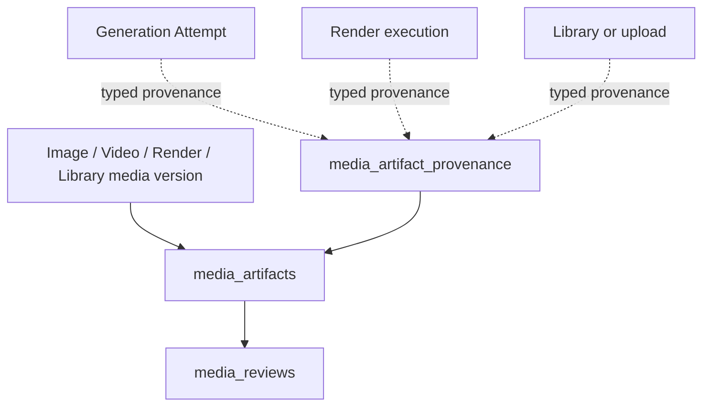

# UNIVERSAL_MEDIA_REVIEW_SUBJECT_FOUNDATION_V1

## Closure

- Starting `origin/main`: `ebb49748af321bc10ed92604dc43398907a05568`
- Branch: `feat/universal-media-review-subject-foundation-v1`
- Worktree: `C:/Users/flavi/.traycer/worktrees/fmultiman__content-studio-ai/feat-image-generation-session-attempt-foundation-v1`
- Architectural authority: `GEMINI_PROVIDER_AND_UNIVERSAL_MEDIA_REVIEW_PREFLIGHT_V1.md`
- Active Supabase project: `nuhdhnasuohizxtmyiju`
- Paid provider calls: **0**

This slice establishes an immutable media artifact subject for Review. It does not implement Gemini, Video Review, Creative Editor integration, or Library redesign.

## Final model

`media_artifacts` is the canonical subject. It identifies one immutable media version and stores owner/project/production scope, media type, storage provider/path, identity mode, identity fingerprint, version, MIME, byte size, and applicable dimensions/duration.

`media_artifact_provenance` records typed, scope-checked origins. The V1 schema supports image generation, video generation, render execution, Library, and upload provenance through real typed foreign keys. It deliberately does not use an unchecked `source_type + source_id` pair.

`media_reviews.media_artifact_id` is now required and is the canonical subject link. Existing Image Review FKs (`image_attempt_id`, `image_output_id`) remain during compatibility and provenance transition. The Attempt remains useful context; it is no longer the universal subject.

## Identity and hashing

New runtime Image resolution is server-owned. `resolveImageArtifact` accepts the validated Image output and Attempt context, validates the private storage path, reads the exact stored bytes, and computes SHA-256. It never treats a client URL, client hash, or client MIME as authoritative.

Artifact identity is scoped by owner, media type, storage provider/path, and version. Hash uniqueness is also owner-scoped; identical bytes are not globally deduplicated across users. The database protects identity fields with an immutability trigger. A changed file requires a new artifact/version.

The SQL backfill cannot read private object bytes. Existing bridged artifacts therefore use `identity_mode = 'legacy_storage_snapshot'`, preserve the server-known storage identity and media facts, and leave `content_hash` null. Their deterministic fingerprint is migration identity metadata, not a fabricated content hash. New runtime-created artifacts require `identity_mode = 'sha256'` and a real 64-character SHA-256.

## Migrations

Three additive migrations were applied in order:

1. `scripts/056_create_media_artifacts.sql` creates the artifact table, scoped identity indexes, RLS, scope validation, update timestamp, and identity immutability trigger.
2. `scripts/057_create_media_artifact_provenance.sql` creates typed provenance, typed foreign keys, shape/scope validation, uniqueness, RLS, and provenance immutability.
3. `scripts/058_extend_media_reviews_with_artifacts.sql` adds the artifact FK, creates legacy storage snapshot artifacts for existing eligible Image Reviews, attaches Image provenance, backfills all Review links, verifies reconciliation, then makes the link non-null and reinstalls Review scope/lifecycle guards.

No existing Review payload was rewritten. No Review was re-executed. No destructive migration was used.

## Reconciliation evidence

Read-only verification after migration on the active project:

| Invariant | Result |
| --- | ---: |
| Normalized Image Reviews before/after | 17 / 17 |
| Reviews with `media_artifact_id` | 17 |
| Unique artifacts linked by those Reviews | 13 |
| Typed Image-generation provenance rows | 17 |
| Backfilled legacy storage snapshots | 13 |
| SHA-256 artifacts from SQL backfill | 0 |
| Legacy-only outputless evaluation | 1, preserved outside normalized Reviews |
| Historical Attempts without evaluation | 5, remain Review-less |
| Discarded Reviews/evaluations | 0 |
| Library files after migration | 69 |
| Video generation rows changed | 0; migration is additive and Video Review is out of scope |

The 13-to-17 relationship is intentional: multiple historical Reviews can inspect the same immutable Image artifact. No duplicate Review rows were created.

## Runtime compatibility

`POST /api/reviews/image` remains the existing entry point. The Review service now resolves the server-owned Image output to a canonical artifact before creating the Review execution, includes the artifact in the request fingerprint, and persists `media_artifact_id`. Existing evaluator selection, strict result parsing, lifecycle, refinedPrompt, Approval isolation, and Library isolation remain unchanged.

The repository contract exposes `subject.artifactId` while retaining Image Attempt/output identifiers. Existing Image Review history remains readable. New Review execution does not write ImageDraft evaluation JSON. The one outputless legacy evaluation remains available through the bounded legacy compatibility path and is intentionally not fabricated into an artifact.

## Security and immutability

Artifacts and provenance have owner-scoped RLS SELECT policies; trusted server/service paths perform writes. Database scope triggers verify owner, Project, Production, Attempt, output, and typed provenance relationships. Review scope validation verifies that the artifact belongs to the Review owner, is an Image artifact for this current route, and agrees with existing Attempt/output lineage. Artifact identity and completed Review subject identity are protected by database triggers.

Resolver operations are idempotent: existing typed provenance is reused, an existing owner-scoped artifact identity is reused, and typed provenance uses a unique artifact/key constraint. Insert races re-query the canonical artifact instead of creating a second identity.

## Verification

Passed:

- focused Vitest: 3 files, 11 tests passed (`media-artifacts`, Review service, Review contracts);
- TypeScript typecheck (`tsc --noEmit -p tsconfig.typecheck.json`);
- ESLint (`pnpm lint`);
- `git diff --check`;
- Supabase table/RLS/trigger/count verification.

The focused tests cover SHA-256 calculation, trusted storage resolution, artifact creation, provenance reuse, cross-owner path rejection, and Review service compatibility through the resolver boundary. No provider was called.

The full Vitest suite and browser/Production smoke remain environment-dependent and were not used to justify paid execution. A safe authenticated smoke can verify existing Review history and artifact linkage without invoking the evaluator; no authenticated Production session was available during this closure.

## Residual debt and next mission

- Existing bridged artifacts need a future controlled rehash pass if exact byte hashes are required for historical snapshots; the current records remain auditable through storage provider/path/version and are explicitly marked legacy snapshots.
- ImageDraft evaluation JSON remains legacy compatibility data and is not deleted.
- Creative Editor render, generated Video, Library, and upload artifact creation are schema/provenance-compatible but intentionally have no runtime adapter in this slice.
- Review still uses the Image-specific API and adapter.

The exact next mission is `GEMINI_REVIEW_PROVIDER_FOUNDATION_V1`, which may add the official Gemini execution provider for Review only. It must reuse this artifact subject foundation and must not implement Gemini generation, Veo, Antigravity, or Video Review in this slice.
