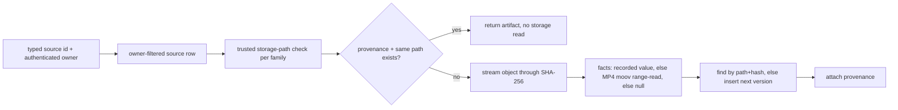
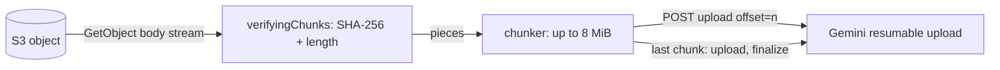

# VIDEO_MEDIA_ARTIFACT_AND_STREAMING_FOUNDATION_V1

## Closure

- Starting `origin/main`: `ecb9ccce055f3d9d504af1aad15651c04fe3ca75` (the mission brief quoted `ecb9ccc237…`; the prefix matches, the actual SHA is recorded here).
- Branch: `feat/video-media-artifact-streaming-foundation-v1`.
- Schema changes / migrations: **none**. The existing Universal Media Review schema (`056`/`057`/`058`) represents every required video artifact.
- Paid provider calls: **0** (Gemini, Kling, OpenAI, Nano Banana). Every transport and storage interaction in tests is mocked.
- Not in scope and not done: Video Review adapter, Video Review UI, provider picker, Review criteria/schema, any change to Video Generation / Creative Editor / Library behavior.

This slice adds two internal foundations the Gemini Video Review adapter needs and does not have today:

1. a server-side, owner-authorized, idempotent way to turn existing immutable video media into canonical `media_artifacts` (+ typed provenance);
2. a bounded-memory read path (S3 → verified stream → Gemini Files API chunks) so a video up to the existing 500 MB / 10 min caps is never held whole in process memory.

**No current UI or route invokes either.** Registration is a server primitive (`ensureVideoArtifact`) for the next mission's Review route; the streaming path is reachable only through a Review execution that provides a video artifact, and none exists yet. No user-facing flow changed.

## Audit: what actually existed

| Question | Finding |
|---|---|
| `media_artifacts` schema | Identity `(user_id, media_type, storage_provider, storage_path, content_hash)` unique where hash is non-null, and `(user_id, media_type, storage_provider, storage_path, version)` unique. `identity_mode` is `sha256` (hash required) or `legacy_storage_snapshot`. `mime_type` NOT NULL; `byte_size`, `width`, `height`, `duration_ms` nullable. Immutability and owner/Project/Production scope are enforced by triggers; RLS is owner-SELECT only, writes are service-role. |
| `media_artifact_provenance` | Typed FKs (`image_generation`, `video_generation`, `render_execution`, `library`, `upload`) with shape and scope triggers. Unique key is `(artifact_id, provenance_key)`; **`provenance_key` is NOT NULL with no default** (verified against the live Production schema). |
| Dedup rule | SHA-256 + exact storage key, per owner. Not hash-only: two objects with equal bytes at different keys are two artifacts (two physical objects). |
| Existing Image creation path | `lib/media-artifacts/image.ts` (`resolveImageArtifact`), whole-object read + hash, Attempt/output provenance. |
| Review authorization | `lib/reviews/media.ts` `resolveAuthorizedReviewMedia`: owner-filtered artifact lookup, trusted storage path per family, size/duration guardrails; client supplies only an artifact id. |
| S3 read helpers | `readS3Object` (`transformToByteArray`, whole object), `headS3Object`, `createPresignedReadUrl`, `copyS3ObjectToLibrary`. No streaming read existed. |
| Gemini Files API | `uploadFile` sent the entire `Uint8Array` in a single `upload, finalize` request; the review provider called `media.load()` (whole object) first. |
| Production data | 0 video artifacts existed (17 Image provenance rows from the 058 bridge). |

### Defect found in the shared provenance writer

`attachImageProvenance` upserted without `provenance_key` and with `onConflict: 'artifact_id,image_generation_attempt_id,image_output_id'`, a column list with no unique index. Against the real schema that statement cannot succeed (NOT NULL violation / no conflict target). It was latent: Image Review only reached it for a *new* image artifact, and every existing Review was bridged by migration 058 (which does write `provenance_key`), so the fast path returned first. Fixed here by routing it through the single new provenance writer (`lib/media-artifacts/provenance.ts`), which derives the key (`image_generation:{attempt}:{output}`, identical to the 058 backfill key so existing rows stay a no-op) and conflicts on `(artifact_id, provenance_key)`. No schema change was needed. This is the only Image-path change.

## Video source families

| Family | Real today? | Immutable boundary | Storage key | Facts available without reading the file |
|---|---|---|---|---|
| Video Generation output | Yes (`video_generations`) | Terminal `succeeded` row (CAS in `completion.ts`) + deterministic `{user}/videos/ai/{project}/{generationId}.mp4` | validated by `isTenantVideoStoragePath` | recorded size, mime; **no** duration/dimensions/hash |
| RenderExecution video | Yes (`render_executions`, `kind='video'`) | Terminal `completed` row (stale-attempt fenced) + deterministic scratch key `users/{user}/renders/scratch/{execution}/output.mp4` | validated by `validateVideoRenderLibrarySource` | worker-recorded size, duration, optional width/height |
| Library uploaded video | Yes (`library_files`, `kind='video'`) | the Library object key (user-writable claim, so re-proven) | validated by `isTrustedLibraryStoragePath` | `file_size`, `mime_type` |

All three exist, so none is a "no source path" case and nothing was invented. No family stores a SHA-256, so identity is computed by streaming the object once.

Render scratch is intentionally registered lazily (see below), not at worker completion: hashing hundreds of MB inside the worker-facing `complete` request would be wrong coupling. `Library save` of a render copies to a new Library key, which is a *different physical object* and therefore a different artifact whose provenance is the LibraryFile.

## Artifact identity

Unchanged contract: `identity_mode='sha256'`, `content_hash` = SHA-256 of the exact stored bytes, identity = `(owner, video, provider, path, hash)`. The legacy-snapshot mode is **not** used for video.

- Same object, any number of sources → one artifact.
- Different bytes later appear at the same key → a new artifact `version = max + 1` (the old row is immutable and stays), never an UPDATE.
- Lost insert race (`23505`) → re-query and converge on the canonical row.

## Provenance

`lib/media-artifacts/provenance.ts` is the single writer. Rows are separate from identity:

| Source | `provenance_kind` | typed FK | `provenance_key` |
|---|---|---|---|
| Video Generation | `video_generation` | `video_generation_id` | `video_generation:{id}` |
| RenderExecution | `render_execution` | `render_execution_id` | `render_execution:{id}` |
| Library upload | `upload` | `library_file_id` | `library:{id}` |
| Library (render saved / other) | `library` | `library_file_id` | `library:{id}` |
| Image generation | `image_generation` | attempt + output | `image_generation:{attempt}:{output}` |

Upsert is `ON CONFLICT (artifact_id, provenance_key) DO NOTHING`, so registration twice (or a repair after a crash between artifact insert and provenance insert) never duplicates a row. A provenance hit is only accepted if the artifact's `storage_path` still equals the source's current path, so a Library move cannot resurrect an artifact for a key that no longer exists.

## Registration flow — `lib/media-artifacts/video.ts`

- Input is a typed source id (`ensureVideoArtifact`) or a `ResolvedVideoSource` built server-side. There is no URL parameter anywhere; the browser never supplies a storage key.
- A foreign user's source is indistinguishable from a missing one (`SOURCE_NOT_FOUND`) and storage is never opened.
- Errors are normalized `MediaArtifactError` codes (`SOURCE_NOT_FOUND`, `SOURCE_NOT_READY`, `UNTRUSTED_STORAGE_PATH`, `STORAGE_UNAVAILABLE`, `SIZE_MISMATCH`, `STORE_FAILED`); messages carry no keys, buckets or credentials.
- A recorded size that disagrees with the stored object's length is `SIZE_MISMATCH` (the object is not the recorded one); nothing is created.
- Registration is lazy and idempotent and is **not** called from provider completion, the render `complete` route or Library save, so Review infrastructure can never make a generation, render or upload fail. Autosave/CAS, Kling, Creative Editor authoring and VideoDraft semantics are untouched.

### Factual metadata, never guessed

`lib/media-artifacts/mp4-metadata.ts` reads `moov` using header-sized ranged reads (walks top-level box sizes, so a trailing `moov` in a 500 MB file costs a few hundred bytes of header reads plus `moov` itself, capped at 8 MiB). It returns duration (`mvhd`) and the first video track's dimensions (`tkhd`). Anything unrecognised, truncated or oversized yields `null`. Facts already recorded by a trusted writer (worker `output_*`, Library `file_size`) are used as-is and trigger no probe. Duration of a Video Generation output or Library video that is not an MP4 with a readable `moov` stays `null`, and the Review guardrail then rejects it (fail closed), as the existing contract requires.

## Streaming architecture

- `lib/storage/s3.ts` `openS3ObjectStream(path, { range?, signal? })` returns the live Node body stream plus `contentLength`/`contentType`; it never calls `transformToByteArray`. Server-only, no URL input, no credentials leave the server, storage failures propagate. `readS3Object` is unchanged and still serves small images.
- `lib/media-artifacts/streaming.ts`: `sha256OfStream` (O(1) state) and `verifyingChunks`, which checks the exact length and, for `sha256` artifacts, the hash **when the stream ends**.
- `lib/reviews/media.ts`: video artifacts now expose `openStream()` returning `{ byteLength, chunks, abort() }` (verified, error-normalized, key-free). A video's `load()` now **refuses** instead of buffering, so there is no silent whole-object fallback. The trusted-path set gained exactly one entry: a render's own scratch key.
- `lib/providers/gemini/client.ts` `uploadFile` follows the official resumable protocol: `start`, then `upload` chunks at explicit `X-Goog-Upload-Offset`, last chunk `upload, finalize`. Chunk size is `GEMINI_UPLOAD_CHUNK_BYTES = 8 MiB` (the protocol's required granularity). The final chunk is only sent after the source has been drained to its end, so a hash/length failure aborts **before** finalize and no remote file exists. A source shorter or longer than declared fails without finalize. The whole-upload ceiling is `GEMINI_UPLOAD_TOTAL_TIMEOUT_MS = 600 s` (per-request timeout unchanged at 300 s). The legacy `bytes` form remains for small bodies and is one finalize request.
- `lib/providers/gemini/review-provider.ts`: video goes `openStream()` → `uploadFile` and never calls `load()`. Video media without `openStream` is rejected rather than buffered. On any upload failure the media stream is `abort()`ed (storage connection released).

### Memory behavior

- Hash path: one piece at a time.
- Upload path: at most one 8 MiB protocol chunk being assembled plus the next incoming storage piece (peak ≈ 2 × chunk; tests assert produced-but-unsent ≤ chunk + one piece while uploading 96 MiB). Bounded by chunk size, independent of file size.
- `Buffer.concat` is never applied to the object; the only concat is on ranged MP4 header reads (≤ 8 MiB `moov`).
- Old full-buffer path remaining: `readS3Object` and `AuthorizedReviewMedia.load()` remain, for **images** (≤ 15 MB) and the static-render output route only. Video cannot reach them.

## Authorization summary

1. Browser sends a typed id (source id or artifact id). Never a URL or key.
2. Server loads the row filtered by the authenticated owner (service-role client, explicit `user_id` filter); cross-user = not found.
3. Storage key must pass the family's trusted-path rule derived from the row's *own* owner/project, never from the key itself.
4. Only then is storage opened, and only for that key. No arbitrary fetch, no SSRF surface, no new public/presigned exposure, no RLS change.
5. Review authorization (`resolveAuthorizedReviewMedia`) re-verifies owner, path, kind, limits and (while streaming) length + hash.

## Guardrails preserved

`REVIEW_VIDEO_MAX_BYTES` (500 MB), `REVIEW_VIDEO_MAX_DURATION_MS` (10 min), and fail-closed unknown size/duration are unchanged and run before any storage read or upload; the stream's own byte length is re-checked before upload. Limits were not widened.

## Tests (all mocked; no provider, S3 or DB contact)

- `media-artifacts/__tests__/video.test.ts` — Video Generation creation, factual-null metadata, idempotency, crash-repair, concurrent convergence, insert-race recovery, version bump, size mismatch, storage failure, not-ready; wrong-user for all three families; untrusted/foreign/traversal/URL keys for all three families (storage never opened); RenderExecution (recorded facts, selective probe, ineligible states, Production scoping); Library (upload/library provenance, ineligible kinds, moved key); 128 MiB object hashed in ≤ 1 MiB pieces without joining.
- `media-artifacts/__tests__/mp4-metadata.test.ts`, `streaming.test.ts` — container parsing (v0/v1, audio skipped, trailing `moov` via header reads), null on junk/oversize, O(1)-memory hashing, verifier hash/length/destroy behavior.
- `providers/gemini/__tests__/files-upload.test.ts` — chunking/offsets/commands, bounded memory over 96 MiB, exact-multiple finalize, short/long source, integrity failure before finalize, read failure, mid-upload provider failure normalization (no body/key leak), credential vs upload failure, host pinning, total timeout.
- `providers/gemini/__tests__/review-provider.test.ts` — video streamed without `load()`, no buffering fallback, stream released on failure/limit breach; existing image/Files-API behavior retained.
- `reviews/__tests__/media.test.ts` — streaming verified chunks, `load()` refusal for video, hash/length mismatch, key-free error normalization, abort, never-opened-for-foreign/untrusted/over-limit, scratch-key trust (own only).
- `storage/__tests__/s3-stream.test.ts` — live stream not materialised, inclusive range, abort signal, null/propagation.
- `media-artifacts/__tests__/image.test.ts` — updated for the corrected provenance writer. Existing Image Review tests are unchanged and green.

## Residual gaps / follow-ups

- **No caller yet.** The Video Review adapter (next mission) must call `ensureVideoArtifact` from its server route; until then production has 0 video artifacts, by design.
- **Duration for non-MP4 or fragmented/`moov`-less files** stays null (Review rejects). A fragmented-MP4 (`moof`) duration reader is not implemented.
- **Library move rewrites the object key** (`moveLibraryS3Object` copies then deletes): an earlier artifact for the old key becomes unreadable at Review time and a move yields a new artifact on next registration. Not changed here (Library storage was out of scope).
- **Render scratch durability.** A scratch object is registered as-is; there is no scratch retention guarantee in this repo, so a Review of an old render may find the object gone (`REVIEW_OUTPUT_UNAVAILABLE`). Saving to Library gives a durable key.
- **Hash-at-registration cost.** Registering a large video reads it once end to end. It is lazy and idempotent, but a Vercel function timeout on a very large first registration is possible; a bounded reconciliation/backfill job is a documented future step and was deliberately not built or run (no historical Production data was touched).
- **Chunk retry/resume.** A failed chunk fails the upload; Gemini's `query` command is not used to resume. Acceptable for V1 (the remote file does not exist until finalize, so nothing leaks).
- `ensureVideoArtifact` has no HTTP route; adding one is an adapter-mission decision.
