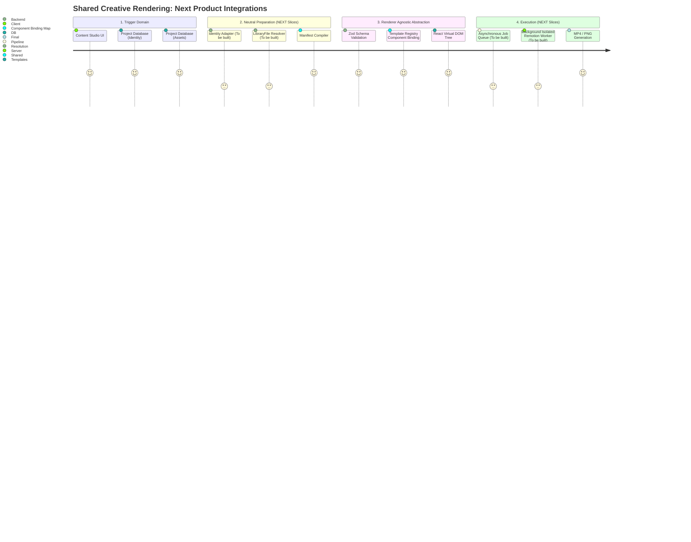

# Wave 10 — Final Spike Verdict & Productization Blueprint

**Date:** 2026-09-20
**Scope:** Final architectural audit and productization roadmap for the Shared Creative Rendering Spike.

---

## 1. Executive Verdict

**SPIKE:** `COMPLETE_WITH_CONSTRAINTS`
**ARCHITECTURE:** `APPROVED_WITH_CONSTRAINTS`
**NEXT PHASE:** `PRODUCTIZATION`

The Shared Creative Rendering Spike has proven its core hypothesis. A declarative, renderer-neutral domain model can successfully drive a shared array of React components to produce both static image (PNG) and temporal media (MP4) artifacts using the Remotion engine as a strictly isolated adapter.

## 2. Spike Graduation Decision

**Should Shared Creative Rendering become an official Content Studio subsystem?**
`APPROVE_WITH_CONSTRAINTS`

The spike should end. No further "proof" waves are necessary. The architecture is sufficiently validated to graduate from experimental research into systematic product implementation. The constraints are explicitly defined boundaries that must be resolved through standard product development (siloed asset buckets, identity integration, worker queues) rather than architectural research.

## 3. Final Implemented Architecture

```text
"O"?"?"?"?"?"?"?"?"?"?"?"?"?"?"?"?"?"?"?"?"?"?"?"?"?"?"?"?"?"?"?"?"?"?"?"?"?"?"?"?"?"?"?"?"?"?"?"?"?"?"?"?"?"?"?"?"?"?"?"?"?"?"?"?"?"?"?"?"?"?"?"?"?"?"?
"'                             CONTROL PLANE                                "'
"'  (Authoring State / Live Preview / Derived Manifests)                    "'
"""?"?"?"?"?"?"?"?"?"?"?"?"?"?"?"?"?"?"?"?"?"?"?"?"?"?"?"?"?"?"?"?"?"?"?"?""?"?"?"?"?"?"?"?"?"?"?"?"?"?"?"?"?"?"?"?"?"?"?"?"?"?"?"?"?"?"?"?"?"?"?"?"?"~
                                     "'
                     "O"?"?"?"?"?"?"?"?"?"?"?"?"?"?"?""?"?"?"?"?"?"?"?"?"?"?"?"?"?"?"?
                     -                               -
    StaticRenderManifest (v0)               TimelineManifest (v0)
                     "'                               "'
                     -                               -
   resolveStaticRenderManifest()           resolveTimelineManifest()
   - Validates template + props          - Validates sequence + tracks
   - Resolves Identity (Fixtures)*       - Resolves Identity (Fixtures)*
   - Resolves Assets (Fixtures)*         - Resolves Assets (Fixtures)*
                     "'                               "'
                     -                               -
    ResolvedStaticRenderInput               ResolvedTimelineInput
                     "'                               "'
                     """?"?"?"?"?"?"?"?"?"?"?"?"?"?"?""?"?"?"?"?"?"?"?"?"?"?"?"?"?"?"~
                                     -
    COMPONENT BINDINGS (Component Resolver) / TEMPLATE REGISTRY
    Mapping `component_key` ' React Props
                                     "'
                                     -
   TYPOGRAPHY READY BOUNDARY (`document.fonts` readiness + CSS injection)
                                     "'
                                     -
                   SHARED VISUAL TREE (React / DOM / SVG)
             (DocumentaryCard variants / QuoteCard variants)
                                     "'
"O"?"?"?"?"?"?"?"?"?"?"?"?"?"?"?"?"?"?"?"?"?"?"?"?"?"?"?"?"?"?"?"?"?"?"?"?"? "O"?"?"?"?"?"?"?"?"?"?"?"?"?"?"?"?"?"?"?"?"?"?"?"?"?"?"?"?"?"?"?"?"?"?"?"?
"'     STATIC REMOTION ADAPTER        "' "'     VIDEO REMOTION ADAPTER        "'
"'  StaticRenderManifestStill         "' "' TimelineComposition               "'
"'  (PNG output)                      "' "' (MP4 output)                      "'
"""?"?"?"?"?"?"?"?"?"?"?"?"?"?"?"?"?"?"?"?"?"?"?"?"?"?"?"?"?"?"?"?"?"?"?"?"~ """?"?"?"?"?"?"?"?"?"?"?"?"?"?"?"?"?"?"?"?"?"?"?"?"?"?"?"?"?"?"?"?"?"?"?
* Denotes integration boundary pending productization
```

## 4. Original Hypothesis vs Final Architecture

-   **Survived unchanged:** The flow from neutral manifests through declarative resolution to a shared React visual tree mapped to Remotion adapters was entirely preserved.
-   **Evolved:** Typography required an explicit wait boundary (`TypographyReadyBoundary`) to prevent Chromium from silently defaulting to system fonts. This boundary correctly envelops the component tree.
-   **Disproven:** None.
-   **Added by necessity:** A central `COMPONENT_BINDINGS` table in the resolver. A completely magical polymorphic component adapter was discarded in favor of explicit typed boundaries translating `component_key` payloads directly into proper React props per template. This is a healthier, more maintainable pattern.

## 5. Proven Capabilities

-   **FACT**: `StaticRenderManifest` securely bridges into Remotion and outputs the expected dimensional PNGs.
-   **FACT**: `TimelineManifest` bridges into Remotion, processes declarative template segments with correct arithmetics frames (`progress`, `localFrame`), and produces MP4s.
-   **FACT**: The Remotion libraries are strictly isolated, with no renderer imports found in neutral layers.
-   **FACT**: Polymorphic templates are supported (Documentary Card and Quote Card load from the same adapter using the component binding list).
-   **FACT**: Deterministic typography is proven in tested scenarios using offline OFL variable fonts, blocking renders on failure.
-   **FACT**: Authoring uses derived manifests combined with runtime-only visual tuning (overrides), keeping the base manifest pure.

## 6. Unproven / Deferred Capabilities

-   **FACT**: No connection exists between real `LibraryFile` records (or S3 objects) and the creative `AssetRef` pipeline.
-   **FACT**: Project Identity is hardcoded to memory fixtures. The `compileVisualIdentity` bridge from Project DB to `VisualTokensSnapshot` defaults are missing.
-   **FACT**: Audio tracks, caption pipelines, and motion variables like `pan` or `reveal` are un-implemented or fail natively by schema design.
-   **FACT**: The system lacks asynchronous production infrastructure (DB jobs, Queues, cloud workers).

## 7. Domain / Renderer Verdict

**Verdict:** `APPROVED`
**FACT**: The schemas (`lib/schemas/creative/**`) and resolution pipelines contain zero Remotion or Next.js leaks. Remotion functions purely as a stateless, downstream execution environment.

## 8. Template Registry Verdict

**Verdict:** `APPROVED`
**FACT**: Wave 9A proved the capability to map an abstract ID (`editorial.quote-card`) through to the appropriate template without contaminating the global Timeline or Static layout files. The abstraction is proven.

## 9. Static / Video Symmetry

**Verdict:** `APPROVED`
**FACT**: Identical component trees and primitives are shared across both manifests.
**RECOMMENDATION**: Do not unify `StaticRenderManifest` and `TimelineManifest`. While they share primitive building blocks, a video timeline and a static export represent fundamentally different media spaces. Keeping the top-level schema discrete preserves composability.

## 10. Authoring Verdict

**Verdict:** `APPROVED`
**FACT**: Live authoring previews (e.g. `DocumentaryCardPreviewTuning`) accurately segregate the raw manifest from ephemeral runtime overrides.
**RECOMMENDATION**: Current authoring isolation is healthy enough to start constructing the Portal-based editing interface without architectural compromise.

## 11. Timeline / Motion Verdict

**Verdict:** `APPROVED_WITH_CONSTRAINTS`
**FACT**: Semantic strings (`none`, `fade`, `slow_push`) successfully map to internal component transitions via progress fractions (0 ' 1).
**RECOMMENDATION**: Do not construct a global configuration language. Missing presets like `pan` and `reveal` should be added exactly as `slow_push` was: hard-coded CSS/scale evaluations inside particular template components reacting to the semantic generic `progress` prop.

## 12. Typography Verdict

**Verdict:** `APPROVED_WITH_CONSTRAINTS`
**FACT**: Wave 9B and 9C proved typography could be frozen deterministically preventing fallback.
**RECOMMENDATION**: A full font catalog interface is unnecessary BEFORE product graduation. The MVP should stick to supporting a small, static list of approved fonts stored within the cloud storage system and downloaded onto the worker.

## 13. Asset Model Verdict

**Verdict:** `APPROVED_WITH_CONSTRAINTS`
**RECOMMENDATION**: `AssetRef` and `ResolvedAsset` are perfect interfaces. The next immediate hurdle is creating the specific `resolve-asset` adapter connecting these structs to actual DB `LibraryFile` entries and minting short-lived Signed S3 URLs for Chromium.

## 14. Provenance Requirements

**INFERENCE**: The creative rendering layer needs only minimal tracking to function.
**RECOMMENDATION**: The MVP requires only a basic linkage: Source ID/URL, license class (e.g., `commercial`, `editorial`), and alt-text/caption. The renderer does not need legal logic, just display strings and valid URLs. Do not build a complex DAM yet.

## 15. Visual Primitive Strategy

**RECOMMENDATION (Pack B atomic pngs)**: Evaluate whether the newly created external transparent PNG assets (torn papers, archival bits) should be hosted within a dedicated S3/Supabase read-only bucket, rather than being placed in the `/public` static repo structure. A primitive resolver could fetch these exactly as it fetches dynamic user assets to centralize external dependencies.

## 16. Visual System Verdict

**Verdict:** `APPROVED`
**FACT**: The system seamlessly adapts across 4:5 and 9:16 environments.
**INFERENCE**: Visual styling imperfections and layout issues are now disconnected from renderer architecture.

## 17. Performance Verdict

**FACT**: Wave 8 reported ~117.8s per 6s (180 frames) 1080x1920 H.264 video on local execution.
**POSSIBLE CONTRIBUTORS**: Single-threaded Remotion limits, deep CSS software vectorization on local hardware, and cold webpack bundles are the most likely contributors, though not formally profiled yet. This metric does not disqualify the architecture.
**RECOMMENDATION**: DO NOT OPTIMIZE YET. The next metric must be benchmarking an 8-core Cloud worker with a warm Webpack bundle. Performance on local DEV environments is a false signal.

## 18. Testing Verdict

**Verdict:** `APPROVED`
**FACT**: Current testing isolates behavior brilliantly (e.g., AST boundary regex suites).
**RECOMMENDATION**: Scrub brittle local CLI mock testing once moving toward Production Background jobs. Integration tests for Supabase data resolving will be the highest upcoming priority.

## 19. Security / Execution Verdict

**Verdict:** `APPROVED FOR DEV ONLY`
**FACT**: Security boundary bridges (Next.js server-side `child_process.spawn`) apply strict parsing for the `AuthoringRenderRequest`.
**RECOMMENDATION**: This Node bridge MUST be entirely deprecated prior to a production rollout. Rendering requires total decoupled processes (Jobs/Containers) to avoid blocking the API server or experiencing arbitrary file execution.

## 20. Remaining Architecture Debt

| Debt | Severity | Type / Evidence | Impact | Recommended Timing |
| :--- | :--- | :--- | :--- | :--- |
| **Fixture-Only Assets** `resolveAsset` rejects real S3 | HIGH | FACT: `resolve-asset.ts` restricts | Will not render portal images | Immediate (Phase 1) |
| **Fixture-Only Identity** Cannot parse real projects | HIGH | FACT: Hardcoded strings | Will not brand portal materials | Immediate (Phase 1) |
| **Local Proxy Env blocking** dev-routes break | MEDIUM | FACT: `proxy.ts` breaks without auth | Fails new developer clone checkout | Immediate (Phase 1) |
| **Palette fallback `#0b1020`** | LOW | FACT: Hardcoded inside primitives | Reduces dark-mode contrast quality | Phase 2 (Identity polish) |
| **In-Component Asset resolving** (`torn-paper`) | LOW | FACT: `DocumentaryCard.tsx:95` | Bypasses asset descriptor | Deferred |

---

## 21. Spike Final Verdict

The Shared Creative Rendering Spike is **COMPLETE_WITH_CONSTRAINTS**.
The core structural architecture is verified and reliable. No further sandbox testing is required. Implementation can transition fully to Productization.

## 22. Productization Roadmap

The product integration phase should immediately follow these vertical slices (ordered by dependency):

1. **Subsystem Foundation (The Bridges)**
   Provide the `LibraryFile` S3 integration for `resolveAsset` and complete the Project Identity V1 Adapter to convert DB formats into the `VisualTokensSnapshot`.
2. **First Output: Static Export Worker**
   Establish the infrastructure. Build an event-driven `RenderExecution` PostgreSQL table and set up a background worker (or Remotion Lambda) just to execute static PNG manifest renders.
3. **Portal Authoring Integration (MVP UI)**
   Connect the frontend layout to dispatch static render requests to the new API. Use *Quote Card* and *Documentary Card*.
4. **Visual Primitive Strategy Cloud**
   Push Pack B transparent atoms to the system S3 bucket and implement the `PrimitiveResolver`.
5. **Video / Timeline Execution**
   Bring MP4 rendering to the background worker nodes. Re-test concurrency metrics.

## 23. Minimum Real Portal Production Slice

The smallest deployable unit allowing Content Studio to produce real results using this system must be divided into a local proof and production deployment:

**FIRST REAL PRODUCT INTEGRATION PROOF (Local):**
- `Quote Card` Single Template (simplest typography and layout logic).
- Basic `StaticRenderManifest` PNG generation using the existing local render paths.
- Connecting `LibraryFile` real-world asset resolution (S3 bucket reading).
- Real `VisualTokensSnapshot` mapping from project databases.

**PRODUCTION DEPLOYMENT REQUIREMENTS:**
- An asynchronous queue dumping generated PNGs into a persistent bucket, replacing the local Node execution bridge.

**Optional (Cut for V1 Product Launch):** Timeline MP4 renders, Documentary Evidence linking, Audio, Captions, Advanced Motion.

## 24. Production Infrastructure Timing

**When to investigate Production Cloud Renderers (Remotion Lambda / Cloud Run / Workers)?**
**AFTER** real asset integration (LibraryFile/S3) is complete and tested via standard CLI execution in development.
*Reasoning*: Moving the renderer into a Fargate container or Remotion Lambda without first building the Signed-URL S3 downloading mechanism guarantees the cloud test will fail or give inaccurate bandwidth metrics. Prove the data can move from the DB to the code locally first, then wrap it in the deployment infrastructure in order to get accurate cloud billing/throughput data.

## 25. Final Architecture Diagram



## 26. Immediate Next Action

Initiate Phase 1 of Productization: Implement compiling the actual Project Identity to `VisualTokensSnapshot`, and update `resolveAsset` to translate a real `LibraryFile` ID into an accessible S3 Signed URL.
