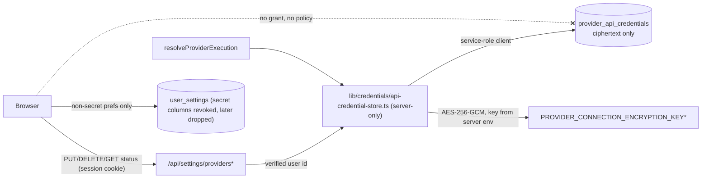

# FUTURE-059 — BYOK credential storage and access hardening: architecture and migration design (Phase 1)

Status: **DESIGN ONLY — awaiting approval.** No code, migration, data change, rotation or provider call was made. Baseline `origin/main` `62279b1bae5956bb5824ee5c49c1b2d45fcdb0ef`. Audit authority: Traycer artifact `future-057-post-smoke-hardening-audit` (Part A). Extends `docs/architecture/AI_PROVIDER_CREDENTIALS_ARCHITECTURE_V1.md`.

**Secret handling.** This document contains no secret value. Discovery used source code, schema/constraint/grant/policy **metadata**, and aggregate counts only (no `SELECT *`, no key column read). Every test in this design uses dummy keys.

---

## 1. Current architecture and verified risks

### 1.1 Where each credential lives today

| Provider | Storage | Kind | Server consumers (all via `resolveProviderExecution` → `resolveProviderCredential`) | Configured users |
| --- | --- | --- | --- | --- |
| OpenAI | `user_settings.openai_api_key` (plaintext `text`) | API key | Prompt Assistance, image generation, translation, scene-prompt, feed-text, channel-piece body, legacy prompt/evaluator routes, default Review provider | 2 |
| Gemini | `user_settings.gemini_api_key` (plaintext) | API key | Prompt Assistance (Gemini models), Gemini Image/Video Review | 1 |
| NanoBanana | `user_settings.nanobanana_api_key` (plaintext) (+ non-secret `nanobanana_base_url`, `nanobanana_model`) | API key | `/api/nanobanana/generate` (user session) and `/api/nanobanana/callback` (service role, owner = `task.user_id`) | 1 |
| Kling REST | `user_settings.kling_api_key` (plaintext) | API key | `POST /api/video-generations`, `/api/video-generations/[id]/sync`, connection status (`lib/video-generation/connections.ts`) | 1 |
| Kling MCP | `provider_connections` (safe metadata) + `provider_connection_secrets` (**AES-256-GCM ciphertext**) | OAuth tokens | `lib/provider-connections/*` (`getValidAccessToken` is the only reader) | 1 connection |
| Replicate | `user_settings.replicate_api_key` (plaintext) | API key | **none** (no execution path) | 0 |

Counts are aggregate `COUNT(...) FILTER (WHERE col IS NOT NULL AND btrim(col) <> '')` over 4 users; no contents were read.

The five `*_api_key` columns are therefore **the live BYOK store, not legacy**. Platform keys (`OPENAI_API_KEY`, `KLING_API_KEY`) are a separate, gated `content_studio_credits` path (`platform-credentials.ts`) and are out of scope.

### 1.2 Code paths (exact)

- **Single read choke point:** `lib/credentials/provider-credentials.ts` `resolveProviderCredential` (called only by `lib/credentials/provider-execution.ts` `resolveProviderExecution`). 17 call sites across `app/api/*` and `lib/reviews/{service,video-service}.ts`. It reads the column named in `PROVIDER_SECRET_COLUMN` with **the Supabase client the caller passed** (user-session client in most routes; service-role client in `nanobanana/callback`, `reviews/*`) and **ignores the query error** (a failed read looks like "missing").
- **Status:** `getProviderConfigurationStatuses` (`GET /api/settings/providers`) and `getProviderConfigurationState` (Kling connection logic) select the secret columns with the caller's client and return booleans/`configured|missing|unavailable`. The statuses function also collapses a read error into "missing".
- **Write/remove:** `app/api/settings/providers/[provider]/route.ts` PUT (`upsert` plaintext) / DELETE (`update … = null`) through the **user-session client**; the response contains only `{provider, status}`.
- **Browser:** the three client files that read `user_settings` (`configuracoes/page.tsx`, `imagens/page.tsx`, `theme-preference-bootstrap.tsx`) select explicit non-secret columns; the Settings `upsert` payload contains no key column (source-scan tests assert no wildcard select). `lib/types.ts` `UserSettings` still **declares** the key fields (type-level exposure).
- **Execution-environment backstop:** `assertProviderExecutionAllowed` runs inside `resolveProviderExecution` before any secret is released (FUTURE-050).

### 1.3 Database facts (production metadata)

| Object | RLS | Policies | `anon` | `authenticated` | `service_role` |
| --- | --- | --- | --- | --- | --- |
| `user_settings` | on | 4 own-row (`auth.uid() = user_id`) | all table privileges, incl. TRUNCATE/TRIGGER | all table privileges, incl. TRUNCATE/TRIGGER | all |
| `provider_connections` | on | 1 (select own) | none | `SELECT` | all |
| `provider_connection_secrets` | on | **none** | none | none | all |

Constraints on `provider_connections` (live): `provider = 'kling'`, `connection_method = 'mcp_oauth'`, `status ∈ {connected, authorization_required, error}`, unique `(user_id, provider, connection_method)` — the table cannot hold API-key rows without weakening these checks.

### 1.4 Verified risks

| # | Risk | Class | Severity |
| --- | --- | --- | --- |
| R1 | The authenticated owner's **browser JWT can `SELECT` their own key columns** through PostgREST (row policy allows own row; column privileges are table-wide) | Architectural | **High** |
| R2 | Keys are **plaintext at rest** (DB, backups, PITR, anyone with SQL/service-role access) | Architectural, documented | Medium–High |
| R3 | Table-wide default grants (incl. `anon`, `TRUNCATE`) — protection is RLS-only | Defense-in-depth gap | Medium |
| R4 | Keys share a row/type with preferences; one `select('*')` or generic type use leaks them | Architectural | Medium |
| R5 | `resolveProviderCredential` swallows read errors → an outage looks like "not configured" | Correctness/UX | Low |
| R6 | Replicate column exists with no consumer | Hygiene | Low |
| R7 | One owner's keys were printed into agent/tool transcripts by a `select *` (previous mission) | **Confirmed disclosure to tooling logs** | Medium → rotate (owner action) |

**Not found:** cross-user access, a secret in an API response, a secret in application logs, a secret in the repo/docs, or a client path that selects a key column.

### 1.5 What already exists and should be reused

`lib/provider-connections/crypto.ts` — AES-256-GCM via `node:crypto`, versioned/key-id'd token `v1.<keyId>.<iv>.<tag>.<ciphertext>`, AAD binding, a keyring (`PROVIDER_CONNECTION_ENCRYPTION_KEY`, `_ID`, `_PREVIOUS`, `_PREVIOUS_ID`), typed errors that never expose crypto internals. `token-store.ts` — server-only persistence, service-role client, monotonic `secret_version`, "database failure ≠ no secret". `provider_connection_secrets` — RLS on, **no policies, no client privileges** (verified live), proving the pattern works in this project. A key is configured in Production (the Kling MCP secret row exists).

---

## 2. Target security architecture



Guarantees: (1) credentials encrypted at rest with a key that never lives in the database; (2) decryption only in the server module, only with a server-verified `userId`; (3) the browser role has **no privilege** on the ciphertext table and, after containment, none on the legacy key columns; (4) APIs return `{provider, status, updatedAt}` only; (5) the key is never sent to the client; (6) the user's own credential is the only one used (`user_byok` never falls back to a platform or another provider credential); (7) ownership is enforced by the verified `userId` argument **and** by the AAD (`api-credential:<userId>:<provider>`), so a ciphertext copied to another user or provider fails authentication.

### 2.1 Options considered

| Option | Verdict |
| --- | --- |
| Reuse the proven AES-256-GCM helper + server-only table (recommended) | Key is outside the DB, so DB dumps/backups/PITR/SQL access cannot decrypt; no new cryptographic code; pattern already live |
| Reuse `provider_connections`/`provider_connection_secrets` | Rejected: live CHECKs pin `provider='kling'`/`mcp_oauth`; loosening them couples API keys to OAuth semantics and risks the working Kling MCP path |
| Supabase Vault / pgsodium | Rejected for now: decryption happens inside the DB (any SQL-capable role with vault access can read), more moving parts, less control over rotation |
| Cloud KMS envelope encryption | Valid later hardening (master key never in app env); needs new infrastructure; not required for this slice |
| Only revoke column privileges (keep plaintext) | Good **containment** (closes R1) but not a substitute for encryption (R2); included as an early slice |

## 3. Schema proposal (additive; applied in a later slice)

```sql
CREATE TABLE provider_api_credentials (
  id             UUID PRIMARY KEY DEFAULT gen_random_uuid(),
  user_id        UUID NOT NULL REFERENCES auth.users(id) ON DELETE CASCADE,
  provider       TEXT NOT NULL CHECK (provider IN ('openai','gemini','nano_banana','kling')),
  -- v1.<keyId>.<iv>.<tag>.<ciphertext>; plaintext = JSON {"v":1,"secret":"..."} so fields can be added later.
  -- AAD = "api-credential:<user_id>:<provider>"
  ciphertext     TEXT NOT NULL,
  key_id         TEXT NOT NULL,                 -- non-secret copy of the key id (rotation queries without decrypting)
  secret_version INTEGER NOT NULL DEFAULT 1,    -- bumped on every rewrite; CAS for the rotation job
  source         TEXT NOT NULL CHECK (source IN ('user_entry','legacy_backfill')),  -- provenance, non-secret
  created_at     TIMESTAMPTZ NOT NULL DEFAULT NOW(),
  updated_at     TIMESTAMPTZ NOT NULL DEFAULT NOW(),
  CONSTRAINT provider_api_credentials_one_per_user_provider UNIQUE (user_id, provider)
);
ALTER TABLE provider_api_credentials ENABLE ROW LEVEL SECURITY;      -- no policies
REVOKE ALL ON TABLE provider_api_credentials FROM PUBLIC, anon, authenticated;
GRANT SELECT, INSERT, UPDATE, DELETE ON TABLE provider_api_credentials TO service_role;
```

- **Provider identifiers** match `AiProvider` (`openai`, `gemini`, `nano_banana`, `kling`). `replicate` is deliberately excluded (no consumer, no configured user) — retirement needs approval (see §12).
- **Status/last-updated:** `updated_at`/`created_at`/`source`; the API exposes `updatedAt` only. No key hint (last four characters) is stored in the clear.
- **Kling MCP stays where it is.** `nanobanana_base_url`/`nanobanana_model` are non-secret preferences and stay in `user_settings` (the base URL is currently stored and returned only, not used for outbound calls).

## 4. Server-only helper API (`lib/credentials/api-credential-store.ts`)

Narrow, audited, imported only by `provider-credentials.ts` and the settings write route (enforced by a source-scan test; added to the service-role allow-list in `credential-boundary.test.ts`):

- `readApiCredential({userId, provider}) → {status:'configured', secret} | {status:'missing'}` — throws typed `CredentialStoreUnavailableError` (DB error) or `CredentialUnreadableError` (decrypt failure); never returns/logs ciphertext or plaintext in errors.
- `writeApiCredential({userId, provider, secret, source})` — validates (trimmed, non-empty, ≤512 chars, no whitespace/control characters), encrypts with the current key, upserts; `source='legacy_backfill'` uses insert-on-conflict-do-nothing and never overwrites a user entry.
- `removeApiCredential({userId, provider})`, `getCredentialStatuses(userId) → Record<provider, 'configured'|'missing'> | 'unavailable'` (selects `provider, updated_at` only — never `ciphertext`).
- All use `createServiceRoleSupabase()` (inherits the FUTURE-050 local-runtime guard). The caller must pass a **server-verified** user id (the session user, or `task.user_id` from the database in the NanoBanana callback) — never a request value.

`resolveProviderCredential`/`getProviderConfigurationStatuses`/`getProviderConfigurationState` keep their public signatures (the `supabase` argument becomes unused for secrets), so none of the 17 call sites change.

## 5. Encryption key lifecycle

- **Reuse the existing keyring** (`PROVIDER_CONNECTION_ENCRYPTION_KEY`, `_KEY_ID`, `_KEY_PREVIOUS`, `_KEY_PREVIOUS_ID`): one master key lifecycle, domain separation by AAD. (A separate key for API credentials is a possible variant — decision in §12.)
- **Production holds the key already** (a Kling MCP secret is stored). `isConnectionEncryptionConfigured()` is the readiness check; if the key is absent, writes/reads fail closed with `CONNECTION_ENCRYPTION_NOT_CONFIGURED` and no plaintext is ever written to the new table.
- **Environment rule:** credential **writes** require a production-class runtime (`classifyExecutionEnvironment() === 'production'`); the database is shared by Preview/Local, and a different key there would produce ciphertext Production cannot read. Preview/Local reads are not needed (provider execution is disabled outside Production).
- **Rotation:** set the new key as current with a new id and move the old one to `_PREVIOUS`; reads select the key by the id in the token; a server job re-wraps rows where `key_id <> current` using `UPDATE … WHERE secret_version = <read version>` (CAS) so it cannot clobber a concurrent user write. Remove `_PREVIOUS` only when a count query shows zero rows with the old `key_id`.
- **Key loss:** ciphertext becomes unreadable (fail closed, status `unavailable`/`PROVIDER_NOT_CONFIGURED`), users re-enter keys (BYOK is user-recoverable); Kling MCP needs re-authorization. Mitigation: the master key is kept in two controlled locations (Vercel production env + an offline secret store owned by the operator), recorded in the runbook; DB backups alone can never decrypt.
- **Never** log keys, plaintext or ciphertext from any module.

## 6. Privilege / RLS / PostgREST strategy

1. **New table:** RLS on, no policies, all client privileges revoked (the verified `provider_connection_secrets` pattern). PostgREST therefore returns nothing and no ciphertext reaches a browser.
2. **Legacy columns — containment before retirement.** Once no server code depends on the user-session grant (Slice 1), replace the table-wide privileges on `user_settings` with **column-level** grants; this keeps all non-secret settings working and is reversible by `GRANT`:

   ```sql
   REVOKE ALL ON TABLE user_settings FROM anon;
   REVOKE ALL ON TABLE user_settings FROM authenticated;
   GRANT SELECT (id, user_id, theme, studio_intensity, auto_mode_default, save_prompt_history, notifications_email,
                 notifications_browser, automation_enabled, default_image_model, image_evaluator_enabled,
                 max_refinement_iterations, nanobanana_base_url, nanobanana_model, created_at, updated_at)
     ON user_settings TO authenticated;
   GRANT INSERT (user_id, theme, studio_intensity, auto_mode_default, save_prompt_history, notifications_email,
                 notifications_browser, automation_enabled, default_image_model, image_evaluator_enabled,
                 max_refinement_iterations, nanobanana_base_url, nanobanana_model),
         UPDATE (…same list minus user_id…) ON user_settings TO authenticated;
   GRANT DELETE ON user_settings TO authenticated;      -- unchanged own-row deletion
   ```
   `service_role` keeps everything. `anon` needs nothing (every policy is own-row). TRUNCATE/TRIGGER/REFERENCES disappear for browser roles as a side effect.
3. **Consequences to handle:** a browser `select('*')` on `user_settings` now fails with *permission denied* (already forbidden by the existing source-scan test); the Settings `upsert` keeps working because it names only granted columns; **every future column added to `user_settings` must be granted explicitly** (a PGlite test enumerates columns and fails if one is neither granted nor in the secret list); the user-session client can no longer read the legacy secret columns, which is why server reads must move to the service-role store first.
4. **Retirement:** after verified cut-over, null the legacy values, then `DROP COLUMN` the five columns and remove the key fields from `lib/types.ts`.

## 7. Provider compatibility matrix

| Provider | Consumers affected | Free pre-cutover verification | Notes |
| --- | --- | --- | --- |
| OpenAI | 9 routes/services + Review | `GET /v1/models` (no tokens) | highest traffic; verify first |
| Gemini | Prompt Assistance, Image/Video Review | `models.list` (no tokens) | service-role callers already pass a service client |
| NanoBanana | generate (user) + callback (service role, owner key) | none documented → one authorized minimal smoke | callback must pass `task.user_id` from the DB; cannot use the session |
| Kling REST | video-generations create/sync, connection state | none documented → one authorized minimal smoke | `getProviderConfigurationState` keeps the `unavailable` distinction |
| Kling MCP | unaffected | existing connection check | already encrypted; no change |
| Replicate | none | n/a | retire column; no data to migrate |

## 8. Migration phases (zero-downtime)

Deviation from the draft order: **containment (revoking browser column access) is moved before encryption cut-over**, because it depends only on a server-only read path and closes the highest risk (R1) early. Approval requested in §12.

| Stage | What | Rollback |
| --- | --- | --- |
| **A. Foundation (no behaviour change)** | Add `api-credential-store.ts`; mode flag `PROVIDER_API_CREDENTIAL_MODE` (`legacy` default); in `legacy` mode the resolver/status/write read and write the **legacy columns through the service-role store** (plaintext at rest unchanged). Additive migration creates `provider_api_credentials` (empty). | revert code; table is empty/unused |
| **A′. Containment** | Apply the §6 column-level privilege migration. Browser JWT can no longer read key columns. | `GRANT` the columns back (no data change) |
| **B. Dual-read** | `PROVIDER_API_CREDENTIAL_MODE=dual`: read the encrypted row first; **only if no encrypted row exists** fall back to legacy (bounded, logged by code). A present-but-unreadable encrypted row **fails closed** (no silent fallback to an older plaintext key). | set mode back to `legacy` |
| **C. Backfill** | *Lazy migrate-on-read* in the Production runtime: when `dual` mode falls back to legacy, encrypt that value in-process and `INSERT … ON CONFLICT DO NOTHING` (`source='legacy_backfill'`), best-effort, never blocking the request, never logging a value. Completeness is measured by counts only (§9). With 4 users a one-off server-run sweep is optional; inactive accounts can alternatively re-enter keys. **No plaintext leaves the server process**: no script on a workstation, no value in migrations, CI output, logs, tool responses or docs. After the insert the code re-checks that the legacy value is still present; if the user removed it meanwhile the new row is deleted (prevents resurrecting a removed key). | delete `source='legacy_backfill'` rows; legacy untouched |
| **D. Dual-write** | Settings PUT writes encrypted **and** legacy for a short window; DELETE removes both. | mode back to `legacy` (legacy still current) |
| **E. Verify** | Counts show every configured legacy key has an encrypted twin; free provider checks (OpenAI, Gemini); one authorized minimal smoke each for NanoBanana and Kling REST; each active owner executes with its own key. Soak period with zero legacy-fallback events. | none needed (still dual) |
| **F. Encrypted-only** | `PROVIDER_API_CREDENTIAL_MODE=encrypted`: no legacy reads; writes encrypted-only and null the legacy column on replace/remove. Default in code becomes `encrypted`. | set `dual` (legacy values still present) |
| **G. Retire** | After the rollback window: null remaining legacy values, then `DROP COLUMN` the five key columns (and `replicate_api_key` earlier if approved); drop key fields from `lib/types.ts`; update the architecture doc. | restore from backup is the only path — hence the window |

**When legacy fallback must end (Stage F gate, all required):** (1) a counts query shows no user with a non-empty legacy key lacking an encrypted row; (2) zero `credential.legacy_fallback` log events for 14 consecutive days; (3) E verifications passed for every provider with an active user; (4) containment A′ has been live ≥ 7 days; (5) an operator confirms the master key is escrowed. Legacy columns are kept (unreadable by the browser) for a further 7-day rollback window before G.

**Deployment order:** migration (additive table / privileges) → code → env flag change, each separately; code that needs the table is never deployed before the table exists; flag changes are env-only (redeploy), so rollback is a flag flip.

## 9. Failure, rollback and monitoring

| Situation | Behaviour |
| --- | --- |
| Encryption key missing/invalid | reads/writes fail closed with a typed error; execution returns `PROVIDER_NOT_CONFIGURED`-class response; no plaintext written anywhere new |
| Decryption failure (wrong key id, tampering, AAD mismatch) | `CredentialUnreadableError` → status `unavailable`; **no fallback to legacy**; alert via log code |
| Encrypted row missing | `dual`: legacy fallback + lazy backfill; `encrypted`: `missing` |
| Store/DB outage | `unavailable` (not `missing`) — fixes R5; Settings shows a retry state instead of "not configured" |
| Concurrent updates | user writes are last-writer-wins on `(user_id, provider)` (each result is a valid user key); backfill never overwrites (do-nothing); rotation job uses CAS on `secret_version` |
| Interrupted backfill | idempotent per `(user, provider)`; partial state is valid because reads are per provider |
| Stale status | status is read from the store on every request (no cache); the Settings page refetches after save/remove |
| Wrong-user access | impossible by API shape (no request-derived id), AAD binding, and a source-scan test restricting the store's importers |
| Cut-over rollback | flag back to `dual`/`legacy`; legacy plaintext is still only server-readable (containment is not undone); no `GRANT` is restored |
| Partial provider migration | per-provider decisions are independent; the flag is global but the fallback is per row |

**Monitoring without secrets:** structured one-line logs with codes only — `credential.read outcome=encrypted|legacy_fallback|missing|unavailable|unreadable provider=<id>` and `credential.write outcome=ok|failed provider=<id>`; no user input, key, ciphertext or exception message. Readiness queries are counts only (`COUNT(*) FILTER`).

## 10. Test matrix (dummy keys / fixtures only; no real credential, no provider call)

| Area | Tests |
| --- | --- |
| Store | encrypt→store→read round trip server-only; ciphertext differs per write (random IV); AAD swap (other user / other provider / other row) fails; key-id selection with `_PREVIOUS`; missing or malformed key fails closed; typed errors expose nothing |
| Authorization | owner-only by construction; cross-user read impossible; NanoBanana callback uses the DB owner; source-scan: store importers limited to `provider-credentials.ts` + the settings route; service-role allow-list updated |
| PostgREST/PGlite | real migration against PGlite: `authenticated`/`anon` cannot `SELECT`/`INSERT`/`UPDATE` `provider_api_credentials`; after A′ they get *permission denied* for each legacy key column but can read/upsert every non-secret column; a "new column must be granted" completeness test |
| Settings API | PUT stores encrypted and returns only `{provider,status}`; DELETE removes; GET status is boolean/`unavailable`; response bodies and logs contain no dummy secret (substring scan); `nanobanana_base_url` still saved |
| Resolver/execution | all 17 call sites unchanged and compatible (existing route tests keep passing with a mocked store); `user_byok` never falls back to platform or another provider; `purpose: status_read` unaffected |
| Dual-read | encrypted preferred; fallback only when no encrypted row; unreadable encrypted row does **not** fall back; mode flag matrix `legacy|dual|encrypted`, invalid value ⇒ `legacy` until Stage F |
| Backfill | idempotent; never overwrites a user entry; removal race deletes the resurrected row; partially migrated accounts; writes no log containing a value |
| Rotation | re-wrap job with CAS; concurrent user write wins; `_PREVIOUS` removable when counts are zero |
| UI | Settings → API unchanged for configure/replace/remove; new `unavailable` state; no key ever rendered/prefilled |
| Rollback | flag flip returns identical behaviour; no `GRANT` is restored by rollback |

## 11. Proposed implementation slices

1. **Slice 1 — server-only access foundation** (no data movement, no migration): store module over the **legacy** columns via service role, mode flag, resolver/status/write routed through it, error-surfacing fix (R5), tests, allow-list. Risk low; rollback revert.
2. **Slice 2 — containment migration** (privileges only): §6 column-level grants + PGlite proof; verification by metadata queries; optional authorized live probe with a **dedicated test user and dummy value** (needs a non-production database — see §12). Rollback `GRANT`.
3. **Slice 3 — encrypted store + dual-read + lazy backfill + dual-write**: additive table migration, crypto reuse, status/write/remove, monitoring logs, tests.
4. **Slice 4 — verification and cut-over**: counts, free checks, authorized smokes, soak, flag to `encrypted`, default flip.
5. **Slice 5 — retirement**: null + drop columns, type cleanup, docs.
Each slice is its own PR with focused + full-suite validation; Slices 2, 3 and 5 contain migrations and need explicit approval at the time.

## 12. Risks and decisions requiring human approval

1. **Rotate first.** The keys exposed in a previous tool transcript should be rotated by their owner at the providers **before** Stage C, so the backfill does not encrypt compromised values (owner action; nothing here rotates anything).
2. **Master key:** reuse `PROVIDER_CONNECTION_ENCRYPTION_KEY` for API credentials (simplest, AAD-separated) or create a dedicated key (independent rotation, one more secret to manage)?
3. **Backfill method:** lazy migrate-on-read (recommended, no plaintext handling outside the runtime) vs a server-run sweep vs asking the few affected users to re-enter keys.
4. **Order:** approve moving containment (Slice 2) ahead of encryption cut-over?
5. **Replicate:** retire the column and Settings card (no consumer, 0 users)?
6. **Verification environment:** there is no staging database. Privilege behaviour is proven in PGlite; a live PostgREST probe against Production would require a dedicated test user with a dummy value in the production database — acceptable, or provision a Supabase branch/staging?
7. **Master-key escrow location** and who owns the break-glass runbook.
8. **Soak/rollback durations** (14-day fallback silence, 7-day post-cutover window) are proposals.
9. **Broader hygiene (separate mission):** default `anon` table grants across the project (incl. TRUNCATE) go beyond credentials.
10. **Stop condition status:** no step of this design requires reading any credential value; if a later slice finds it must, it stops and reports.

FUTURE_059_BYOK_CREDENTIAL_HARDENING_DESIGN_READY
