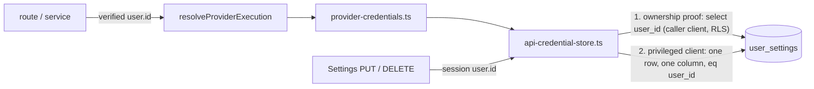

# FUTURE-059 Slice 1 — Server-only BYOK credential access foundation

Status: implemented and validated with mocks. **No** database migration, **no** grant or RLS change, **no** encryption, **no** backfill, **no** credential rotation, **no** provider call, **no** worker change. Design authority: `FUTURE_059_BYOK_CREDENTIAL_HARDENING_DESIGN_V1.md`. Baseline `origin/main` `dbaa7bd1babd720f035a1b4e7e25de69bee04141` (verified).

**What this slice does NOT claim.** Credentials are **not** encrypted. The five `user_settings.*_api_key` columns are still the live plaintext store. The browser role **still has column privileges** on those columns (PostgREST access is **not** revoked). Those are separate, pending milestones (Slice 2 containment, Slice 3 encrypted storage).

**What it does.** It makes the server the only code path that reads or writes those columns, using a server-side privileged client, so Slice 2 can revoke browser column grants without breaking any server feature. It also stops a database failure from being reported as "provider not configured".

## 1. Consumer audit (actual source)

All credential resolution funnels through `resolveProviderExecution` → `resolveProviderCredential` (`lib/credentials/`). Status and write endpoints are the two Settings routes.

| Provider | Storage | Server consumers | Client used for the secret read **before** this slice |
| --- | --- | --- | --- |
| OpenAI | `user_settings.openai_api_key` | channel-pieces/generate-body, evaluate-image, openai/generate-image (canonical + legacy), posts/generate-feed-text, prompt-assistance, prompts/generate-image-prompt, prompts/translate, videos/generate-scene-prompt, Review service (default evaluator) | browser-session client (RLS) in routes; `params.db ?? service role` in Review |
| Gemini | `user_settings.gemini_api_key` | prompt-assistance (Gemini models), Image/Video Review services | session client / Review `db` |
| NanoBanana | `user_settings.nanobanana_api_key` (+ non-secret `nanobanana_base_url`) | nanobanana/generate (session), nanobanana/callback (service role, owner = `task.user_id`, `purpose: status_read`) | session / service role |
| Kling REST | `user_settings.kling_api_key` | video-generations (create), video-generations/[id]/sync, `lib/video-generation/connections.ts` state | session client |
| Kling MCP | `provider_connection_secrets` (**AES-256-GCM**, service role only) | `lib/provider-connections/*` | unchanged by this slice |
| Replicate | `user_settings.replicate_api_key` | none (0 consumers) | — |

Direct reads of the key columns existed in exactly two places: `provider-credentials.ts` (resolve / status / state) and `app/api/settings/providers/[provider]/route.ts` (via `providerSecretColumn`). Browser code reads `user_settings` only with explicit non-secret column lists.

## 2. The boundary

New server-only module `lib/credentials/api-credential-store.ts` — the **only** file that names the key columns (enforced by `credential-boundary.test.ts`, now also covering `gemini_api_key`, previously missing from that scan).

1. **Owner id**: always a server-verified value (`supabase.auth.getUser()` in routes, the database row's `user_id` in the NanoBanana callback). The store rejects empty/padded/over-long ids and unknown providers (own-property lookup, so `__proto__` / `constructor` cannot select a column) with `CredentialAccessDeniedError`, before any query. No route reads an owner from the request; the Settings PUT test sends `userId`/`user_id` in the body and proves they are ignored.
2. **Ownership proof**: the caller's *own* client reads only the non-secret `user_id` of that row. A browser-session client sees only its own row (RLS), so a foreign id yields no row and **no privileged read happens**; a row for a different owner is refused. A service-role caller (webhook/background code that took the owner from our database) passes, exactly as before. The proof stays valid after Slice 2 because `user_id` remains a granted column.
3. **Privileged read/write**: `createServiceRoleSupabase()` (inherits the FUTURE-050 local-runtime guard). One row, explicit single column (`select(column)`; statuses select the five key columns and return booleans only), `.eq('user_id', owner)`. No wildcard, no multi-user query. Writes are an `upsert({user_id, <column>[, nanobanana_base_url]})` / `update({<column>: null}).eq('user_id', owner)` on the same privileged client — the browser-session client is no longer used for any secret column.
4. **Fail closed**: if the service-role client cannot be built (not configured, not permitted in a local runtime, malformed admin credential) the store throws `ProviderCredentialUnavailableError` — it never falls back to the browser-session client for secrets. Practical consequence: a local `next dev` without `CONTENT_STUDIO_LOCAL_SERVICE_ROLE_PROJECT_REF` shows Settings credential status as "Indisponível no momento" and cannot save keys; Preview/Production are unaffected (Preview cannot execute providers anyway).
5. **Encrypted-first seam**: `readStoredApiCredential` / `readStoredApiCredentialStatuses` / `writeStoredApiCredential` / `removeStoredApiCredential` are the only functions Slice 3 needs to change (encrypted row first, bounded legacy fallback). Their signatures and the resolver's public signatures do not change.

Importers are restricted by test: the secret-bearing functions may be referenced only by `provider-credentials.ts` and the Settings write route; a transitive import-graph test proves **no `'use client'` file can reach** the store, the resolver, `provider-execution`, `provider-credential-http` or the service-role factory (mutation-checked: a canary client file importing the resolver fails the test).

## 3. Missing vs unavailable vs denied vs malformed

| Situation | Before | Now |
| --- | --- | --- |
| No row / null / empty / whitespace | `missing` | `missing` (unchanged) |
| **Database read error** (proof or secret read) | **`missing`** (error ignored) | `ProviderCredentialUnavailableError` `reason: store_failure`, HTTP 503 `PROVIDER_CREDENTIAL_UNAVAILABLE` |
| Privileged client cannot be created | n/a | same error, `reason: store_client_unavailable` |
| Stored value is not a string | treated as `missing` | same error, `reason: malformed` |
| Unacceptable owner id / unknown provider / empty secret on write | n/a | `CredentialAccessDeniedError` (403 semantics) |
| Foreign owner id with a browser-session caller | RLS → `missing` | `missing`, **no privileged read** |
| Provider execution failure | unchanged | unchanged (outside the credential layer) |

Public contracts: `resolveProviderCredential`/`resolveProviderExecution` signatures are unchanged and `ProviderExecutionResult` gains **no** new union member — an unreadable store **throws**, so no call site can treat it as "not configured". `GET /api/settings/providers` keeps its shape; a provider's `status` may now also be `"unavailable"` (store failure, or a malformed value for that provider); the Settings card shows "Indisponível no momento". `getProviderConfigurationState` (Kling connection logic) keeps its existing `unavailable` contract and never throws for an unreadable store.

Call-site handling of the thrown error (no change to any "not configured" response):

- Routes with an outer `catch` (generate-body, evaluate-image, feed-text, generate-image-prompt, translate, video-generations create and sync, scene-prompt, OpenAI legacy) → controlled `503 { error, code: 'PROVIDER_CREDENTIAL_UNAVAILABLE', provider }` via `providerCredentialUnavailableResponse`.
- prompt-assistance: mapped at the resolver call (nothing recorded before it).
- OpenAI canonical image submit and NanoBanana generate: the **claimed Attempt is closed** (`failImageAttempt`, a pre-provider failure) and the route answers 503 — it is not left pending.
- Image/Video Review services: the Review row is closed as `provider_error` and the service throws `ReviewServiceError(503, 'REVIEW_STORE_UNAVAILABLE')`, not `REVIEW_PROVIDER_NOT_CONFIGURED` (which would have misreported the cause).
- NanoBanana callback: unchanged — any failure already answers a retryable 503 ("Retry later"), so the provider calls back again.

## 4. No secret in logs, errors or responses

The thrown errors carry a static, browser-safe message, a coarse `reason` and the provider id — no value, column, query text, database message or `cause`. Failures log one code-only line (`[credential-store] <op> unavailable reason=… provider=…`); a source test forbids any console line in the store that mentions a secret/row/value/ciphertext/`.message`. Tests plant a dummy key inside the fake database error message and assert it appears in no error, response or captured log.

## 5. Preserved behaviour

Settings → API (configure, status, replace, remove), including the NanoBanana base URL in the same atomic upsert; provider/model routing; `user_byok` never falling back to a platform key or another provider; execution-policy gating (FUTURE-050) and `status_read`; Kling MCP encrypted path (the store contains no reference to provider connections — tested); usage and cost accounting; FUTURE-057 automation. No model defaults, no UI redesign (one new status label).

## 6. Tests (dummy keys, in-memory fakes, mocked providers)

| File | Covers |
| --- | --- |
| `lib/credentials/__tests__/api-credential-store.test.ts` (45) | own-user read via the privileged client with the caller limited to `user_id`; one explicit column per provider; cross-user denial and caller-supplied id cannot redirect (reads and statuses); mismatching proof refused; bad owners/providers refused before any query; trusted service-role-style caller; missing variants; store failures for the proof, the read, and an uncreatable privileged client; statuses → `unavailable` (not `missing`); malformed values; `resolveProviderExecution` throws (never `provider_not_configured`, never a platform key); writes/removal (payload exactly the owner row + one column, base URL only for NanoBanana, empty secret refused, failures surface, fail closed without the privileged client); no secret/DB text in errors or logs; seams refuse to run outside vitest |
| `lib/__tests__/settings-providers-credential-boundary.test.ts` (10) | real routes over the real store: status-only GET, privileged vs session reads, `unavailable` on failure, auth required, PUT/DELETE through the privileged client for the **session** user (body `userId` ignored), failures answer static 500 with nothing leaked, fail closed without a privileged client |
| `lib/__tests__/credential-store-unavailable.test.ts` (27) | 6 routes × (503 + code, zero provider calls, Attempt closed where one was claimed, genuine "not configured" unchanged); static guard that every resolver call site handles the error |
| `lib/reviews/__tests__/credential-unavailable.test.ts` (3) | Review closed as `provider_error`, 503, evaluator not called; missing credential still 422; unexpected errors not swallowed |
| `lib/__tests__/credential-boundary.test.ts` (+7) | store is the only file with the key columns (now including Gemini); secret-bearing functions have two importers; no `select('*')` of `user_settings` anywhere; every store select is explicit; no secret-bearing log/error text; Kling MCP isolation; client import graph; the store exists |

Existing suites (≈33 files that mock `user_settings` through the caller's client) run unchanged: the shared vitest setup turns on a documented harness (`globalThis` flag, same pattern as the FUTURE-050 mocked-providers harness) under which the store reads through the caller's fake client; the security tests above switch it **off** and install a separate privileged fake. The setup file sets the flag directly rather than importing the store, because importing it there pre-loads the real service-role module and defeats other suites' `vi.mock`.

## 7. Validation

| Check | Result |
| --- | --- |
| Focused: store, settings, routes, reviews, boundary, provider guards | PASS |
| Typecheck | 0 errors |
| ESLint (changed files) | 0 errors, 0 warnings |
| Full suite (5225 tests / 285 files) | 5223 pass; 2 fail — `editor-workspace` and `static-parity` (`Estilo` vs source `Estilos`), pre-existing on clean main and unrelated. An earlier run under machine load showed timeouts that cleared with a raised timeout; one intermediate run found 4 files failing because of the setup-file import described above — fixed, not baseline |
| Production build (`next build --webpack`) | compiles (74 s); then trips the known `ImagesPageShell` page-export type check that also fails on clean main in this environment; Vercel is the authoritative build |

## 8. Migration, worker, data

None, none, none. No `scripts/*.sql`, no grant, no RLS policy, no environment variable, no data movement. Rollback: revert the PR; behaviour returns to browser-session reads (all data untouched).

## 9. Residual risks

- Browser/PostgREST column access to the key columns is **still open** (Slice 2). The owner's JWT can still `SELECT` their own keys.
- Keys remain plaintext at rest (Slice 3).
- The privileged client now serves every credential read: a service-role outage or misconfiguration makes credential status `unavailable` and provider calls 503 (previously the session client would have worked). Preview/Production already require the service role for other features.
- Two queries per resolution (ownership proof + secret read) instead of one; both are single-row indexed lookups.
- The ownership proof trusts the caller's client: a route that passes a **service-role** client together with a request-derived id would be authorized. No such route exists (guarded by review and the existing "no request-derived mode" scans), but this is an invariant of the callers, not something the store can verify.
- Local `next dev` needs `CONTENT_STUDIO_LOCAL_SERVICE_ROLE_PROJECT_REF` to manage credentials (intentional, FUTURE-050).
- Keys printed in an earlier tool transcript should still be rotated by their owner before Slice 3 backfill.

## 10. Prerequisites for Slice 2 (column-privilege containment)

1. This slice deployed and observed healthy in Production (Settings status and one authorized read path per active provider show no `PROVIDER_CREDENTIAL_UNAVAILABLE`).
2. Approval of the design's open decisions for Slice 2: ordering (containment before encryption), the exact non-secret column allow-list for `authenticated`, and a verification path (PGlite role tests plus a dummy-user live probe, or a Supabase branch).
3. A written rollback (`GRANT`) and an operator able to apply the migration (no migration is applied by the agent).
4. Confirmation that no other code reads the key columns with the browser-session client (this slice's scans guarantee this for the repository; check dashboards/SQL consumers outside it).

## 11. Delivery evidence

- Starting `origin/main`: `dbaa7bd1babd720f035a1b4e7e25de69bee04141` (verified).
- PR [#169](https://github.com/fmultiman/content-studio-ai/pull/169): the required Vercel check was SUCCESS before the merge (merge commit): `747d5eb451eeef2d70aebfea01556e19138692ec`.
- Production deployment: GitHub deployment for `747d5eb`, environment Production, state `success`. Read-only unauthenticated probes: `GET /api/settings/providers` → `401`, `POST /api/prompts/translate` → `401`.
- Not performed (by design): no authenticated Production smoke, no provider call, no credential read or write, no migration, no environment-variable change. Whether authenticated Settings status renders correctly against the live service-role path is therefore **not yet observed in Production**; it is covered by mocked tests only and is the first item of the Slice 2 prerequisites (§10).
- Worker, migration, data: none.
