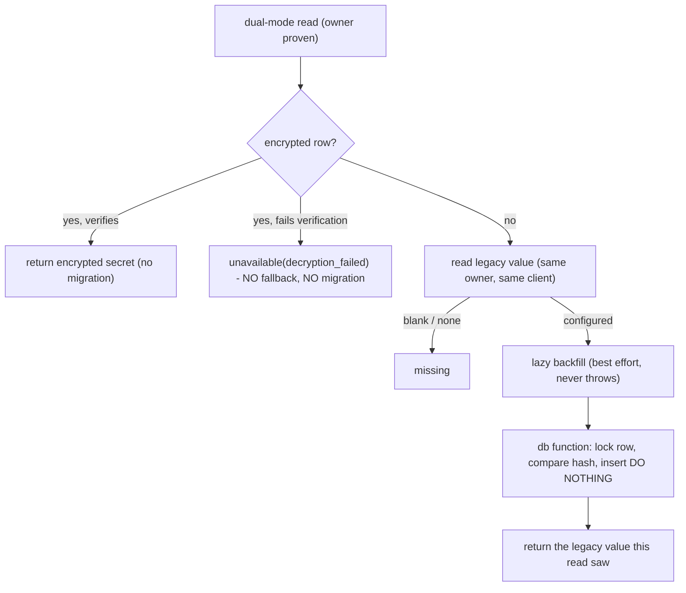

# FUTURE-059 Slice 3B — Lazy migrate-on-read and the inactive-user sweep (code only, dormant)

Status: **DORMANT CODE DELIVERED; NOTHING ACTIVATED.** Baseline `origin/main` `1eccbcfa43c865617d594d8081bdc487502b822f` (verified). This slice adds the mechanism that will later move existing plaintext BYOK credentials into the encrypted store. In Production it does nothing: the credential store is in `legacy` mode, `provider_api_credentials` does not exist, no BYOK master key exists, no backfill secret is set, no migration or SQL was applied, no credential was read or moved, and no provider was called.

**What is NOT true after this slice.** Credentials are **still plaintext** in `user_settings` (browser access closed by Slice 2). Nothing here encrypts or moves a real credential. Do not describe the BYOK keys as encrypted until the activation sequence in §9 has been completed and verified.

Builds on `FUTURE_059_BYOK_CREDENTIAL_SLICE_3A_V1.md` (encrypted store, key identity, modes, table SQL).

## 1. What was added

| File | Purpose |
| --- | --- |
| `docs/productization/sql/FUTURE_059_SLICE_3B_backfill_function.{up,down}.sql` | **new, NOT applied** — one atomic, row-locking database function (the smallest change the data model needs, §3) |
| `lib/credentials/credential-backfill.ts` | **new** — encrypt + conditional insert of ONE credential; best-effort lazy wrapper (coalescing, back-off) |
| `lib/credentials/credential-backfill-sweep.ts` | **new** — operator-invoked sweep and migration-completeness report |
| `app/api/internal/credential-backfill/route.ts` | **new** — secret-guarded operator entry point; disabled until its secret is provisioned |
| `lib/credentials/api-credential-store.ts` | the `dual`-mode fallback now triggers the lazy migration; +operator-only `createOperatorPrivilegedClient`, `readLegacyCredentialPage` |
| `lib/credentials/encrypted-credential-table.ts` | +`backfillEncryptedRow` (rpc) and `selectEncryptedRowsForUsers` |
| tests | 5 new suites + 2 opt-in local-stack suites extended/added (§7) |

## 2. Discovery (before editing)

The 3A store already has: the Slice 1 ownership proof and privileged client; `legacy | dual | encrypted` modes (default `legacy`); the dual-mode read that falls back to the legacy value **only when no encrypted row exists** and never when one exists but fails verification; the encrypted table module as the only file naming `provider_api_credentials`; and the unapplied table SQL (service-role-only, locked down inside its own transaction). Lazy migration therefore belongs exactly at the dual-mode fallback, after the owner is proven and the legacy value was read.

## 3. The one required data-model addition (flagged for review)

The mission requires that **a delayed migration can never overwrite a newer credential nor resurrect a removed one**, with a verifiable guarantee, and says to stop and propose the smallest change if the data model cannot give it. With plain PostgREST calls it cannot:

- "read legacy, then `INSERT` encrypted" from the application leaves a window in which the user removes or replaces the credential;
- undoing a wrong insert afterwards is a compensating action that can itself fail (outage, crash), leaving a resurrected credential — not a guarantee;
- PostgREST cannot express "insert only if this column still equals what I read, atomically".

**Smallest change: one SQL function** (`public.backfill_provider_api_credential`, `SECURITY INVOKER`, callable by `service_role` only), prepared as a reviewed artifact and **not applied**:

1. `SELECT <legacy column> … FOR SHARE` on the owner's `user_settings` row — a concurrent removal/replacement either committed first (the function sees the new/NULL value) or waits until the function finishes;
2. refuse (`legacy_changed`) unless the legacy value's SHA-256 equals the one the application read — the plaintext key is **never sent to the database** (only its hash and the ciphertext), so it cannot appear in statement/parameter logs;
3. `INSERT … ON CONFLICT (user_id, provider) DO NOTHING` — an encrypted row written meanwhile (by the user or another migration) is never overwritten (`exists`);
4. results `inserted | exists | legacy_changed | no_settings_row`; nothing else is ever written.

Like the Slice 3A table, the function must lock itself down in its own transaction because this project's default privileges grant `EXECUTE` on new functions to `anon`/`authenticated`/`service_role` (verified in the catalog and reproduced in tests). Behaviour change in the data model: **none** — no new column, table, policy or privilege on existing objects. If the function is not applied, lazy migration and the sweep fail closed and the read path is unaffected (§5).

## 4. Lazy migrate-on-read

- Never from the client: it runs inside the server store, after the ownership proof, with the privileged client; no route exposes it.
- It runs only on the fallback path. The `legacy` branch, the `encrypted` branch, a present-but-invalid encrypted row, Replicate and unsupported providers never reach it.
- It cannot change what the read returns, cannot fail the read, and costs at most one attempt: simultaneous reads in a process coalesce; after a failure the credential backs off for 60 s (process-local damping only — correctness never depends on it).
- Logs are code-only: `[credential-backfill] lazy outcome=inserted|failed reason=… provider=…`.

## 5. Concurrency analysis (each row has a test)

| Scenario | Mechanism | Proven by |
| --- | --- | --- |
| simultaneous reads | in-process coalescing; at most one insert in the database | fake DB; real PostgREST |
| simultaneous migrations (other instances) | unique index + `DO NOTHING`; exactly one `inserted`, the others `exists` | fake; **two real connections** (PostgreSQL 17.6) |
| **replacement during migration** | stale hash ⇒ `legacy_changed`; or the user's encrypted row exists first ⇒ `exists`; the user row is never overwritten | fake; real: a replacement committed first blocks then refuses; a user write racing the migration lands last (`user_entry` wins) |
| **removal during migration** | legacy removal order is *legacy first, encrypted second*; removal committed first ⇒ `legacy_changed`; migration holding the lock first ⇒ removal waits, then deletes the encrypted row ⇒ gone from **both** stores | real concurrent transactions |
| stale snapshot | exact SHA-256 equality (a trailing space is a different credential) | fake; PGlite |
| partial encrypted write failure | the rpc is the single write; a failure leaves nothing, the read still returns the legacy value, back-off prevents a retry storm | fake; real (function absent) |
| duplicate insert conflicts | `ON CONFLICT DO NOTHING` | PGlite; real |
| database outage / function missing | `store_failure`, logged by code, never blocks the read | fake; real |
| encryption key unavailable | active mode raises `encryption_not_configured` *before* any fallback or migration | fake |
| existing encrypted row | never touched; corrupted/foreign-bound row is an explicit error, not a fallback and not migrated over | fake; real |

Mutation check: removing `FOR SHARE` from the SQL makes the five row-lock tests fail against the real database (verified, then restored).

## 6. Inactive-user sweep and completeness report

Entry point: `POST /api/internal/credential-backfill` (operator route), core in `credential-backfill-sweep.ts`.

| Property | Behaviour |
| --- | --- |
| Invocation | explicit only. No cron, no package script, no startup/instrumentation hook, no deployment step, no link from the app; tests and a source scan assert it. The route does nothing unless an operator **provisions** `CREDENTIAL_BACKFILL_OPERATOR_SECRET` (≥ 32 chars, optional, unset by default ⇒ `503`) |
| Client invocation | impossible: no session path; wrong/missing `Authorization: Bearer` ⇒ `401` before any database access (constant-time compare); only `POST`; production-class runtime only (`403` elsewhere) |
| Request | allow-listed body `{ dryRun?, batchSize?, maxBatches?, cursor?, confirm? }`; any other field (owner, user, provider, secret…) ⇒ `400`; `batchSize` ≤ 25, `maxBatches` ≤ 20 |
| **Dry run by default** | executing needs `"dryRun": false` **and** `"confirm": "migrate-legacy-credentials"`; a dry run performs no write of any kind |
| Mode | executing requires `dual` (⇒ `409` otherwise, before reading anything): in `legacy` mode user writes do not keep the encrypted copy current, so pre-populating it would let a stale value win once the mode is flipped |
| Configuration | no usable BYOK key ⇒ `409 encryption_not_configured`, before reading anything |
| Coverage | enumerates **every `user_settings` row** with a keyset cursor — including accounts that never trigger a read |
| Writes | the same atomic function as the lazy path; never overwrites; legacy changed/removed ⇒ counted `legacyChanged`; an encrypted row that appeared ⇒ `raced`; corrupted/divergent rows are only reported |
| Resumable / idempotent | returns `nextCursor`; a replay is harmless. The cursor never skips an owner whose migration **failed**: after any failure it points to the last owner completed *before* the first failure (`done:false` with a `null` cursor means "restart from the beginning") |
| Stop conditions | `encryption_not_configured`, `mode_must_be_dual`, `store_client_unavailable`, `store_failure` (paging), `payload_invalid`, `failure_threshold` (3 consecutive write failures by default) |
| Output | counts per provider and in total, the cursor, flags — **no key, hash, ciphertext or database message**, and the route logs one code-only summary line |

### Classification (per owner × provider; Replicate excluded)

`legacyOnly` (what a migration would move) · `verified` (both exist, decrypt OK, equal) · `divergent` (both exist, decrypt OK, differ — stale/conflicting, **never auto-resolved**) · `integrityErrors` (encrypted row exists but cannot be verified) · `encryptedOnly` · execution only: `migrated`, `raced`, `legacyChanged`, `failed`. Comparison is by constant-time digest in memory; nothing is printed.

### Measurable cut-over gates (not "inactivity")

`cutoverReady` is non-null **only** for a complete dry run started from the beginning that did not stop, and is `true` iff `legacyOnly = 0`, `integrityErrors = 0`, `divergent = 0` and at least one owner was scanned. A run that executed migrations never claims readiness itself — re-run a complete dry run. Additional gates are in §9 step 10.

## 7. Tests and validation (dummy data only)

| Suite | Tests |
| --- | --- |
| `credential-backfill.test.ts` — lazy migration, existing/corrupted/foreign records, missing key, concurrency & race simulations, failure/back-off, resolver compatibility, inactive modes make zero encrypted-store calls | 28 |
| `credential-backfill-sweep.test.ts` — dry run, inactive coverage, pre-flight stops, clamping, execution, idempotence, resumability incl. failed-owner cursor, partial failure, races, no secret in reports, never auto-runs | 26 |
| `credential-backfill-route.test.ts` — disabled by default, 401/403/400 matrix, allow-listed body, confirmation, 409 stops, counts-only responses | 37 |
| `slice-3b-backfill-function-pglite.test.ts` — the SQL: privileges (default-privilege trap reproduced), decisions, hash parity incl. multi-byte, providers, guards, rollback | 17 |
| `credential-boundary.test.ts` — +9 guards (lazy path reachable only from the dual fallback, function name in one module, sweep/route reachability, route contract, secret placement, no scheduling, no logging, SQL placement); 3A guards updated for the new importers | 62 (was 53) |
| `slice-3b-local-postgrest.integration.test.ts` — **opt-in**, real PostgreSQL 17.6 + PostgREST + JWT + supabase-js + **separate connections for true lock tests** | 12 on **PostgREST 13.0.8** and 12 on **14.18** (3 consecutive runs each) |
| 3A/Slice 2 local-stack suites re-run against the new code | 24 and 32 on both versions |

| Validation | Result |
| --- | --- |
| Typecheck | 0 errors |
| ESLint (changed and new files) | 0 errors, 0 warnings |
| Full suite | **5502 passed, 68 skipped (the opt-in local-stack suites), 2 failed** — `editor-workspace` and `static-parity` (`Estilo` vs `Estilos`), pre-existing on clean `main`, unrelated. One run ended in the known sporadic vitest worker segfault and was repeated |
| Production build (`next build --webpack`) | compiles (77 s); then trips the known `ImagesPageShell` page-export type check that also fails on clean `main` locally; Vercel is the authoritative build |

Not proven here: Kong, GoTrue, the hosted PostgREST configuration and event triggers (hosted Supabase). PostgREST answers `503` while it reloads its schema cache; the store reports that as retryable `unavailable`, and the suites wait for reloads to settle.

## 8. Production state after this slice (disabled)

`PROVIDER_API_CREDENTIAL_MODE` unset ⇒ `legacy`: the new code is never reached (zero encrypted-store calls, tested). No environment variable added or changed; the optional `CREDENTIAL_BACKFILL_OPERATOR_SECRET` is unset, so the operator route answers `503` and touches nothing. No BYOK master key. Tables/functions: none applied. No required new secret. Deploying this slice cannot start a migration.

## 9. Complete future activation sequence (each step needs its own explicit authorization)

1. **Rotate the exposed provider keys** (those printed in an earlier tool transcript) at the providers, so compromised values are never copied into the encrypted store.
2. **Create the dedicated BYOK master key** — 32 random bytes, base64 — as the Vercel **Production** variable `BYOK_CREDENTIAL_ENCRYPTION_KEY` (optionally `…_ID`), distinct from the Kling key (a shared key is refused); keep an escrow copy in a second operator-controlled store. Key loss makes every encrypted row unrecoverable. Do not put it in Preview/Local.
3. **Review and apply** `FUTURE_059_SLICE_3_provider_api_credentials.up.sql`, then `FUTURE_059_SLICE_3B_backfill_function.up.sql`, as `postgres`, each in its own transaction through an authorized channel. Confirm: table ACL `postgres=arwdDxtm, service_role=arwd`, RLS on, no policy; function `EXECUTE` for `service_role` only, `SECURITY INVOKER`. A hosted dry run on a disposable project is recommended first.
4. **Optional, only when a sweep is needed:** provision `CREDENTIAL_BACKFILL_OPERATOR_SECRET` (≥ 32 random chars) as a Production variable. Remove it after the sweep.
5. **Redeploy and verify readiness while still `legacy`:** `GET /api/settings/providers` must show `credentialStorage.encryptionKey: "configured"`. Optionally run a sweep **dry run** (allowed in `legacy` when the key is staged): it must report `legacyOnly = N` and everything else `0`, proving the table and key work without writing.
6. **Activate `dual`:** set `PROVIDER_API_CREDENTIAL_MODE=dual`, redeploy, smoke (Settings statuses, one controlled non-secret save, one status check). From now on user writes go to both stores and every first read of a legacy-only credential migrates it lazily.
7. **Watch the logs** (codes only): `[credential-store] read outcome=legacy_fallback` should decline as users are migrated; any `[credential-backfill] lazy outcome=failed reason=…` needs a cause (`store_failure` ⇒ function/table missing or outage; `encryption_not_configured` ⇒ key).
8. **Cover inactive users:** `POST /api/internal/credential-backfill` with `{"dryRun": true}` and read the counts; then execute in bounded batches (`{"dryRun": false, "confirm": "migrate-legacy-credentials", "batchSize": 10, "maxBatches": 5, "cursor": <previous nextCursor>}`) until `done: true`; replay any interrupted page.
9. **Resolve findings:** `divergent` (both stores differ) — ask the user to re-enter the key in Settings (a `dual` write converges both) or decide manually; never delete a row to "fix" a count. `integrityErrors` — user re-entry replaces the row; investigate tampering or a retired key id first.
10. **Prove cut-over readiness (all must hold):**
    - a complete dry run from the start returns `cutoverReady: true` (no legacy-only, divergent or integrity findings), and `usersScanned` equals `SELECT count(*) FROM user_settings` (counts only);
    - zero `legacy_fallback` log events and zero failed lazy attempts for the agreed soak (proposal: 14 days);
    - provider verification: free checks where available (OpenAI model list, Gemini models list), one authorized minimal smoke each for NanoBanana and Kling REST;
    - Slice 2 containment live ≥ 7 days; master key escrowed and recovery rehearsed.
11. **Retire the fallback:** set `PROVIDER_API_CREDENTIAL_MODE=encrypted`, redeploy, smoke. Keep the (browser-inaccessible) legacy values for a rollback window, then null and drop them in Slice 5.
12. **Remove** `CREDENTIAL_BACKFILL_OPERATOR_SECRET`.

### Failure handling

| Symptom | Meaning | Action |
| --- | --- | --- |
| lazy `failed reason=store_failure` | database function/table missing, PostgREST reloading, or outage | check migrations; reads are unaffected; retried after 60 s per credential |
| `409 mode_must_be_dual` / `encryption_not_configured` | sweep preconditions | fix configuration; nothing was read |
| `stopped: failure_threshold` | 3 consecutive write failures | investigate; resume from the returned cursor (idempotent) |
| `legacyChanged` / `raced` counts | users changed credentials during the run | expected; re-run a dry run |
| `divergent` / `integrityErrors` | stale/conflicting or unreadable encrypted data | §9 step 9; they block cut-over by design |
| Settings shows a provider `unavailable` | encrypted credential cannot be verified, or configuration | `credentialStorage` diagnostic; restore the key / re-enter the credential |

### Rollback matrix

| From | Action | Effect |
| --- | --- | --- |
| during sweep | stop calling the route | idempotent; partial progress is valid |
| `dual` → `legacy` | set the variable to `legacy`, redeploy | safe: in `dual` the legacy column is always current. Encrypted rows stay but are not read. **Before re-activating `dual` later, run a dry run: any `divergent` row (a legacy-mode write made the encrypted copy stale) must be resolved first** |
| `encrypted` → `legacy` | **never directly**: go `encrypted → dual → legacy` | in `encrypted` mode the legacy column is not kept current |
| function SQL | `…3B…down.sql` | drops only the function; lazy migration and the sweep then fail closed, reads unaffected |
| table SQL | `…3_…down.sql` | refuses while rows exist (data-loss guard) |
| application | never below `747d5eb` while Slice 2 containment is active | |

## 10. Remaining risks and gates

- Keys stay plaintext at rest until §9 is completed; the unrotated, previously exposed keys remain a prerequisite risk.
- The row-lock guarantee is proven on PostgreSQL 17.6 with real concurrent connections and on PGlite for the decisions, but **not on hosted Supabase**; a disposable hosted project run before Production is recommended.
- The ciphertext and a SHA-256 of the legacy value travel to the database through PostgREST; the hash of a high-entropy API key is not reversible in practice, but it is derived from the secret and is therefore treated as sensitive in the logs policy (never logged by the application).
- The operator route is a network-reachable administrative endpoint guarded by one shared secret: keep it unset except during a sweep, rotate it afterwards, and keep it out of Preview/Local.
- `legacy`-mode writes while encrypted rows exist make them stale (see rollback matrix); the `divergent` count is the detector.
- Lazy migration adds one rpc (plus an in-memory encryption) to the first read of each legacy-only credential in `dual` mode.
- Slice 3B does not retire the plaintext columns, does not touch Kling MCP, FUTURE-057 workflows or any model default. Slices 4 (cut-over) and 5 (retirement) are not started.

## 11. Delivery evidence

- Starting `origin/main`: `1eccbcfa43c865617d594d8081bdc487502b822f` (verified).
- PR [#177](https://github.com/fmultiman/content-studio-ai/pull/177): the required Vercel check was SUCCESS before the merge (merge commit): `f46c3d479ab3bb9f735ba247ec9a4bd92cdec91e`.
- Production deployment: GitHub deployment for `f46c3d4`, environment Production, state `success`.
- Post-deploy checks (read-only, 2026-10-11 ~20:55 UTC): the operator route answers `POST` → `503 CREDENTIAL_BACKFILL_NOT_CONFIGURED` for any caller (no secret is provisioned — it is disabled and performs nothing, including for a wrong bearer), `GET` → `405`; unauthenticated `GET /api/settings/providers` → `401`. Authenticated `GET /api/settings/providers` → `200`, statuses unchanged (OpenAI, Gemini, NanoBanana, Kling REST `configured`; Replicate `missing`), entries still only `status` and `connectionMethod`, `credentialStorage: { mode: "legacy", invalidModeValue: false, encryptionKey: "not_required" }`, no "Indisponível no momento".
- Database (metadata only): `provider_api_credentials` does not exist; `backfill_provider_api_credential` does not exist; `user_settings` ACL still `{postgres=arwdDxtm, service_role=arwdDxtm, authenticated=d}` with 16 column ACLs (Slice 2 unchanged). No SQL was executed against Production; no environment variable was added or changed; no key was created, read, moved or rotated; no sweep or migration ran; no provider was called.
- Worker: none. Migrations: prepared, not applied.
