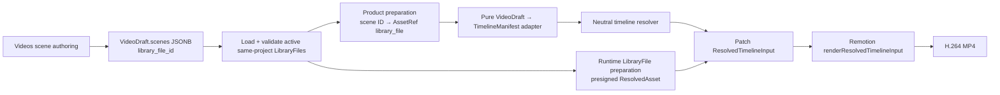

# Phase 2H0 — VideoScene Asset Binding Architecture

**Nature:** Read-only architecture and domain-integration study. No source, `/videos`, schema, migration, API, database, or storage change was made. This document is the only change in the phase.

**Evidence labels:** **FACT** is verified against the current repository; **INFERENCE** follows from those facts; **RECOMMENDATION** is the proposed product direction; **OPEN QUESTION** requires a later product decision or implementation proof.

## 1. Executive Summary

**FACT.** `VideoDraft.scenes` is the real, persisted authoring document for `/videos`: it is a `JSONB` array on `video_drafts`, autosaved through `POST/PATCH /api/video-drafts`. Its scene media field, `image_url`, is not a Library reference or a normal URL contract. The current scene card reads a selected local JPEG/PNG/WebP with `FileReader.readAsDataURL()` and writes the resulting base64 `data:` URL into that field.

**FACT.** The proven creative path already accepts a real `LibraryFile` as a runtime asset, but only through the external proof seam `sceneAssets: Record<VideoScene.id, AssetRef>`. The pure adapter correctly refuses to treat `image_url`, description, or prompt as canonical render media. Phase 2G-D proved that an externally bound, same-project `LibraryFile` can produce a real H.264 MP4.

**RECOMMENDATION.** The smallest correct product binding is an optional, additive `VideoScene.library_file_id: string | null` persisted inside the existing `scenes` JSONB document. It is a domain-owned identity reference to exactly one scene's primary media, not a persisted renderer input. In the product preparation layer, a validated `library_file_id` becomes the existing neutral `AssetRef { type: 'library_file', ref: library_file_id }`; the pure adapter remains storage- and database-agnostic.

This is intentionally narrower than a new scene-asset table, a generalized multi-layer model, or persisting `AssetRef` itself. The existing `LibraryFile.kind` already distinguishes `image`, `video`, `audio`, and other media, so the one ID is forward-compatible with stills and clips. Current timeline preparation is image-only; a selected video ID may be persistible in the future model but must not be sent to the current Documentary Card hero renderer as if it were supported.

**Verdict: `SCENE_ASSET_BINDING_REQUIRES_MINIMAL_EXTENSION`.**

## 2. Scope / Method

Read-only audit of:

- prior authorities: `PHASE_2G0_TIMELINE_VIDEOS_INTEGRATION_ARCHITECTURE.md`, `PHASE_2G_A_VIDEODRAFT_TIMELINE_ADAPTER.md`, `PHASE_2G_B_TIMELINE_LIBRARYFILE_ASSET_BOUNDARY.md`, `PHASE_2G_C_REAL_MP4_RENDER.md`, and `PHASE_2G_D_SAME_PROJECT_TIMELINE_PROVENANCE.md`;
- `lib/types.ts`, `scripts/002_create_drafts_tables.sql`, and `scripts/020_create_productions.sql`;
- `/videos`, `components/videos/*`, `app/api/video-drafts/route.ts`, and scene-prompt generation;
- `library_files`, `/api/library-files`, `/arquivos`, `MediaPickerDialog`, and the existing ChannelPieceMedia comparison;
- `AssetRef`, Timeline adapter/preparation, the LibraryFile-to-ResolvedAsset adapter, and image-generation paths.

**FACT.** `git status --short` was empty before this documentation change and no product state was read or mutated beyond repository files. The analysis does not infer live data beyond the already-recorded same-project proof in Phase 2G-D.

## 3. Current VideoScene Persistence

| Question | Current factual answer |
|---|---|
| Where is a scene persisted? | In `video_drafts.scenes`, not in a separate scene table. |
| Table or JSONB? | `scripts/002_create_drafts_tables.sql` declares `scenes JSONB DEFAULT '[]'::jsonb`. `production_id` was later added to the parent draft in `scripts/020_create_productions.sql`. |
| Runtime type | `VideoScene` in `lib/types.ts`. |
| Scene fields | `id`, `order`, `description`, `prompt`, `image_url`, `duration` (seconds), and `movement`. |
| Schema validation | No Zod scene schema exists at the video-draft API boundary. `POST`/`PATCH /api/video-drafts` only coerce non-arrays to `[]` and otherwise write the supplied `scenes` JSON unchanged. |
| Ordering | Array position is the persisted collection order; `order` is assigned on creation and rewritten client-side after deletion. There is no scene FK/table or scene-level API. |
| Parent ownership | A draft stores nullable `project_id` and `production_id`; current creation requires a valid Production and derives its project server-side. |

**FACT.** Autosave in `app/(dashboard)/videos/page.tsx` waits 800 ms after changes to `videoName`, `scenes`, project, production, or current draft. It serializes the whole `scenes` array to `/api/video-drafts`; a `beforeunload` handler invokes the same save routine. Explicit save sends the same shape. Thus any additive scene property that the API accepts will persist in JSONB without a database migration. `POST` derives the parent project from the validated Production. `PATCH` validates a supplied Production, but its general update payload can set `project_id` from `body.projectId` without an independent project lookup when no `productionId` is supplied; this is an existing boundary gap that a binding implementation must not repeat.

**INFERENCE.** “No migration” is a factual delivery advantage, but the current lack of boundary validation makes it unsafe to rely on JSONB permissiveness alone. The next slice must add a deliberate scene-input validation/normalization boundary alongside the new field rather than silently accepting arbitrary asset IDs.

## 4. Current `image_url` Semantics

**FACT.** `components/videos/scene-card.tsx` permits only JPEG, PNG, and WebP. On a local selection or drag/drop it calls `FileReader.readAsDataURL(file)` and writes the result to `scene.image_url`. Removal writes `null`. It neither uploads to S3 nor creates an `Image` or `LibraryFile` record.

**FACT.** The current producer is therefore a base64 `data:image/...` URL. The static type is merely `string | null`, so it would also technically accept a remote URL from an existing/legacy row; no code normalizes, validates, or produces one. The audited `/videos` flow produces base64 data URLs only.

**FACT.** Its consumers are strictly visual preview consumers: `SceneCard` renders it as the optional “Imagem Base,” `StoryboardModal` renders it as a thumbnail, and `/videos` uses its truthiness to decide whether a scene has content to autosave. The `VideoDraft → TimelineManifest` adapter emits an explicit `scene_image_url_not_used` diagnostic and never inserts the value into an `AssetRef` or manifest.

**INFERENCE.** `image_url` is overloaded in the limited UI sense: it acts as both the user-selected source image and the immediate scene-card/storyboard preview. It is not a generated frame, composition hero contract, temporary render URL, or persistent asset identity. Its name hides this distinction and should not be used as evidence that the field already models a reusable scene asset.

## 5. Current Library Capabilities

**FACT.** `library_files` is the current generic project media record (`scripts/015_create_library_files.sql`): identity, `user_id`, nullable `project_id`, folder, name, `kind`, MIME type, file size, storage provider/path, public/thumbnail URLs, soft-delete timestamp, and timestamps. `kind` already permits `image`, `video`, `audio`, `document`, and `other`.

**FACT.** `GET /api/library-files` lists non-deleted files for the authenticated user and supports `projectId`, folder, and kind filters. It derives short-lived presentation URLs from storage paths. `/arquivos` already offers project filter, folder tree, kind filter, thumbnails/image preview, upload, move, soft-delete/restore, and permanent deletion.

**FACT.** A reusable picker exists: `components/publication/media-picker-dialog.tsx`. It receives a `projectId`, loads `/api/library-files?projectId=…`, renders image thumbnails and video cards, offers image/video filtering, and can upload JPEG/PNG/WebP/GIF/MP4/WebM/MOV. Its current side effect is ChannelPieceMedia association, so it is not directly drop-in for a VideoScene; its Library browsing/card/filter/upload presentation can be extracted or parameterized rather than duplicated.

**FACT.** Library uploads already create `LibraryFile` records and S3 objects. The general `/arquivos` path uploads then posts to `/api/library-files`; ChannelPieceMedia's dedicated upload route does the equivalent with a project derived from the ChannelPiece.

## 6. AssetRef Semantics

**FACT.** Shared Creative Core `AssetRef` is a renderer-neutral, strict contract with `type` (`library_file`, `image`, `production_artifact`, `external`, or `fixture`), opaque `ref`, and optional render-oriented presentation fields (`fit`, `focal_point`, `alt`, `version`, `checksum`). It has no database, storage, React, Next, or Remotion dependency.

**FACT.** Its neutral nature does not make it a referential-integrity model. A `library_file` ref is only an opaque string. The synchronous neutral resolver deliberately returns a placeholder with empty URL for it. `prepareTimelineLibraryFileAssets()` receives a caller-supplied lookup and produces the real runtime asset separately; the existing `adaptLibraryFileToResolvedAsset()` currently accepts only `LibraryFile.kind === 'image'` with an `image/*` MIME type.

**RECOMMENDATION.** Do not persist `AssetRef` directly on `VideoScene` in V0. It would allow renderer-facing source categories such as `fixture` or `external` into the authoring document without proving project ownership, soft-delete handling, or a product need for their per-scene semantics. Persist the product identity (`library_file_id`) and generate `AssetRef(type: 'library_file')` in a product preparation step. This preserves `AssetRef` as a neutral render input while keeping Videos free to add its own domain semantics later.

## 7. Options Considered

| Option | Fit to actual code | Result |
|---|---|---|
| A — `VideoScene.library_file_id` | One primary hero/media slot maps exactly to the current `sceneAssets[scene.id]` seam. JSONB supports an additive field; `LibraryFile.kind` is already generic. | **Recommended.** |
| B — persist structured `VideoScene.asset_ref` / `media_ref` | Could carry `fit` and focal point, but either duplicates the existing `AssetRef` or introduces a new structure before a second scene slot/layer needs it. Asset identity, owner validation, and deletion lifecycle would still need separate rules. | **Defer.** Consider only when a scene needs more than one independently addressed media role. |
| C — separate scene-asset binding table/domain | Would provide FK-like queryability, roles, ordering, and robust delete constraints, but the product currently has a single primary scene image and JSONB scenes have no independent rows. It entails migration/API/autosave redesign beyond the smallest slice. | **Defer.** |
| D — reuse `ChannelPieceMedia` | It already validates user and same-project source selection and supports LibraryFile/image alternatives. But it belongs to a ChannelPiece, has publication roles/positions, and `VideoDraft` has no ChannelPiece FK. Reusing it would falsely couple authoring media to publication context. | **Not needed for the binding. Reuse its ownership policy and picker patterns.** |
| E — continue `image_url` or make it a Library URL | Confuses volatile presentation/binary data with identity, cannot safely resolve storage or lifecycle, and conflicts with 2G-A’s explicit no-base64 manifest boundary. | **Reject for new canonical media.** |

## 8. Recommended Persistent Binding

**RECOMMENDATION.** In the next implementation slice, extend the JSONB scene shape with an optional nullable field conceptually equivalent to:

```ts
library_file_id: string | null
```

This phase does not introduce that field in code or a database migration.

Binding rules:

1. It denotes the scene’s one primary asset identity, not an arbitrary URL, binary payload, signed URL, renderer URL, template slot registry, or generation-provider identifier.
2. It must name an active, authenticated-user-owned, project-scoped `LibraryFile` in the same Project as `VideoDraft.project_id`.
3. `LibraryFile.kind` declares the underlying asset category. A selected image can use the existing hero path; a selected video is stored as the same identity type but is render-incompatible until a clip-capable template/preparer is delivered.
4. The product layer converts it to `AssetRef { type: 'library_file', ref: library_file_id }`, supplying an adapter/template default such as `fit: 'cover'` only when that choice is actually needed.

**INFERENCE.** This captures the only durable fact that must survive authoring, while avoiding premature persistence of template-specific crop/focal/motion policy. A later need for explicit crop metadata can justify a small structured `media` object without invalidating the `library_file_id` identity choice.

## 9. Project Ownership

**FACT.** The best existing comparison is `POST /api/channel-piece-media`: it resolves the parent’s Project, fetches the selected `LibraryFile` for the authenticated user, rejects a null `project_id`, and rejects a different Project before insertion. Its database migration also contains stronger relation checks, but those constraints cannot protect a JSONB field.

**RECOMMENDATION.** Apply defense in depth at these boundaries:

| Boundary | Responsibility |
|---|---|
| Library selection UI | Request `/api/library-files?projectId=<VideoDraft.project_id>` and restrict choices to active compatible kinds. This is discoverability, not authority. |
| Video-draft POST/PATCH/autosave | Validate each non-null scene `library_file_id`: format, user ownership, `deleted_at IS NULL`, non-null project, and exact `LibraryFile.project_id === VideoDraft.project_id`. Reject the write on any invalid binding; never accept a client-provided project assertion. |
| Product preparation before adaptation/render | Re-fetch or load the `LibraryFile` under the authenticated/authorized render context and reassert active status and same project before building `AssetRef`/runtime URL. This protects stale or bypassed JSONB records. |
| Runtime asset preparation | Treat an absent, deleted, wrong-project, or unsupported-kind file as an explicit diagnostic/failure. Do not fall back to `image_url`, a fixture, or a cross-project file. |
| Renderer | Consume only the already-resolved input. It should not open a database client; its safety boundary is that preparation succeeded. |

**OPEN QUESTION.** Soft delete and permanent delete currently operate on `LibraryFile` without awareness of references buried in `video_drafts.scenes` JSONB. V0 can surface the scene as unresolved after deletion; product policy must later decide whether Library should block destructive deletion, warn/locate affected drafts, or allow it with repair UX. A database FK is impossible for this JSONB reference without a later structural change.

## 10. Autosave/API Implications

**FACT.** Autosave already sends the complete scene array, so no new endpoint is inherently needed to persist an additive JSONB property. The current draft route owns canonical parent Project/Production checking on creation, but does not validate individual scene fields.

**RECOMMENDATION.** The minimal implementation slice should keep the same autosave route and whole-document update pattern. It should add scene-shape validation/normalization at that route and validate referenced LibraryFiles server-side. It should not add a separate scene API, asset-binding API, or database table merely to save one ID.

**INFERENCE.** Whole-document autosave makes stale-write conflict handling an existing concern rather than a new asset-binding concern. The new validation must validate the submitted document as a whole against its parent Project, not trust a cached client-side picker result.

## 11. Backward Compatibility

**FACT.** Existing drafts may have no `library_file_id`, and any legacy scene image is stored within the JSONB `image_url` field. Current preview components render that field directly.

**RECOMMENDATION.** Use additive compatibility, without a bulk destructive migration:

- scenes without `library_file_id` remain loadable and keep their legacy preview behavior;
- a valid non-null `library_file_id` is authoritative for new product media and future rendering;
- when a binding exists but cannot be resolved, report an explicit unavailable-asset state — do **not** silently fall back to a potentially stale `image_url`;
- new Library-based selection should write a Library reference rather than fresh base64; it may clear the legacy preview value as part of the user’s deliberate replacement, but no old draft needs automatic rewrite;
- the pure Timeline adapter continues to reject legacy `image_url` as canonical render input.

## 12. Legacy `image_url` Strategy

**Classification: `LEGACY / DEPRECATE LATER`.**

**RECOMMENDATION.** Keep it temporarily for compatibility and current preview of historical drafts, but deprecate it as canonical scene media immediately for all new authoring paths. Do not remove it or migrate every row in the first binding slice. Its precedence is deliberately unambiguous: `library_file_id` wins for product media; `image_url` is a legacy display fallback only when no binding exists.

**OPEN QUESTION.** The repository has no read-time telemetry or draft-age policy that establishes when it is safe to remove legacy inline data. A later cleanup phase needs an inventory and a user-visible migration/repair strategy before removal.

## 13. Library Picker Reuse

**FACT.** `MediaPickerDialog` already has the exact broad interaction required for a future scene picker: project-scoped Library listing, thumbnail/card display, active image/video filter, and upload flow. `/arquivos` additionally supplies folders, broad type filters, and management operations.

**RECOMMENDATION.** Reuse or extract the `MediaPickerDialog` Library browse UI and card components behind a callback such as “select `LibraryFile`,” rather than reusing its ChannelPieceMedia association side effect. V0 scene selection should filter to `kind=image` because the proven Documentary Card hero preparation rejects video. Keep the data binding generic so a later clip-capable picker can allow `kind=video` without changing the persisted ID model.

## 14. Generator → Library → Scene Boundary

**FACT.** `/videos` currently has no media-generation path. Its only AI operation generates prompt text through `/api/videos/generate-scene-prompt`. Existing image generation persists into the separate `images` domain (with its own storage URLs/metadata); it does not currently create a `LibraryFile` as part of that flow.

**RECOMMENDATION.** The future unifying boundary is:

```text
AI image generator / AI clip generator / upload
  → canonical LibraryFile (project-scoped)
  → VideoScene.library_file_id
  → product preparation
  → AssetRef(library_file)
```

The scene never needs to know whether the file originated from OpenAI, NanoBanana, an AI clip provider, or a local upload. Provider provenance belongs in the generating/output lifecycle, not the scene’s primary-media identity.

**OPEN QUESTION.** Existing generated `Image` records are not `LibraryFile`s. Whether a future image-generator “use in scene” action creates/links a LibraryFile copy, promotes an existing `Image`, or extends Library’s source model is an adjacent lifecycle decision. It should be settled before claiming all generated images can use the new binding.

## 15. Image vs Video Assets

**FACT.** Library’s storage model and picker already represent video. The present timeline preparation function and its reused LibraryFile adapter are image-only; non-image LibraryFiles become explicit unresolved diagnostics. The active template is an image hero composition, not a video clip compositor.

**RECOMMENDATION.** Make the persisted binding generic (`library_file_id`), but make V0 selection/render support image-only. This avoids a second migration or scene field when clip support arrives, while accurately refusing to render an MP4/WebM/MOV in an image hero slot today.

**DEFER.** Audio tracks, B-roll, multiple scene layers, timing trims, crop keyframes, overlays, and per-slot asset collections are not needed to establish the primary-media binding. Those needs are the threshold for a structured scene media object or a separate binding domain.

## 16. Adapter Boundary

**RECOMMENDATION.** Choose product-layer preparation, corresponding to option C in the requested alternatives:

```text
load VideoDraft + scenes
  → validate/resolve each scene.library_file_id against LibraryFile
  → create sceneAssets[scene.id] = AssetRef(library_file)
  → adaptVideoDraftToTimelineManifest(draft, sceneAssets)
  → resolveTimelineManifest
  → prepareTimelineLibraryFileAssets + patchResolvedTimelineAssets
```

**FACT.** This reuses the 2G-A adapter and 2G-B/2G-C preparation seam exactly as designed. It keeps Supabase lookup, active-state checks, ownership checks, S3 presigning, and signed URLs out of the pure adapter and out of the manifest. It also does not require `VideoScene` to import Creative Core types.

**RECOMMENDATION.** Do not make the pure adapter query LibraryFile or derive a binding directly from database state. It may accept the prepared map as it does now; a thin product orchestrator should derive that map from persisted scene references.

## 17. Render Product Path



**FACT.** Every boundary after `D` exists and was live-proven in Phase 2G-D except the product persistence and derivation of the `sceneAssets` map. The neutral manifest contains the opaque `AssetRef`, never storage paths or signed URLs; runtime URLs arise only at `G`.

## 18. Generate vs Render UX Semantics

**FACT.** `/videos` exposes a “Gerar Vídeo” button whose handler only waits three seconds and displays a toast saying the flow is simulated. It invokes neither a media provider nor the Timeline/Remotion path. The only current per-scene “Gerar” action produces prompt text, not media.

**RECOMMENDATION.** Do not let that label become the future final-render action. “Generate media” and “render composition” are distinct operations:

| User intent | Future action |
|---|---|
| Create or regenerate a still/AI clip | **Gerar mídia** → LibraryFile → select/bind to scene. |
| Assemble the authored timeline into an MP4 | **Renderizar vídeo** → preparation → renderer → output lifecycle. |

The UI should eventually split them; in an initial renderer integration, the fake top-level action should semantically become “Renderizar vídeo,” while scene-level generation remains a separately scoped future capability. This phase makes no UI change.

## 19. Output Lifecycle Implications

**FACT.** Phase 2G-D produced an MP4 locally only. It did not upload it, create a `LibraryFile`, or create `ChannelPieceMedia`. `LibraryFile.kind='video'` and the existing ChannelPieceMedia upload/persistence pattern can support a later output lifecycle, but `VideoDraft` has no ChannelPiece FK.

**RECOMMENDATION.** Keep final-output persistence separate from scene-input binding. The future direction remains `render MP4 → explicit save → LibraryFile(kind=video) → ChannelPieceMedia when a ChannelPiece context exists`. Do not introduce a ChannelPiece link merely to solve a scene’s input asset.

## 20. Migration / Compatibility Path

1. **Next minimal slice:** add the optional JSONB scene reference and server-side validation; expose it through existing autosave/API. No database migration is necessary because scenes are JSONB.
2. **Later UX slice:** reuse/extract the project-scoped Library picker for an image-only scene selection. New selections stop generating raw base64 scene media.
3. **Later renderer slice:** derive the existing external `sceneAssets` map from the persisted references in a product orchestration layer; render only compatible image bindings.
4. **Later output slice:** add explicit MP4 save/lifecycle independently.
5. **Later cleanup:** inspect legacy `image_url` usage, offer repair/migration where justified, and remove it only with evidence.

**FACT.** The existing JSONB model makes step 1 migration-free. **INFERENCE.** It does not make it constraint-free: the API validation, runtime revalidation, and deletion policy above are what substitute for a database FK in the first slice.

## 21. Risks / Open Questions

| Topic | Status |
|---|---|
| JSONB reference cannot have an FK or automatic cascading delete rule | **FACT / risk.** Require API and preparation defenses; decide deletion UX later. |
| Current VideoDraft API does not schema-validate scenes | **FACT / risk.** The minimal slice must add validation rather than adding a free-form property alone. |
| Image generator outputs live in `images`, not Library | **FACT / open integration question.** Define promotion/copy/link boundary before generator-to-scene UX. |
| Current timeline hero supports only images | **FACT / constraint.** Persist generic identity but restrict V0 binding UI/render eligibility to images. |
| `LibraryFile` can be moved between Projects after scene save | **FACT / risk.** Render preparation must reassert project equality; moving should make the old binding unavailable, never cross-project. |
| Multiple scene media roles/layers | **OPEN QUESTION.** Do not model until a concrete template/workflow proves the need. |
| Future explicit crop/focal/alt metadata | **OPEN QUESTION.** Default at adapter/template level now; introduce structured scene media metadata only if authoring requirements demand it. |

## 22. Recommended Next Slice

**RECOMMENDATION.** Implement one contained slice only: add optional `library_file_id` to the `VideoScene` JSONB shape, validate it server-side against the draft’s active same-project `LibraryFile`, and round-trip it through the existing `/api/video-drafts` autosave/API.

Do not include the Library picker, render button, MP4 persistence, media-generation provider, multi-scene behavior, or video-clip rendering in that slice. A focused test set should cover valid same-project persistence, null/legacy compatibility, cross-project rejection, deleted/missing-file rejection, and no conversion of `image_url` into canonical media.

## 23. Architecture Verdict

**`SCENE_ASSET_BINDING_REQUIRES_MINIMAL_EXTENSION`**

**FACT.** A fully real same-project `VideoDraft + LibraryFile → AssetRef → runtime asset preparation → Remotion → MP4` chain is already proven, but its scene binding is proof-time external state rather than persisted product state.

**RECOMMENDATION.** Persist only `VideoScene.library_file_id` in the existing JSONB authoring document, validate it against parent Project ownership at save and preparation boundaries, and derive `AssetRef` outside the pure adapter. This is the smallest architecture that makes Library media canonical for new scenes without coupling Videos to Remotion, duplicating ChannelPieceMedia, or prematurely creating a generalized scene-asset subsystem.

## Decision Matrix

| Item | Classification | Decision |
|---|---|---|
| `VideoScene.image_url` | **LEGACY / DEPRECATE LATER** | Retain for legacy preview only; never canonicalize into renderer media. |
| LibraryFile reference | **MINIMAL EXTENSION** | Add optional `library_file_id` in scene JSONB. |
| AssetRef persistence | **NOT NEEDED** | Derive neutral `AssetRef` in product preparation. |
| Scene asset binding | **MINIMAL EXTENSION** | Persist one primary LibraryFile identity; retain existing external map internally. |
| Library picker | **REUSE** | Reuse/extract project-scoped browsing/cards/filtering; not its CPM side effect. |
| Project ownership validation | **REUSE + MINIMAL EXTENSION** | Mirror CPM same-project policy in VideoDraft API and preparation. |
| Image asset support | **REUSE** | Existing LibraryFile and timeline preparation support it. |
| Video clip asset support | **DEFER** | Identity model supports it; current hero preparation/render does not. |
| Generator provenance | **DEFER** | Generator → Library boundary needed; scene should stay provider-agnostic. |
| MP4 output persistence | **DEFER** | Existing LibraryFile/CPM direction applies later. |
| ChannelPiece link | **NOT NEEDED** | Not required for scene input binding; future output/publication concern. |
