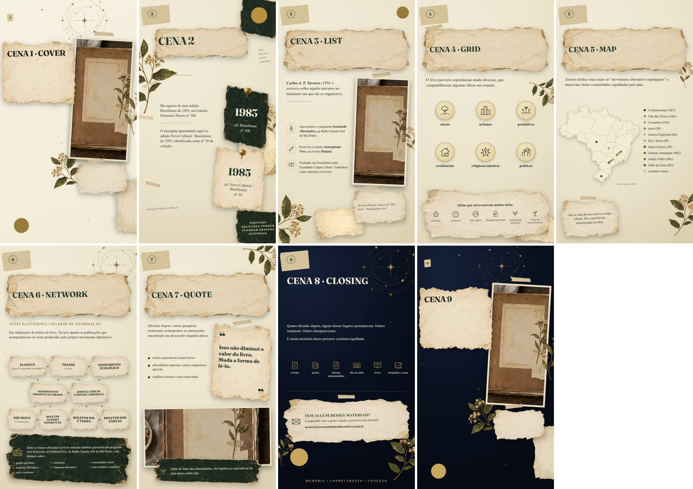

# VIDEO_SCENE_COMPOSITION_PARITY_V1

A Video Scene is now an **authored visual/narrative composition with a duration**, comparable in product meaning to a Static Slide.

- The selected Scene owns its supported layout, appearance, content, image, element order and visibility, Motion and duration.
- That state persists, reloads, drives the Live Authoring Player and drives the final VPS render, from one source of truth (`VideoScene` JSONB).
- The root Timeline stays a contiguous Scene sequence. Element → Track stays unresolved.

## 1. Starting point

- Starting SHA: `bcf24fe020d53291bc6822c559c51f3f948ba9f2`, equal on local HEAD, `origin/main` and remote `main`, with a clean tree.
- `/creative-editor/video/[draftId]` is the only VideoDraft writer (previous mission). That was not reopened.

## 2. Phase 0 — factual Static ↔ Video parity audit (before any code)

| Capability | Static Slide (executable) | Video Scene (before) | Semantically shared? | Video now? | Deferred |
|---|---|---|---|---|---|
| Template family | `templateId` per ChannelPiece authoring state (1 registered) | implicit default | yes | yes, **per VideoDraft**, implicit (one family) | persisted id until a 2nd family exists |
| Layout | `variant` per slide (8 layouts) | fixed `cover` | yes | **yes, per Scene** (all 8, verified at 9:16) | — |
| Appearance | `appearance` per slide (layout-supported) | fixed Dark (renderer fallback) | yes | **yes, per Scene** | — |
| Content fields | `contentOverride` per slide, bounded descriptors | none; title = "Cena N" placeholder | yes | **yes, per Scene** (same form) | — |
| Asset slots | `assetOverrides` for hero + 10 material slots | hero only (`library_file_id`) | yes | hero only | material slots per Scene (renderer takes materials per render, not per segment) |
| Element anatomy | layout elements | read-only | yes | per Scene layout | — |
| Element visibility | `hiddenElements` | none | yes | **yes, per Scene** | — |
| Element order | `elementOrder` | none | yes (spatial stack) | **yes, per Scene** | — |
| Element transforms / tuning | `primitiveTransforms`, `tuning` | none | yes | no | per-Scene transforms/tuning (needs per-segment runtime channels + UI) |
| Typography/style overrides | Entrelinha (`tuning.title.lineHeight`) | none | yes | no | same as tuning |
| Primitive/material bindings | paper/tape project primitives | none | yes | no | per Scene materials |
| Motion | — (still) | `movement` → preset | Video-only | kept | keyframes, per-element motion |
| Duration | — | `duration` | Video-only (temporal) | kept | — |
| Root-vs-unit ownership | ChannelPiece → slides[] | VideoDraft → scenes[] | yes | yes | — |
| Save / reload | per-piece authoring state | VideoDraft PATCH | yes | same PATCH, now carries composition | — |
| Render round-trip | frozen StaticRenderManifest + layering beside it | TimelineManifest (cover only) | yes | TimelineManifest with per-segment variant, appearance, content, layering | — |

**Renderer facts found:**

- **Content, layout and hero already flowed.** The Timeline template segment already carried `template.variant`, `content` and `assets`, so layout, content and the hero reached the worker unchanged.
- **Appearance and element state did not.** `TemplateSegment` did not forward `appearance`, `elementOrder` or `hiddenElements`, even though `DocumentaryCard` (via `component-resolver`) already supported them for Static. Since `TemplateSegment.tsx` is copied into the VPS worker by `export.mjs`, those three axes required a worker bundle update. The user chose to perform it (§14).
- **Motion:** the renderer draws `slow_push` only as the **Cover hero** slow zoom, and `fade` on the whole Scene. `slow_pan` (Pan/Tilt) is declared by the Template but drawn by **no** layout. The old Motion tab labelled Pan/Tilt as "panorâmica lenta". This was a pre-existing truth gap, now labelled honestly (§11).
- **Canvas:** layouts are authored on a 1080×1350 reference and scaled per axis. Video is 1080×1920, the same path the Static "reel" canvas uses.

## 3. VideoScene before

```ts
{ id, order, description, prompt, image_url, library_file_id?, duration, movement }
```

Every Scene rendered as Cover · Dark · title "Cena N" · default stack · all visible, regardless of authoring.

## 4. Chosen minimum composition contract

```ts
interface VideoScene {
  // unchanged
  id, order, description, prompt, image_url, library_file_id?, duration, movement
  // new, optional
  composition?: {
    layout?: string                      // a Video layout of the draft's Template family
    appearance?: 'light' | 'dark'        // must be supported by the layout
    content?: Record<string, unknown>    // the layout's DocumentaryCard content
    element_order?: string[]             // paint order back->front; absent = default stack
    hidden_elements?: string[]           // absent/empty = all visible
  }
}
```

**Nesting and storage:**

- A single optional `composition` object keeps the **spatial** composition visibly separate from **temporal** state (`duration`, `movement`) and from the legacy briefing fields (`description`, `prompt`, `image_url`).
- It lives in the existing `video_drafts.scenes` JSONB, so there is **no DB migration** and no new table.
- Absent axes are omitted, so an untouched Scene stays byte-identical.

| Field | Belongs to | Why |
|---|---|---|
| `layout` | Scene | each Scene chooses its structure (Static: per slide) |
| `appearance` | Scene | per-layout rendering axis (Static: per slide) |
| `content` | Scene | what the Scene draws |
| `element_order`, `hidden_elements` | Scene | authored spatial stack of that Scene |
| hero binding | Scene (`library_file_id`, unchanged) | kept where it was: moving it would be a migration |
| Template family | VideoDraft (implicit) | one registered family; a stored id would be a choice that does not exist |
| `duration`, `movement` | Scene, **temporal** | not part of the spatial composition |
| resolved stack / z-index / signed URLs | derived | never persisted |
| selected Scene, open layer, tab, zoom | UI | never persisted |

**Deliberately not added:**

- `template_id` (per Scene or per draft);
- material slot overrides and primitive selection per Scene;
- element transforms/tuning and typography overrides;
- a composition "version";
- any timeline/track/segment persistence.

## 5. Template, Layout, Appearance ownership

- **Template family:** one per VideoDraft, implicit (`editorial-documentary-collage-v1`, the only registered family). The Template tab shows it read-only. There is no per-Scene Template switching.
- **Layout:** per Scene, from `VIDEO_SCENE_LAYOUT_IDS` = all 8 layouts. The descriptor declares them for `video` at 1080×1920. Each was rendered at 9:16 through the real Remotion path (local official render and the exported worker) and checked visually before being offered (evidence below). Switching layout carries the title over, starts from the Template's example content (the same source as Static "Novo slide"), and restores the default stack. Duration and Motion never change.
- **Appearance:** per Scene, limited to the layout's `supportedAppearances`. It is kept across a layout switch when still supported, and always emitted explicitly in `template.appearance`.



Scenes 1–8 show one layout each. Scene 1 is Cover **Light**, Scene 2 is Info with its dark title strip **hidden**, and Scene 6 is Rede **Light**. Scene 9 is an untouched pre-composition Scene: exactly the old Cover · Dark · "CENA 9".

## 6. Content model

- `composition.content` is the layout's DocumentaryCard content.
- The Video Conteúdo tab edits it through the **shared `LayoutContentForm`** with bounded descriptors:
  - the six structured layouts reuse `LAYOUT_CONTENT_FIELDS`;
  - Cover and Info got `COVER_CONTENT_FIELDS` / `INFO_CONTENT_FIELDS`, with the same bounds as their schemas. These are not wired into Static, whose inline Cover/Info fields are unchanged.
- Edits go through the pure `applyContentAction`, extracted from the Static reducer. Static behaviour is identical and covered by a regression test.
- The legacy `description`/`prompt` stay as the Scene's **briefing** ("Roteiro da cena"), labelled as not drawn.
- **Semantic validation** happens where the content is drawn: the Template registry validates it on preview and render. An invalid composition shows in the Player, disables "Renderizar", and is rejected by the render route with 422 `SCENE_COMPOSITION_INVALID` before anything is enqueued.

## 7. Asset binding model

- The Scene's content image stays `library_file_id` → transient `library_file` AssetRef → claim-time presigned ResolvedAsset. No URL is ever persisted.
- The adapter emits `assets.hero` **only** for layouts that draw a content image (Cover, Lista, Citação), because the other layouts' asset contracts reject it.
- For those other layouts, the Assets tab says the layout draws no content image, and the saved binding is **kept** (it returns if the Scene switches back). CENAS thumbnails follow the same rule.
- Material slots (papers, tapes, pins…) keep the Template default in video (gap §15).

## 8. Elements

- **Implemented per Scene:** stack order (Camadas grip / keyboard) and visibility (eye), through the same `ElementLayers` component and the same normalizers (`normalizeElementOrder`, `normalizeHiddenElements`) as Static. The default stack is stored as "no override".
- **Deferred:** per-element position/scale/rotation and Entrelinha. The disclosure panel says so.
- Spatial stack order ≠ Timeline track order. No track was created.

## 9. Style

`StyleSourcePanel` stays read-only (identity tokens → Template defaults). There are no per-Scene typography/colour overrides; the renderer uses Template defaults globally. Project Identity → Template token resolution is untouched, as it remains separate work.

## 10. Render carrier

- `TemplateSegmentPayload` gained optional `layering: { element_order?, hidden_elements? }` (strict, bounded). Appearance uses the existing `TemplateRef.appearance`.
- `TemplateSegment.tsx` forwards `appearance`, `elementOrder` and `hiddenElements` to the binding. Absent means the previous defaults, so every older manifest and frozen snapshot renders unchanged.
- A legacy Scene's segment now carries `appearance: 'dark'` explicitly. That equals the Cover's old fallback, so it renders identically even on a not-yet-updated worker.

## 11. Motion and duration

- Motion remains `VideoScene.movement`: Scene-level, semantic, and never keyframed or per element.
- The Motion tab now states each movement's real effect **in the Scene's layout**:
  - "aproximação lenta · imagem principal" for zoom-in on Cover;
  - "sem efeito visível nesta estrutura" for Pan/Tilt everywhere, and for zoom-in outside Cover;
  - unsupported movements stay "sem preset · estático".
- Duration remains temporal Scene state, edited by the Inspector or the Timeline edge. Tests and the browser prove that composition edits never touch duration and duration edits never touch composition.

## 12. Backward compatibility

- A missing composition resolves to the Template default the Scene always rendered with.
- An authored value the video cannot honour (an unknown layout, an unsupported appearance) falls back to the default with a diagnostic and an Inspector warning, and is **never rewritten** in storage.
- Nothing is migrated on read, loading creates no dirty state, and old drafts stay renderable.
- The API only validates the structure of `composition` on POST/PATCH: known keys, a Video layout, a supported appearance, plain-object content ≤ 16 KB, and bounded element id lists.

## 13. Preview / final-render derivation

Both surfaces go through the same chain:

- Live Player: `VideoScene[]` → `buildRenderExecutionSnapshot` (→ `adaptVideoDraftToTimelineManifest` → `resolveSceneComposition`) → `resolveTimelineManifest` → `TimelineComposition`/`TemplateSegment` → `DocumentaryCard`.
- Final render: the render route runs the same snapshot builder from the **saved** draft, and the worker renders the same `TemplateSegment` tree.

A test asserts that the preview manifest **equals** the render snapshot manifest for a 3-Scene authored draft. Another renders `TemplateSegment` markup and asserts the authored appearance, z-order and hidden layer.

## 14. Worker

- **Changed renderer file:** only `remotion/timeline/TemplateSegment.tsx` (+6 lines, backward compatible). There was no change to worker infrastructure (`server.mjs`, coordinator, entrypoint, container).
- **Why a deploy is needed:** the Scene's appearance and element state must reach `DocumentaryCard` inside the VPS bundle.
- **Export:** `node infra/render-worker-runtime/export.mjs` copied 53 files, and the coordinator and entrypoint bundles passed their smoke tests.
- **Tarball:** `infra/render-worker-runtime/dist/content-studio-video-scene-composition-parity-v1.tar.gz`, 55 files, sha256 `241f3f0398aeed66f7404703310505f507a25ab5b2346bb7b709a7fc49f23cd1`. The renderer files are byte-identical to `bc8cde1`.
- **Local exported-worker proof:** `POST /render` on the exported `server.mjs` with the 9-Scene evidence input produced a 1080×1920, 270-frame MP4 in 119 s. Its frames match the evidence above (Cover Light, Info hidden strip, Rede Light, legacy Cover Dark).
- **Ordering:** the operator updates the VPS worker **before** the web deploy, so there is no window where the web emits appearance/layering that an old worker would ignore.

## 15. Remaining Scene composition gaps

- Per-Scene material slots (paper, tape…) and primitive selection.
- Per-element transforms, tuning and Entrelinha.
- Per-Scene style/typography overrides. Project Identity → Template tokens is untouched.
- Pan/Tilt (`slow_pan`) is declared but not drawn by any layout, and zoom-in only draws on the Cover hero. This is labelled honestly; implementing the pans is renderer work.
- The Template family is implicit. A second family would need a VideoDraft-level choice.
- CENAS thumbnails show only the hero image, not a rendered miniature of the Scene.

## 16. Tests and checks

**New `lib/creative/video-editor/__tests__/scene-composition.test.ts` (22 tests):**

- defaults and legacy compatibility (resolution, legacy manifest equality, no migration-on-read, unsupported values);
- Scene-scoped edits (content independence, layout switch, no-op re-select, appearance, element order/visibility normalization);
- reorder/duration preservation;
- JSONB round-trip, dirty tracking, and write-boundary validation;
- API + render-route wiring;
- **preview manifest ≡ render snapshot manifest**;
- all 8 layouts valid at 1080×1920;
- rejected compositions reported;
- the renderer painting appearance/order/visibility;
- Inspector hydration without bleed, bounded forms for every layout, truthful Motion effects;
- Static reducer regression.

**Updated tests:**

- `video-draft-to-timeline.test.ts`: legacy TemplateRef now has the explicit `appearance: 'dark'`, and no `layering`.
- `static-parity.test.ts`: Template/Elementos derived from the selected Scene, with Camadas editable.
- Removed `lib/__tests__/video-scene-state.test.ts` together with its orphaned module.

**Results:**

- `pnpm test`: 91 files / 1166 tests passed.
- `tsc --noEmit`: clean.
- ESLint on all changed files: clean.
- `pnpm build`: success.

## 17. Browser validation (local, authenticated, real draft `7b12b65d…`, 3 legacy Scenes)

| # | Step | Result |
|---|---|---|
| 1–2 | Open the legacy-compatible draft; Scene 1 selected | Hydrates as Cover · Dark · title "Cena 1", with all 8 structures offered |
| 3–7 | Scene 1: content (eyebrow, title, text), Appearance Light, hide Botânica seca, Motion zoom-in | Motion labels: zoom-in "imagem principal", Pan/Tilt "sem efeito visível" |
| 8–10 | Scene 2: Lista · Dark · title · hide Caixa de destaque · image replaced (Project Library → `tavares-1985-cip-page.jpg`); Scene 3: Citação · title · Ramo de folhas moved to the front | — |
| 9, 11–12 | Switch between Scenes | Each Scene shows its own structure, appearance, title and hidden layers; no bleed |
| 13–15 | Salvar → reload | API state identical before and after the reload: three distinct compositions, durations 3 / 2.1667 / 4 and movements preserved |
| 18 | CENAS | Captions "Cover · …", "Lista · …", "Citação · …" |
| 19 | TIMELINE | Same Scenes and durations |
| 20 | Reorder (Citação to first) | Each composition travels with its Scene |
| 21 | Duration 4 → 5 s | Total 275 → 305 frames, composition unchanged; discarded with "Voltar ao salvo" |

**Environment notes:**

- Auto-save was still enabled in this browser from the previous mission, so an early exploratory layout switch was auto-saved to the test draft before the intended authoring overwrote it. Auto-save was then turned off, making every validation save explicit.
- Browser screenshots are unreliable in the embedded window, so visual evidence comes from the real render path (§5, §14).
- The embedded window stopped painting mid-session (0 rAF frames), which blocks Live Player playback checks. Playback across a Scene boundary is validated in production (§18).

## 18. Production

**Delivery order:**

1. The operator updated the VPS worker with `content-studio-video-scene-composition-parity-v1.tar.gz` (sha256 `241f3f03…23cd1`) and reported it healthy.
2. Then feature commit `bc8cde10a80fdbc0aa2e361af03bea05fc75732e` was pushed. It is equal on local, `origin/main` and remote `main`, and its Vercel Production deployment reported `success`.

**Authenticated smoke on `content.multihuman.com.br`, real draft `7b12b65d…`:**

| Check | Result |
|---|---|
| Open the draft | Saved compositions restored: CENAS "Cover · Comunidades alternativas", "Lista · Quem registrou", "Citação · O que ficou"; "Salvo"; no preview blocker |
| Real VPS render | Execution `97a9cc9a-58fa-4192-8044-766766307b53`: queued 02:59:27, claimed 02:59:34, completed 03:01:25; 1080×1920 h264 + aac; 275 frames; 9.216 s; 2.48 MB |
| Frozen snapshot (read-only SQL) | variants `cover/list/quote`; appearances `light/dark/light`; layering `{hidden:[botanical]}`, `{hidden:[callout]}`, `{element_order:[…,botanicalLeaf]}`; titles as authored; durations 90/65/120 frames; motion `slow_push`/`slow_pan left`/`slow_push`; one hero LibraryFile id per Scene; **no signed URL** |
| Final MP4 frames | Scene 1 Cover **Light** with eyebrow/title/subtitle, Botânica seca absent; Scene 2 Lista **Dark** with the swapped `tavares-1985-cip-page.jpg` and no Caixa de destaque; Scene 3 Citação **Light** with Ramo de folhas in front (`evidence/video-scene-composition-parity-v1/vps-render-3-scenes.jpg`) |
| Output Player | Loads the new execution: readyState 4, 1080×1920, 9.216 s |
| Gallery | "Vídeo renderizado · Novo vídeo" listed first; "Abrir origem" → `/creative-editor/video/7b12b65d…` |
| Static regression on the updated worker | 10-slide Carousel opens "Salvo"; slide navigation (Slide 3 de 10); Template/Conteúdo/Assets/Estilo/Elementos present; Camadas reorder → "Alterações não salvas" → "Voltar ao salvo" → "Salvo"; **Gerar PNG** → static execution `1389c8e1…` completed 1080×1350 in ≈ 6 s |
| Responsive (1440 / 1024 / 768 / 390) | No horizontal page scroll; 6 Inspector tabs fit; the 8 Estrutura options wrap inside the Inspector; Player + CENAS dock present at every width |
| Bottom dock | "Recolher painel" 183 → 0 px, "Expandir painel" → 183 px |
| Live Player playback across Scene boundaries | Window visible (50 rAF frames/s): 00:02.00 → 00:03.73 (Lista) → 00:06.13 (Citação); the Player swaps each Scene's own structure while playing |
| Live Player per Scene | Scene 1 Cover · Light · no Botânica seca; Scene 2 Lista · Dark · no Caixa de destaque; Scene 3 Citação · Light · Caixa de destaque present — identical to the saved composition and to the VPS MP4 |


**Production test data:**

- Draft `7b12b65d…` now holds the authored 3-Scene composition (a test draft from earlier missions).
- New executions `97a9cc9a…` (video) and `1389c8e1…` (static still, scratch output only; nothing was saved to the ChannelPiece).

## 19. Final checkpoint

- Feature: `bc8cde10a80fdbc0aa2e361af03bea05fc75732e` (Vercel Production success).
- Final SHA: the docs commit recording this smoke, verified equal on local, `origin/main` and remote `main`, with its Vercel Production deployment.
- Worker: updated by the operator with the renderer-only change (§14). No worker infrastructure change.
- Not committed: `.env.local`, `.next/`, `tsbuildinfo`, the incidental `next-env.d.ts` change, `infra/render-worker-runtime/dist/` (gitignored, including the tarball), `.tmp/` renders, browser data and scratch scripts.

## GATE B — NOW SAFE TO INVESTIGATE

**Proven boundaries:**

- **Scene as composition:** a Scene owns layout, appearance, content, hero binding and spatial element state (order/visibility) inside the draft's Template family, persisted in `VideoScene.composition`. It is resolved by one function for both the preview and the render.
- **Root Scene sequence:** the root Timeline is still the contiguous primary sequence of Scenes. Its geometry is derived from `duration` and never stored. Composition edits cannot change it.
- **Element:** a spatial Template composition instance (id, label, slot, stack place, visibility) scoped to one Scene's layout. It has **no** temporal semantics today, and nothing forbids adding some later. Element == Track was **not** established.
- **Motion:** a semantic Scene-level preset drawn by the Template. It is not keyframes, not per element, and not a transition.
- **Independent temporal objects:** none exist. Nothing in the composition contract spans Scene boundaries.

**Questions Gate B still has to resolve (not answered here):**

1. independent B-roll;
2. continuous audio;
3. lower thirds;
4. captions;
5. overlays spanning Scene boundaries;
6. transition objects/effects;
7. temporal anchoring;
8. whether a generic Segment is needed;
9. Track semantics;
10. whether a Scene-local timing / nested view is needed;
11. source in/out boundaries.
